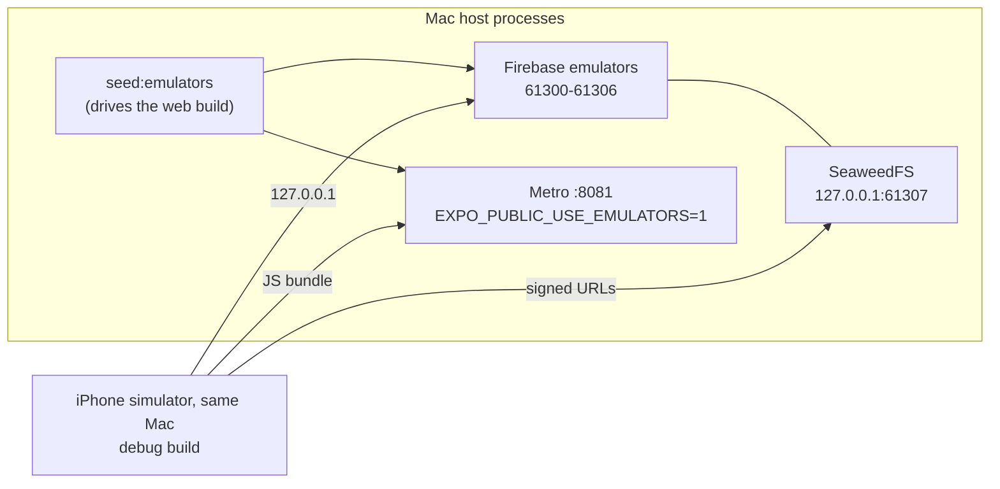

# iOS — building and checking the iPhone app

The app is one Expo codebase on three surfaces: web, Android and iOS. Linux
builds web and Android; **iOS builds only on the Mac**, with Xcode. This file is
the Mac's runbook, written for whoever is at it, including a Claude Code session
that has none of the context of the one that set it up.

Bundle id `com.sabeelinstitute.lms`, the same as the Android package
(`functions/test/unit/projectIdentity.test.ts` holds them equal). Firebase
project `oursabeel-lms`, iOS app registered on that bundle id.

## Two rules that destroy work silently

### 1. Never a bare `npx expo prebuild`

```bash
npx expo prebuild --platform ios      # correct
npx expo prebuild                     # deletes and regenerates app/android/
```

`prebuild` is clean by default: it deletes the native folder of every platform
it is given and writes it again from Expo's template. `app/android/` is
**committed and hand-edited** — the foreground-service permissions and
expo-video's playback service, the notification icon pair, the version pair —
and nothing fails when those are lost; background playback and the push icon
stop working on the next APK. `--platform ios` touches only `app/ios/`.

### 2. `app/ios/` is a build product

It is gitignored and regenerated by every prebuild, so nothing changed in Xcode's
UI survives. Everything the iOS app needs is stated in `app/app.json` (and, for
native config plugins, `app/package.json`). If something can only be fixed in
Xcode, write it down here so the next prebuild can redo it.

## What `app/app.json` says for iOS

| Key | Value | Why |
|---|---|---|
| `platforms` | includes `ios` | |
| `ios.bundleIdentifier` | `com.sabeelinstitute.lms` | the Android package, and the Apple and Firebase registrations |
| `ios.buildNumber` | integer string | Apple requires it to INCREASE on every upload of a version |
| `ios.supportsTablet` | `false` | phone first; no iPad layout has been checked |
| `ios.googleServicesFile` | `./GoogleService-Info.plist` | gitignored, like `google-services.json` |
| `ios.infoPlist.CFBundleDisplayName` | `Sabeel LMS` | the home screen truncates `Sabeel Institute LMS`; the same short name as the Android launcher (`APP_SHORT_NAME`) |
| `ios.config.usesNonExemptEncryption` | `false` | answers export compliance, so builds reach testers without the questionnaire |
| `ios.privacyManifests` | what the app collects, none of it for tracking | Expo writes `PrivacyInfo.xcprivacy` from it; Apple refuses an upload without one |
| `expo-video` plugin | `supportsBackgroundPlayback: true` | prebuild writes `UIBackgroundModes: [audio]`; without it a lecture stops when the phone locks |
| `expo-image-picker` plugin | `cameraPermission` | the camera's purpose string (photographing work for an assignment) |
| `expo-build-properties` | `ios.usePrecompiledModules: false` | see below |
| `expo-build-properties` | `ios.extraPods`: GoogleUtilities, RecaptchaInterop with modular headers | without them `pod install` refuses: "Swift pod AppCheckCore depends upon GoogleUtilities and RecaptchaInterop, which do not define modules" |
| `@react-native-google-signin/google-signin` | registered BARE | the plugin then reads `REVERSED_CLIENT_ID` out of the plist, so the URL scheme has one home; given options it wants the value copied by hand, and validates it on every platform, web export included |
| `@sentry/react-native` | registered BARE | org, project and token come from the build environment; given options it writes them into `ios/sentry.properties` |

There is deliberately **no `ios.version`**: `expo.version` is the one version on
every surface, and Apple's `X.Y.Z` shape is checked by `npm run check:ios`.

### Expo modules are compiled from source

SDK 57 links Expo modules as precompiled xcframeworks by default. Those binaries
were built against a newer `ExpoModulesCore` than the one the lockfile installs,
so an app linked against them dies in dyld at launch, before any JavaScript
runs:

```
dyld: Symbol not found: _$s15ExpoModulesCore10BaseModuleC11willDestroyyyFTj
  Referenced from: …/Frameworks/ExpoImageManipulator…
```

SpringBoard logs it only as an exit in domain dyld, code 4; `xcrun simctl launch
--console-pty booted com.sabeelinstitute.lms` prints the symbol. With
`usePrecompiledModules: false` every module compiles against the installed core,
which is what Android does anyway. The first build is slower; nothing can skew.

### Reading back what prebuild wrote

```bash
cd app/ios
plutil -p SabeelInstituteLMS/Info.plist | grep -E 'UIBackgroundModes|audio|CFBundleDisplayName|CFBundleShortVersionString|CFBundleVersion|ITSAppUsesNonExemptEncryption|UsageDescription'
/usr/libexec/PlistBuddy -c 'Print :CFBundleURLTypes' SabeelInstituteLMS/Info.plist   # sabeellms + com.googleusercontent.apps.…
cat SabeelInstituteLMS/SabeelInstituteLMS.entitlements                                # aps-environment development
plutil -p SabeelInstituteLMS/PrivacyInfo.xcprivacy
```

`aps-environment` is `development` in the source entitlements, written by
expo-notifications' plugin. That is right for a debug build; the App Store export
re-signs it to `production`. After `pod install`, React Native merges the pods'
required-reason APIs into `PrivacyInfo.xcprivacy` (file timestamps, user
defaults, boot time) beside the data types `app.json` declares.

`NSMicrophoneUsageDescription` and `NSPhotoLibraryUsageDescription` carry
expo-image-picker's generic defaults. The app never asks for either (the camera
only; the document picker needs no permission), but Apple's upload scanner can
demand a string for any API the binary links, so they stay.

## Files a clone does not have

All gitignored. Without each, something builds and quietly does not work.

| File | What it carries | Without it |
|---|---|---|
| `app/GoogleService-Info.plist` | the iOS app's Firebase config and Google OAuth client | prebuild fails; `check:ios` says so first |
| `app/.env.local` | `EXPO_PUBLIC_SENTRY_DSN_ANDROID`, which `app/src/sentry.ts` reads on every native platform (iOS reports to the same React Native Sentry project) | the app ships with crash reporting off |
| `app/.env.sentry-build-plugin` | `SENTRY_ORG`, `SENTRY_PROJECT` (`sabeel-recording-android`), `SENTRY_AUTH_TOKEN`, `IOS_TEAM_ID`, `ASC_KEY_ID`, `ASC_ISSUER_ID`, optional `ASC_KEY_PATH` | no dSYMs uploaded; no signing or upload |
| `~/.appstoreconnect/private_keys/AuthKey_<ASC_KEY_ID>.p8` | the App Store Connect API key (NOT the APNs key) | `-allowProvisioningUpdates` cannot sign; no upload |
| `functions/.secret.local` | placeholders for the secrets the functions bind (see `docs/DEV-TOOLING.md`) | the functions emulator asks Secret Manager and logs 403s |

`scripts/load-build-env.sh` reads `app/.env.sentry-build-plugin` (parsed, not
sourced; a variable already in the environment wins). Never print or commit any
of these values.

## The Mac's toolchain

Homebrew's prefix on this Mac belongs to another account, so `brew install`
fails; user-level tools go under `~/.local` and `~/opt`.

| Tool | Where | Used by |
|---|---|---|
| Xcode, CocoaPods | system | every iOS build |
| Firebase CLI, idb, idb_companion (a wrapper that execs the real binary), Maestro, uv, shellcheck | `~/.local/bin` | emulators, driving the simulator |
| JDK 21 | `/opt/homebrew/opt/openjdk@21` — export `SR_JDK21_HOME` to it | the Firestore and Auth emulators |
| SeaweedFS 4.47 `darwin_arm64` | `~/opt/seaweedfs-4.47/weed`, the path `scripts/lib/media-store.mjs` reads | the local media store |
| ffmpeg (static arm64 build) | `~/.local/bin/ffmpeg` | the seed's video fixture |

The port guards (`free-emulator-ports.sh`, `preflight-metro.mjs`) use `lsof` on
macOS, where `ss` and `/proc` do not exist.

## The simulator loop



The simulator shares the Mac's loopback, so `127.0.0.1` reaches the emulators and
the signed media URLs as they are — there is no `adb reverse` step on iOS.

```bash
# 1. Emulators + media store (long-running)
SR_JDK21_HOME=/opt/homebrew/opt/openjdk@21 nohup npm run emulators > /tmp/lms-emulators.log 2>&1 &
# 2. Metro, with the emulator flag and the build label (refuses if another project holds 8081)
EXPO_PUBLIC_USE_EMULATORS=1 EXPO_PUBLIC_COMMIT=$(git rev-parse --short HEAD) \
  nohup npm run start -w @sabeel/app -- --port 8081 > /tmp/lms-metro.log 2>&1 &
# 3. The sweep's world, left in place (needs Metro: staff are made by driving the web app)
npm run seed:emulators
# 4. Build and install the debug app
xcrun simctl boot "iPhone 17 Pro"
(cd app && EXPO_PUBLIC_USE_EMULATORS=1 npx expo run:ios --device "iPhone 17 Pro" --no-bundler) || true
xcrun simctl get_app_container booted com.sabeelinstitute.lms     # proves the install
xcrun simctl launch booted com.sabeelinstitute.lms
```

- **`expo run:ios` exits 1 on a good build.** Its last step raises the Simulator
  window through AppleScript, which a session with no GUI may not do. Judge the
  install, never the exit code.
- **`EXPO_PUBLIC_*` in a debug build come from the environment that started
  Metro.** If the emulator sign-in rows are missing, Metro was started without
  the flag: restart it with `--clear`.
- **A JS-only change needs a relaunch, not a rebuild**:
  `xcrun simctl terminate booted com.sabeelinstitute.lms && xcrun simctl launch booted com.sabeelinstitute.lms`.
- The student is `abd.al.rahman.ibn.muhammad.al.shinqiti@example.com` /
  `HikamStudent1`; staff sign in through the "Emulator sign-in (dev only)" rows.
  The seeded world has no student-visible recording with more than one version;
  a device pass that switches versions adds one through the Admin SDK first.

## Driving the simulator

This Mac is reached over ssh: there is no GUI session for the build account, so
Simulator.app cannot run and every simulator is headless. Everything below works
without it.

**idb** for taps, the accessibility tree and hardware buttons:

```bash
idb_companion --udid <UDID> &                 # prints {"grpc_port":10882}
idb connect localhost 10882
idb ui describe-all --udid <UDID>             # every element, with testID as AXUniqueId
idb ui tap --udid <UDID> X Y                  # POINTS: screenshot pixels / 3
idb ui button --udid <UDID> HOME              # also LOCK
xcrun simctl io booted screenshot shot.png
```

With two companions running, every `idb` call needs `--udid`; without it each
fails with "multiple companions".

**Maestro** for typing into React Native text fields (`inputText`) and a real
double tap (`doubleTapOn`). It costs about 35 s a run, most of it the driver.

**The software keyboard.** A headless simulator behaves as if a hardware
keyboard is attached: a field takes focus and no keyboard rises. Switch it off
with `scripts/sim-keyboard.m`:

```bash
xcrun clang -fobjc-arc -framework Foundation -o /tmp/sim-keyboard scripts/sim-keyboard.m
/tmp/sim-keyboard <UDID> 0
```

**Text typed with `idb ui text` when nothing has focus goes to React Native's
dev shortcuts**: `d` opens the Dev Menu and `i` turns on the element inspector,
which persists in the app's preferences. Confirm the caret first. To turn the
inspector off again, with the app stopped:

```bash
D=$(xcrun simctl get_app_container booted com.sabeelinstitute.lms data)
plutil -replace RCTDevMenu.showInspector -bool NO "$D/Library/Preferences/com.sabeelinstitute.lms.plist"
```

**When the accessibility tree comes back empty** — `describe-all` returns one
element for every app, and Maestro fails with "Timed out waiting for AX loaded
notification" — the Mac is overloaded (other accounts run VMs here; check
`uptime`). Shut down any second simulator, wait for the load to fall, and boot
again.

### Device checks the simulator can run

| Check | How |
|---|---|
| A slow connection, Play while loading | `kill -STOP $(lsof -nP -ti TCP:61307 -sTCP:LISTEN)` freezes the media store; `kill -CONT` releases it |
| Background audio | read the clock, `idb ui button HOME`, wait a minute, `simctl launch` brings it back: the clock must have moved by the wall time |
| The lock | `idb ui button LOCK`, wait, `LOCK` again and swipe up; same clock test |
| The app publishing Now Playing | `xcrun simctl spawn booted log show --last 5m --predicate 'eventMessage CONTAINS "nowPlayingItem"'` names the app |
| Killed mid-play | `xcrun simctl terminate booted com.sabeelinstitute.lms`, relaunch, reopen the recording |
| The keyboard over a field | `sim-keyboard <UDID> 0`, focus the field, screenshot |

### What the simulator cannot show

- **Push.** A simulator has no APNs token. Only a phone, through TestFlight.
- **The lock-screen media buttons.** A headless simulator draws no Now Playing
  platter and an empty Control Center, and nothing on the command line sends a
  remote play, pause or skip. The log line above proves the app publishes its
  Now Playing item; the buttons themselves need a phone.
- **A staff Google sign-in.** It needs a real staff account; the emulator rows
  stand in for it.

## Releasing to TestFlight

`scripts/build-ios.sh` archives, exports and uploads with no Xcode UI.

```bash
npm run build:ios -- --check        # every gate, builds nothing, two seconds
npm run build:ios -- --no-upload    # archive + export an .ipa to build-artifacts/ios/export
npm run build:ios                   # archive, export, upload to App Store Connect
```

Its gates, in order: macOS with Xcode and CocoaPods; **no
`EXPO_PUBLIC_USE_EMULATORS` in the shell** (a release built from the dev loop's
terminal would talk to 127.0.0.1); `npm run check:ios`; `IOS_TEAM_ID`; the
Sentry variables (a warning); the App Store Connect key, resolved for every
build because `-allowProvisioningUpdates` signs through it; and a signing
keychain that can actually sign, proved by signing a throwaway binary.

`npm run check:ios` (`scripts/check-ios-config.mjs`) holds the plist to
`app.json` (bundle id) and to `FIREBASE_PROJECT_ID` in `@sabeel/shared`, the
sign-in and Sentry plugins bare, background playback on, export compliance
answered, `expo.version` in Apple's shape and equal to `versionName` in
`app/android/app/build.gradle`, an integer `buildNumber`, the icon 1024x1024
with no alpha channel, the native DSN present, and the privacy manifest.

- **Over ssh the login keychain is locked**, and the archive would die at its
  first framework with `errSecInternalComponent`. Unlock it, typing the password
  at the prompt: `security unlock-keychain ~/Library/Keychains/login.keychain-db`.
- **The build label** is `EXPO_PUBLIC_COMMIT`, inlined when the archive's bundle
  phase runs; a dirty tree stamps it with `+`. Commit first, then build.
- **`ios.buildNumber` must increase on every upload**, even of the same
  version. `expo.version` changes only with a release, on every surface at once.
- **The App Store Connect app record must exist** before an upload has anywhere
  to go. TestFlight is a tab inside it.

## Open on iOS

- **Push will not reach an iPhone as the code stands.** `app/src/push.ts` stores
  what `getDevicePushTokenAsync()` returns, and on iOS that is the APNs device
  token, not an FCM registration token, which `admin.messaging()` cannot
  address. `pushPlatform` is `'android'` everywhere.
- **The update gate** compares `expo.android.versionCode` and sends an outdated
  build to `DOWNLOAD_PAGE_URL`, the Android download page.
- **The rich-text answer keeps the keyboard up.** Tapping outside the field
  does not close it on iOS (there is no Back key to do it), though the screen
  scrolls and Hand in stays reachable above it.
- **The date field** opens iOS's compact picker: the field, then a date pill,
  then the calendar, drawn in the system blue.
- **The lockfile's Expo patch versions** are behind SDK 57's expectations
  (`npx expo install --check`); aligning them changes the Android build too.
