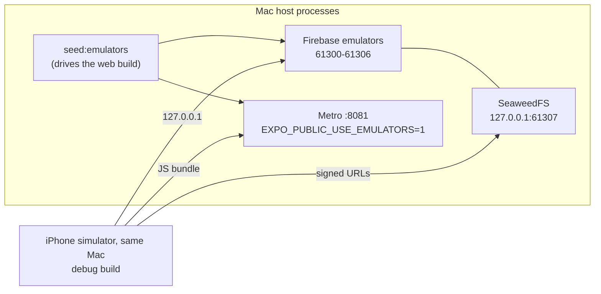

# iOS — building and checking the iPhone app

The app is one Expo codebase on three surfaces: web, Android and iOS. Linux
builds web and Android; **iOS builds only on the Mac**, with Xcode. This file is
the Mac's runbook, written for whoever is at it, including a Claude Code session
that has none of the context of the one that set it up.

Bundle id `com.sabeelinstitute.lms`, the same as the Android package
(`functions/test/unit/projectIdentity.test.ts` holds them equal). Firebase
project `oursabeel-lms`, iOS app registered on that bundle id.

## Two rules that destroy work silently

### 1. Never a bare `npx expo prebuild`

```bash
npx expo prebuild --platform ios      # correct
npx expo prebuild                     # deletes and regenerates app/android/
```

`prebuild` is clean by default: it deletes the native folder of every platform
it is given and writes it again from Expo's template. `app/android/` is
**committed and hand-edited** — the foreground-service permissions and
expo-video's playback service, the notification icon pair, the version pair —
and nothing fails when those are lost; background playback and the push icon
stop working on the next APK. `--platform ios` touches only `app/ios/`.

### 2. `app/ios/` is a build product

It is gitignored and regenerated by every prebuild, so nothing changed in Xcode's
UI survives. Everything the iOS app needs is stated in `app/app.json` (and, for
native config plugins, `app/package.json`). If something can only be fixed in
Xcode, write it down here so the next prebuild can redo it.

## What `app/app.json` says for iOS

| Key | Value | Why |
|---|---|---|
| `platforms` | includes `ios` | |
| `ios.bundleIdentifier` | `com.sabeelinstitute.lms` | the Android package, and the Apple and Firebase registrations |
| `ios.buildNumber` | integer string | Apple requires it to INCREASE on every upload of a version |
| `ios.supportsTablet` | `false` | phone first; no iPad layout has been checked |
| `ios.googleServicesFile` | `./GoogleService-Info.plist` | gitignored, like `google-services.json` |
| `ios.infoPlist.CFBundleDisplayName` | `Sabeel LMS` | the home screen truncates `Sabeel Institute LMS`; the same short name as the Android launcher (`APP_SHORT_NAME`) |
| `ios.config.usesNonExemptEncryption` | `false` | answers export compliance, so builds reach testers without the questionnaire |
| `ios.privacyManifests` | what the app collects, none of it for tracking | Expo writes `PrivacyInfo.xcprivacy` from it; Apple refuses an upload without one |
| `expo-video` plugin | `supportsBackgroundPlayback: true` | prebuild writes `UIBackgroundModes: [audio]`; without it a lecture stops when the phone locks |
| `expo-image-picker` plugin | `cameraPermission` | the camera's purpose string (photographing work for an assignment) |
| `expo-build-properties` | `ios.extraPods`: GoogleUtilities, RecaptchaInterop with modular headers | without them `pod install` refuses: "Swift pod AppCheckCore depends upon GoogleUtilities and RecaptchaInterop, which do not define modules" |
| `@react-native-google-signin/google-signin` | registered BARE | the plugin then reads `REVERSED_CLIENT_ID` out of the plist, so the URL scheme has one home; given options it wants the value copied by hand, and validates it on every platform, web export included |
| `@sentry/react-native` | registered BARE | org, project and token come from the build environment; given options it writes them into `ios/sentry.properties` |

There is deliberately **no `ios.version`**: `expo.version` is the one version on
every surface, and Apple's `X.Y.Z` shape is checked by `npm run check:ios`.

### Precompiled Expo modules need SDK-aligned versions

SDK 57 links Expo modules as precompiled xcframeworks, each built against the
`ExpoModulesCore` of its own release. When the lockfile's Expo packages fall
behind what the SDK expects, a module's binary can call into a newer core than
the one installed, and the app dies in dyld at launch, before any JavaScript:

```
dyld: Symbol not found: _$s15ExpoModulesCore10BaseModuleC11willDestroyyyFTj
  Referenced from: …/Frameworks/ExpoImageManipulator…
```

SpringBoard logs it only as an exit in domain dyld, code 4; `xcrun simctl launch
--console-pty booted com.sabeelinstitute.lms` prints the symbol. Keep
`npx expo install --check` (in `app/`) clean: aligned, the default precompiled
build links and launches. If it ever cannot be aligned, `expo-build-properties`
`ios.usePrecompiledModules: false` compiles every module from source against the
installed core, as Android does.

### Reading back what prebuild wrote

```bash
cd app/ios
plutil -p SabeelInstituteLMS/Info.plist | grep -E 'UIBackgroundModes|audio|CFBundleDisplayName|CFBundleShortVersionString|CFBundleVersion|ITSAppUsesNonExemptEncryption|UsageDescription'
/usr/libexec/PlistBuddy -c 'Print :CFBundleURLTypes' SabeelInstituteLMS/Info.plist   # sabeellms + com.googleusercontent.apps.…
cat SabeelInstituteLMS/SabeelInstituteLMS.entitlements                                # aps-environment development
plutil -p SabeelInstituteLMS/PrivacyInfo.xcprivacy
```

`aps-environment` is `development` in the source entitlements, written by
expo-notifications' plugin. That is right for a debug build; the App Store export
re-signs it to `production`. After `pod install`, React Native merges the pods'
required-reason APIs into `PrivacyInfo.xcprivacy` (file timestamps, user
defaults, boot time) beside the data types `app.json` declares.

`NSMicrophoneUsageDescription` and `NSPhotoLibraryUsageDescription` carry
expo-image-picker's generic defaults. The app never asks for either (the camera
only; the document picker needs no permission), but Apple's upload scanner can
demand a string for any API the binary links, so they stay.

## Files a clone does not have

All gitignored. Without each, something builds and quietly does not work.

| File | What it carries | Without it |
|---|---|---|
| `app/GoogleService-Info.plist` | the iOS app's Firebase config and Google OAuth client | prebuild fails; `check:ios` says so first |
| `app/.env.local` | `EXPO_PUBLIC_SENTRY_DSN_ANDROID`, which `app/src/sentry.ts` reads on every native platform (iOS reports to the same React Native Sentry project) | the app ships with crash reporting off |
| `app/.env.sentry-build-plugin` | `SENTRY_ORG`, `SENTRY_PROJECT` (`sabeel-recording-android`), `SENTRY_AUTH_TOKEN`, `IOS_TEAM_ID`, `ASC_KEY_ID`, `ASC_ISSUER_ID`, optional `ASC_KEY_PATH` | no dSYMs uploaded; no signing or upload |
| `~/.appstoreconnect/private_keys/AuthKey_<ASC_KEY_ID>.p8` | the App Store Connect API key (NOT the APNs key) | `-allowProvisioningUpdates` cannot sign; no upload |
| `~/.apns/AuthKey_<key id>.p8` | the APNs key, for `send-test-push.mjs --apple` (the deployed functions read theirs from Secret Manager) | no real send from the Mac |
| `functions/.secret.local` | placeholders for the secrets the functions bind (see `docs/DEV-TOOLING.md`) | the functions emulator asks Secret Manager and logs 403s |

`scripts/load-build-env.sh` reads `app/.env.sentry-build-plugin` (parsed, not
sourced; a variable already in the environment wins). Never print or commit any
of these values.

## The Mac's toolchain

Homebrew's prefix on this Mac belongs to another account, so `brew install`
fails; user-level tools go under `~/.local` and `~/opt`.

| Tool | Where | Used by |
|---|---|---|
| Xcode, CocoaPods | system | every iOS build |
| Firebase CLI, idb, idb_companion (a wrapper that execs the real binary), Maestro, uv, shellcheck | `~/.local/bin` | emulators, driving the simulator |
| JDK 21 | `/opt/homebrew/opt/openjdk@21` — export `SR_JDK21_HOME` to it | the Firestore and Auth emulators |
| SeaweedFS 4.47 `darwin_arm64` | `~/opt/seaweedfs-4.47/weed`, the path `scripts/lib/media-store.mjs` reads | the local media store |
| ffmpeg (static arm64 build) | `~/.local/bin/ffmpeg` | the seed's video fixture |

The port guards (`free-emulator-ports.sh`, `preflight-metro.mjs`) use `lsof` on
macOS, where `ss` and `/proc` do not exist.

## The simulator loop



The simulator shares the Mac's loopback, so `127.0.0.1` reaches the emulators and
the signed media URLs as they are — there is no `adb reverse` step on iOS.

```bash
# 1. Emulators + media store (long-running)
SR_JDK21_HOME=/opt/homebrew/opt/openjdk@21 nohup npm run emulators > /tmp/lms-emulators.log 2>&1 &
# 2. Metro, with the emulator flag and the build label (refuses if another project holds 8081)
EXPO_PUBLIC_USE_EMULATORS=1 EXPO_PUBLIC_COMMIT=$(git rev-parse --short HEAD) \
  nohup npm run start -w @sabeel/app -- --port 8081 > /tmp/lms-metro.log 2>&1 &
# 3. The sweep's world, left in place (needs Metro: staff are made by driving the web app)
npm run seed:emulators
# 4. Build and install the debug app
xcrun simctl boot "iPhone 17 Pro"
(cd app && EXPO_PUBLIC_USE_EMULATORS=1 npx expo run:ios --device "iPhone 17 Pro" --no-bundler) || true
xcrun simctl get_app_container booted com.sabeelinstitute.lms     # proves the install
xcrun simctl launch booted com.sabeelinstitute.lms
```

- **`expo run:ios` exits 1 on a good build.** Its last step raises the Simulator
  window through AppleScript, which a session with no GUI may not do. Judge the
  install, never the exit code.
- **`EXPO_PUBLIC_*` in a debug build come from the environment that started
  Metro.** If the emulator sign-in rows are missing, Metro was started without
  the flag: restart it with `--clear`.
- **On this Mac, Metro does not see an edit while it runs.** It answers a
  relaunch with "Bundled … (1 module)" and serves the file as it was when Metro
  started — measured with a probe constant appended to a source file, with and
  without watchman running. After any JS edit, restart Metro (as above), then
  relaunch the app:
  `xcrun simctl terminate booted com.sabeelinstitute.lms && xcrun simctl launch booted com.sabeelinstitute.lms`.
  To prove what is served, fetch the bundle the app loads and grep it:
  `curl -s 'http://127.0.0.1:8081/.expo/.virtual-metro-entry.bundle?platform=ios&dev=true&minify=false' | grep -c '<new code>'`.
- The student is `abd.al.rahman.ibn.muhammad.al.shinqiti@example.com` /
  `HikamStudent1`; staff sign in through the "Emulator sign-in (dev only)" rows.
  The seeded world has no student-visible recording with more than one version;
  a device pass that switches versions adds one through the Admin SDK first.

## Driving the simulator

This Mac is reached over ssh, so every simulator is headless. How to drive one,
what it can stand in for and what it cannot show are the stack skill's "On a
headless iOS simulator" (`~/.claude/skills/expo-firebase-stack/SKILL.md`), with
its tools: `tools/sim-ui.py` reads and taps the screen by `testID` through idb,
and `tools/sim-keyboard.m` switches the hardware keyboard off so the software
keyboard rises. idb needs its companion first:

```bash
idb_companion --udid <UDID> &                 # prints {"grpc_port":10882}
idb connect localhost 10882
python3 ~/.claude/skills/expo-firebase-stack/tools/sim-ui.py ids
```

This project's specifics:

| Check | How |
|---|---|
| A slow connection, Play while loading | `kill -STOP $(lsof -nP -ti TCP:61307 -sTCP:LISTEN)` freezes the media store; `kill -CONT` releases it |
| Killed mid-play | `xcrun simctl terminate booted com.sabeelinstitute.lms`, relaunch, reopen the recording |
| The element inspector left on by a stray `i` | with the app stopped: `D=$(xcrun simctl get_app_container booted com.sabeelinstitute.lms data)`, then `plutil -replace RCTDevMenu.showInspector -bool NO "$D/Library/Preferences/com.sabeelinstitute.lms.plist"` |

Left for a phone: a notification tapped from outside the app, the lock-screen
media buttons, and a staff Google sign-in (the emulator rows stand in for it).

## Push on the simulator

An Apple-silicon simulator registers with Apple's SANDBOX push service, so the
whole path runs here: the app's registration, the row, a real send, the banner
and a tap inside the app.

- **The row.** An iPhone registers `{ token, platform: 'ios', apnsEnvironment,
  registeredAt }` (`deviceRow` in `app/src/push.ts`); the token is Apple's, 160
  hex characters on the simulator. `apnsEnvironment` comes from the build's
  provisioning profile; a build with none is either the simulator (sandbox:
  `development`) or a TestFlight / App Store install (`production`). The
  exported `.ipa` carries the App Store profile, `aps-environment production`.
- **Where the path lives.** expo-notifications gives JavaScript a remote
  notification's `userInfo["body"]` as `content.data`, and nothing else of
  `userInfo`, so the server sends `{"aps": {...}, "body": {"path": "…"}}` and
  `pushTaps.ts` reads `content.data.path`. A top-level `path` is invisible.
- **A fake push**, no server, any payload (the app must have permission):

  ```bash
  cat > /tmp/push.json <<'JSON'
  {"aps":{"alert":{"title":"T","body":"B"},"sound":"default"},"body":{"path":"courses/<courseId>/sessions/<sessionId>"}}
  JSON
  xcrun simctl push booted com.sabeelinstitute.lms /tmp/push.json
  ```

- **A real one**, through Apple with the project's key, to the token the app
  registered (read it from `notifications/<uid>/devices` in the emulator):

  ```bash
  npm run build -w @sabeel/shared
  APNS_KEY_FILE=~/.apns/AuthKey_<key id>.p8 \
    node scripts/send-test-push.mjs --apple development <token> <path>
  ```

With the app open the banner shows (the handler in `push.ts`) and a tap on it
opens the path. A tap from outside the app cannot be driven here (above).

## Releasing to TestFlight

`scripts/build-ios.sh` archives, exports and uploads with no Xcode UI.

```bash
npm run build:ios -- --check        # every gate, builds nothing, two seconds
npm run build:ios -- --no-upload    # archive + export an .ipa to build-artifacts/ios/export
npm run build:ios                   # archive, export, upload to App Store Connect
```

Its gates, in order: macOS with Xcode and CocoaPods; **no
`EXPO_PUBLIC_USE_EMULATORS` in the shell** (a release built from the dev loop's
terminal would talk to 127.0.0.1); `npm run check:ios`; `IOS_TEAM_ID`; the
Sentry variables (a warning); the App Store Connect key, resolved for every
build because `-allowProvisioningUpdates` signs through it; and a signing
keychain that can actually sign, proved by signing a throwaway binary.

`npm run check:ios` (`scripts/check-ios-config.mjs`) holds the plist to
`app.json` (bundle id) and to `FIREBASE_PROJECT_ID` in `@sabeel/shared`, the
sign-in and Sentry plugins bare, background playback on, export compliance
answered, `expo.version` in Apple's shape and equal to `versionName` in
`app/android/app/build.gradle`, an integer `buildNumber`, the icon 1024x1024
with no alpha channel, the native DSN present, and the privacy manifest.

- **Over ssh the login keychain is locked**, and the archive would die at its
  first framework with `errSecInternalComponent`. Unlock it, typing the password
  at the prompt: `security unlock-keychain ~/Library/Keychains/login.keychain-db`.
  **The unlock belongs to one login session.** Two ssh logins as the same user
  are two sessions: an unlock typed in one leaves the keychain locked in the
  other (seen: `errSecInternalComponent` in a session on ttys002 while another
  on ttys001 had just unlocked it). Unlock in the session that builds.
- **The build label** is `EXPO_PUBLIC_COMMIT`, inlined when the archive's bundle
  phase runs; a dirty tree stamps it with `+`. Commit first, then build.
- **`ios.buildNumber` must increase on every upload**, even of the same
  version. `expo.version` changes only with a release, on every surface at once.
- **The App Store Connect app record must exist** before an upload has anywhere
  to go. TestFlight is a tab inside it.

## Builds on GitHub

`.github/workflows/ios.yml` builds the app on GitHub's macOS runners, which
are free and unlimited for a public repo. It runs only when started:

```bash
gh workflow run ios.yml                       # build a signed .ipa
gh workflow run ios.yml -f testflight=true    # build it, then upload it to TestFlight
gh run watch <run id>
```

or Actions -> iOS -> Run workflow, or the REST API:
`POST /repos/Sabeel-Institute/lms/actions/workflows/ios.yml/dispatches` with
`{"ref": "main", "inputs": {"testflight": "true"}}`.

Two jobs. **build** installs, writes the gitignored files from secrets,
imports the signing identity into a keychain of its own, installs the App
Store profile, and runs `build-ios.sh --no-upload` with manual signing. It
needs no new build number. Its artifacts, kept 14 days: the `.ipa`, and a
build record (the JavaScript source map and the `Podfile.lock` it resolved).
**testflight**, only with `testflight=true`, asks App Store Connect whether
the build number is free (`scripts/testflight-check.mjs`; if not, it stops in
seconds: raise `expo.ios.buildNumber`, commit, run again), has Apple validate
the `.ipa`, and uploads it. The Internal group gets it by itself.

**What the build job checks.** Before compiling, `build-ios.sh` refuses a
profile that is not installed, is for another app (Kanban's shares the
certificate), has expired, or does not carry the certificate of the keychain's
Apple Distribution identity. After exporting, the workflow refuses an `.ipa`
without the production push entitlement, with `get-task-allow`, signed with
another profile, or without this commit's label in its JavaScript.

**The pods are pinned** by `app/Podfile.lock`, which `build-ios.sh` copies into
the generated `app/ios/` before `pod install`, on the Mac and on GitHub alike.
Without it every clean checkout resolved the third-party pods afresh, and the
Mac, which kept an older lock, built other versions than GitHub from the same
commit (AppCheckCore 11.3.1 and GoogleUtilities 8.1.2 against 11.3.2 and 8.1.5).
If `pod install` resolves anything else, the build stops; when a native
dependency changed on purpose, `cp app/ios/Podfile.lock app/Podfile.lock`,
commit, and build again. Two builds of the same commit then differ only in
their signatures, Xcode's per-build ids, and the commit label, which also
shifts a few bytes of the compiled JavaScript.

**Manual signing** (`IOS_PROFILE_NAME`, set by the workflow from the profile):
the app target alone signs with the Apple Distribution identity and the App
Store profile; nothing is fetched or minted. Automatic signing on a fresh
runner would create a new certificate every run and throw its private key
away, until Apple's per-team certificate limit stopped every build.

| Secret | What | From |
|---|---|---|
| `IOS_DIST_P12`, `IOS_DIST_P12_PASSWORD` | The Apple Distribution certificate and private key, base64, and its password | `~/.config/sabeel-lms/ios-distribution/` on Faisal's machine |
| `IOS_PROFILE` | The App Store profile "Sabeel LMS App Store CI", base64 | the same folder |
| `ASC_KEY_P8` | The App Store Connect API key (Admin) | `~/.appstoreconnect/private_keys/AuthKey_W37AZSR3Q5.p8` |
| `IOS_BUILD_ENV` | `app/.env.sentry-build-plugin`, its `NAME=value` lines only | the Mac's copy |
| `APP_ENV_LOCAL` | `app/.env.local`, its `NAME=value` lines only | |
| `GOOGLE_SERVICE_INFO_PLIST` | `app/GoogleService-Info.plist`, base64 | |

Set one again with `gh secret set NAME -R Sabeel-Institute/lms < file`
(`base64 -w0 file |` for the binary ones). Keep comment lines out of the
multi-line secrets: GitHub masks a secret line by line, so a line of `#` in
one turns every `#` in the log into `***`. The workflow also masks each value
on its own, since a line mask does not cover a value printed by itself.
Everything here is also in `~/.config/secrets-vault/sabeel/apple/`.

**Renewal, before 16 October 2027**, when the certificate (id MQ8FC7CJVA) and
both App Store profiles expire. Everything goes through the App Store Connect
API, from Linux: a new private key and signing request with `openssl`; `POST
/v1/certificates` with `certificateType` `DISTRIBUTION`; `POST /v1/profiles`
(`IOS_APP_STORE`) for each app's bundle id with the new certificate; the key
and certificate packed with `openssl pkcs12 -export -legacy`; the three
secrets set again, here and in the Kanban repo, which shares the certificate;
`vault.sh collect`. Then revoke the old certificate (`DELETE
/v1/certificates/<id>`): a team may hold only a few.

## Open on iOS

- **The update gate** compares `expo.android.versionCode` and sends an outdated
  build to `DOWNLOAD_PAGE_URL`, the Android download page.
- **The rich-text answer keeps the keyboard up.** Tapping outside the field
  does not close it on iOS (there is no Back key to do it), though the screen
  scrolls and Hand in stays reachable above it.
- **The date field** opens iOS's compact picker: the field, then a date pill,
  then the calendar, drawn in the system blue.
