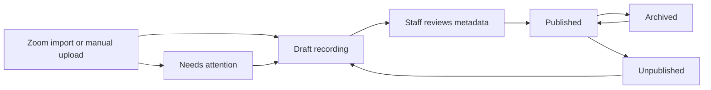
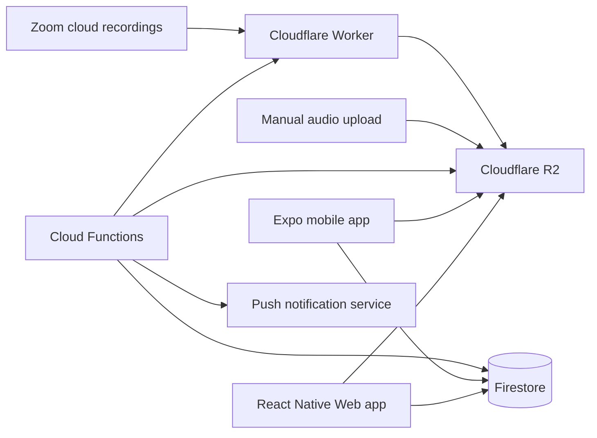

# Sabeel Institute LMS — Product Brief

## Summary

Sabeel Institute LMS is the institute's mobile and web app for adult students and staff: attendance, the class recordings a student who missed a class must play, and assignments with grades. It replaces Zoom links shared by hand, email-list workflows and paper hand-ins with one place for what each student owes and what each class has done, and gives staff a clear accountability ledger.

The app is not a general LMS. It covers attendance, required listening, and assignments with grades — no course grades, quizzes, discussion or messaging.

## Product principles

- **Adult learner tone:** respectful and direct. Use language such as required, listen by, watch by, missed, completed, and pending sync. A recording a student can play any video of says **Watch by**; one that is audio only says **Listen by**; buttons say **Play**; lists that mix both say neither ("Your recordings", "Required, soonest first"). Staff set the date as **Due by**, since a session has its date before it has a recording. Say **missed** rather than overdue once access has closed — overdue implies the work is still doable. Avoid childish, punitive, or shaming language.
- **Action first, full data second:** default views should show what needs attention. Complete sortable list views are still available for students and staff when they need full visibility.
- **Being excused is the entitlement:** a recording opens to exactly the students marked excused for its session, and closes to them when the due date passes. The same fact makes it required listening. Access and accountability were separate principles until 2026-08-14; they are now deliberately one.
- **Audio and video, as the class made them:** a recording holds its class's files — audio, and video where staff took it — as parts and versions, and nothing is transcoded (`docs/plans/VIDEO-AND-MULTIPLE-MEDIA.md`).
- **Professional UX:** the app should feel polished, calm, and easy to use for every role. Avoid a wall of recordings as content grows.
- **Sabeel visual system:** use the Sabeel Institute light theme and brand palette through semantic design tokens. Do not introduce a dark mode.

## Planned stack

- Expo and React Native Web for one mobile and web codebase.
- Firebase Authentication, Firestore, Cloud Functions and Secret Manager; media in Cloudflare R2, with a Cloudflare Worker copying Zoom recordings in (`docs/plans/MEDIA-ON-CLOUDFLARE.md`).
- Zoom Server-to-Server OAuth for the primary recording import path.

The product should be designed for Android, web, and future iOS support. Initial builds and testing will target Android and web only because iOS hardware and an Apple Developer account are not available yet. Do not make architectural choices that would block a later iOS build.

## Users and roles

| Role | Description |
|---|---|
| **Admin** | Full platform access across all cohorts, classes, students, recordings, staff, settings, audit history, Zoom source configuration, and destructive actions. |
| **Manager** | Operational staff member assigned class by class. Can manage students, recordings, attendance, assignments and grades, reports, and audit history within assigned classes. Cannot manage staff/admin settings or Zoom source configuration. |
| **Student** | Adult learner enrolled in one or more classes. Can play the recordings they are given, download them inside the app, mark them complete, hand in assignments, and see the grades returned to them. |

### Authentication and access

- Staff sign in with Google and must use an `oursabeel.com` account.
- Domain login does not grant staff permissions by itself.
- An Admin must approve staff users and assign Admin or Manager role.
- The first Admin account is seeded during setup or deployment.
- Admins have full platform visibility.
- Managers must be assigned class by class. Cohort-level assignment does not grant access to every class in that cohort.
- Students sign in with email and password.
- Staff quick-create student accounts with full name, email, and enrolled cohort/class — **on the web only**. The affordance is absent from the native builds, so an app-store reviewer never meets an account-creation flow; everything else about a student account (roles, enrolment, disabling, resending the set-password link) works on every surface.
- After staff create a student account, the student receives an email to set their own password.
- Disabling a student prevents login while preserving all history, enrollments, and reports.
- A student's page carries their **history**: when the account was created and by whom, then every enrolment, removal and return, and every time the account was disabled or re-enabled — each with who did it and when. It is read out of the audit log, which is the record of those changes, not kept as a second one. A manager's view of it is pinned to the classes they manage; account changes are admin-only.
- The student picker on the create-student form offers only courses that are running — an archived course, or one in an archived cohort, is not offered there. Enrolling into an archived course remains possible from the course's own page.

## Academic structure

The primary hierarchy is:

```text
Cohort/Semester -> Course -> Session -> Recording
                          -> Assignment
```

- A **course** is the subject taught over a cohort (formerly "class"; renamed because "class" was overloaded with "class meeting").
- A **session** is one dated meeting of a course. It owns the **attendance** for that meeting and has zero or one recording. A session exists whether or not it was recorded.
- A **recording** is the audio for a session, linked by `recording.sessionId`. It is pure media + lifecycle; the student-facing title/notes/date are copied (denormalised) from the session, because students cannot read sessions.
- An **assignment** is work set for a course, independent of attendance: it goes to everyone enrolled and to anyone who joins by its due date (see "Assignments and grades"). Its records are `coursework` and `submissions`; `assignments` is the recording grant's name.
- A student account can be enrolled in multiple cohorts/courses over time.
- Listening history is preserved across enrollments.
- Admins and Managers can create and manage cohorts, courses, and sessions within their permissions. A cohort can be renamed from its own page; a rename touches nothing but the name.
- Cohorts are manually marked inactive or archived when they end.
- Courses can be inactive or archived independently.
- A course is effectively active only when both its cohort and the course itself are active.
- Archiving a cohort makes all courses within it effectively inactive.
- Reactivating a cohort restores courses according to each course's own active/archived state.

### Attendance

- Attendance is taken **per session**, in-app, by staff: each enrolled student is marked **present**, **absent**, or **excused**, with an explicit **submit** step. Until attendance is submitted, nobody is granted anything even if a recording is published.
- The submitted attendance is a **snapshot**: it decides who may hear that session's recording, and it is what makes accountability start at enrollment (a student not enrolled when attendance was taken is simply not in the snapshot).
- **`excused` is the only mark that gives a student anything.** It opens the recording *and* makes listening required, until the session's due date. `present` needs nothing; `absent` is an unexcused miss and opens nothing. "Everyone must listen" is expressed by marking everyone **excused**.
- Staff cannot excuse anyone for a session whose due date has already passed — that would create an obligation nobody can meet. To let someone catch up late, move the session's due date forward first.
- Attendance is staff-read only in the sense that nobody sees the roster's marks but staff. Each student sees **their own** mark, on their own class page, from a server-written projection — Firestore has no field-level security, so there is no way to reveal one key of the session's map and hide the rest.

### Archived course access

- Archived courses move out of default student views into history/archive.
- When a course is archived, the default setting is to turn off student access to recordings.
- Staff can explicitly keep archived course recordings available.
- If access is off, students can still see the course/history, but playback is disabled with a clear message.
- When a course is archived, active reminders and active accountability counts stop. Final ledger history remains available for reporting and audit.

## Recording ingestion

The MVP supports two ingestion paths:

1. **Primary:** import audio recordings from an approved Sabeel Zoom source.
2. **Secondary:** manually upload an audio recording when Zoom was not used or did not capture the class.

Both paths produce the same draft recording workflow before publishing.

### Zoom import

**Any staff member may LIST the institute's Zoom recordings; only a scoped
manager may import one** (decision, 2026-09-07). The Zoom API's list is not
class-specific — a cloud recording carries a title, a date and a duration, and
nothing that says which course it belongs to — so filtering it per manager would
be guesswork. Staff are a small, approved, single-institute group, and titles and
dates are not sensitive; importing, which is what actually creates a recording
and grants access, is course-scoped as everything else is.

- Admins configure the central Sabeel Zoom account or approved connected Zoom source.
- Managers can import recordings from approved Zoom sources for their assigned class scopes.
- Staff see a list of available Zoom cloud recordings.
- The Zoom import picker supports date range, meeting title, import status, and duration filters.
- Each Zoom recording in the picker shows the date and the hours its audio ran, in institute time on a 12-hour clock. One recurring meeting carries every class in a cohort, so the topic is the same on every row and two classes can share a date; the hours are what tell them apart.
- The picker opens filtered to the session's own date, as a toggle staff can turn off. Its date range is in institute dates too: an evening class, which Zoom stamps on the next UTC day, is listed under the day it was held.
- The picker takes any of Zoom's formats — slides and speaker, slides only, audio only — from one meeting or several (decision, 2026-10-12, replacing one audio file per meeting). A class recorded in several stretches, or across a meeting that was ended and started again, is imported as parts in the order they ran; the formats of one stretch become versions of one part. It shows the size, class time and monthly storage cost of what is chosen before anything is copied, and the copies run in the background.
- Already imported Zoom recordings show as imported and link to the existing app recording.
- Failed imports show a needs-attention status with retry and useful error details.
- Drafts take their duration and source details from Zoom. Title and date come from the session, which owns them — see the data model — so the Zoom topic and start time are not copied onto the recording.

### Manual upload

Manual upload exists for exceptions — a class Zoom did not record, a phone video of the whiteboard — not the normal path. It must still work well.

- Staff upload one or more files from a computer or a phone: audio as M4A, MP3 or WAV (300 MB each), video as MP4 (8 GB each). Each becomes a new part, or another version of a part already on the recording; a part takes one uploaded video and one audio file.
- The first file on a session creates its draft recording. Files can be added to a recording in any state; students see one only once it is ready.
- Every upload goes in 16 MiB pieces straight to the bucket, each retried on its own, so a dropped connection costs a piece rather than the file.
- On arrival the server reads the file's own headers: anything but AAC, MP3 or PCM audio, or an MP4 of 8-bit 4:2:0 H.264 video (Baseline, Main or High: what phones decode) with AAC or MP3 sound or none, is deleted with a sentence saying how to export it instead. The length stored is the file's own, not the uploader's device's: for a video, the movie's, not its sound track's.
- Leaving the page, or stopping, removes the unfinished file; anything still unfinished a day later is swept.

## Recording lifecycle



### Required metadata before publish

Title, date, due date, and shared notes live on the **session**, not the recording — set when the session is created and edited there. So the only thing a recording needs before publish is **something a student can play** — and nothing still arriving or failed; everything student-facing is inherited from the session it belongs to. (The session's title/notes/date are denormalised onto the recording so students, who cannot read sessions, can still see them.)

Session date defaults to the meeting date. Due date is **required** — see *Due dates* below; it is the day access closes, so a blank one would mean permanent access. Notes are visible to everyone who can access the recording — they are not private staff notes. File attachments are out of scope for the first release.

### Recording statuses

- Draft
- Published
- Archived
- Unpublished
- Import failed / needs attention

### Editing published recordings

Staff edit a recording's student-facing metadata (title, date, notes) by editing its **session**; the change propagates to the recording's denormalised copy and is recorded in audit history. A recording belongs to one session for its life — there is no "move to another course" on the recording itself.

Accountability follows the session's attendance, so it is corrected by re-taking attendance (which reconciles assignments), not by editing the recording. **Archive and unpublish both close the recording to everyone who was excused** — the fan-out grants on `published` and on nothing else, so the two are identical to a student. They differ only in what they say to staff: unpublish means "not ready", archive means "the term is over". Both preserve audit history, and the ledger keeps every row.

Permanent deletion of anything carrying **listening history** — a recording with grants, completions or progress behind it, a student, a course, a session — is Admin-only, requires strong confirmation, and is recorded in the audit log. Normal operations should use disable, archive, or unpublish.

Two deletions are deliberately left to a manager, because neither destroys listening history and both are ordinary corrections to their own class: **removing a completion override** they set (the override is a staff judgement, and the audit log keeps the record of setting and removing it, each with its required reason), and **removing a file from an unpublished draft** so a bad one can be replaced. A published recording's playable files are hidden from students rather than removed, and staff may hide, show, reorder and add files in any state. A file no student ever saw — still uploading or copying, or failed — may be removed from a recording in any state: that is cancelling an upload or clearing a failed import. A draft that has ever been published is not one of these — the server checks the collections, not the status.

## Recordings: access and accountability

### Core rule

**By default no student can open any recording.** The students marked **excused** for a session are granted its recording, and that same grant is what makes listening to it required. Students marked **present** or **absent** are granted nothing: enrolment on its own opens no audio at all.

The grant appears once the recording is **published** AND attendance has been **submitted**, and changing either — publishing, unpublishing, or re-submitting a corrected attendance — reconciles it, deactivating a grant (while keeping its completion/progress history) if a student is no longer excused.

The grant **closes when the session's due date passes**. It is not deleted: the row stays active so the ledger still records who was required to listen and did not, and the student still sees it, marked **Missed** with the date it closed. Staff reopen it by moving the session's due date forward.

There is no separate "assign to everyone" action and no per-recording roster fan-out. "Everyone must listen" is expressed by marking everyone **excused** for that session.

### Leaving and returning

**Unenrolling a student closes their obligations in that course, and they stay
closed until the student is enrolled again.** The register keeps their mark — an
attendance record is what happened on the day and outlives the enrolment — but a
mark alone grants nothing: the fan-out only ever grants students who are
currently enrolled, so no later edit to a session can quietly hand access back.

**Re-enrolling restores the obligations that are still open, and only those**
(decision, 2026-09-07). A recording whose Listen by date passed while the student
was out of the class does not come back: handing one back would create an
obligation already over, against "nothing is ever born expired", over audio the
server then refuses to serve. The student is not recorded as having missed
a window they were not enrolled for — however many times they left and came
back, since the enrolment keeps every stretch they spent in the class. Staff
keep the record either way: the recording ledger goes on listing them under
**Excused, access closed**.

### Late enrollment

Accountability starts at enrollment: a student is only ever granted sessions whose attendance was taken **after** they enrolled (they are in that session's snapshot). A student enrolled after a session's attendance was submitted is never retroactively granted it. To let a late enrollee catch up on an earlier session, staff re-take that session's attendance and mark them **excused** — re-submitting reconciles and grants them. If that session's due date has already passed, staff move it forward first.

There is no course archive to browse: a student's list of what they may listen to *is* their list of what they must listen to, because one fact produces both.

### Due dates

- **Every session has a due date. It is required, and it is the day access closes.** A blank one would mean permanent access — the most permissive setting reachable by leaving a field alone.
- It prefills to the session date plus 7 days and staff can change it.
- Due dates are date-only, not date-and-time, in the institute timezone.
- The due date is the last on-time day: a recording due the 25th is open all through the 25th and closes on the 26th.
- A due date may **become** past by the passage of time, but nothing ever writes one that has already gone. Publishing a recording onto a session whose deadline has passed is refused, as is excusing anyone for it.
- A student who has already pressed play keeps that playback session: a signed URL lives up to 12 hours from minting. Individual URLs cannot be revoked, which is a documented and accepted property of the design.
- **A completion that arrives after the deadline still counts, and carries the date the student's own device recorded** (decision, 2026-09-07). The app gives a student no way to mark one late — past the listen-by date the player is a closed screen with no control — so the only writes that arrive late are ones made ON TIME and queued offline. Rejecting those would punish exactly the student who did the work on a poor connection, and enforcing it would mean putting date arithmetic into `firestore.rules`, which the deadline invariant rules out. The trade accepted: the ledger's completion dates are the student's device clock, so they are evidence of what a student did, not proof of when a server saw it.

## Assignments and grades

How it was decided: `docs/proposals/lms-assignments-proposal.html`; how it is
built: `docs/plans/ASSIGNMENTS.md`.

### Writing and posting

- A teacher writes an assignment on its course: a title, formatted instructions (bold, italic, two kinds of list and links, with Arabic running right to left), files, a due date, how it is graded — points out of a whole number, or satisfactory / needs work — and whether late work is accepted, and until when (a week after the due date unless changed).
- Dates are whole days in institute time, like a session's, and never written in the past.
- Files can be added while a new assignment is being written, before it is saved (Faisal's choice, 2026-10-13). Nothing exists until it is saved as a draft or posted; the files are held until then and join it when it is. The assignment gets exactly the files the form showed, and saving or posting waits until every file is up. Leaving the form without saving throws them away with the rest; files held for a form nobody came back to (a closed tab) are kept thirty days, in case it is still open somewhere, then cleared.
- A **draft** is seen by the course's staff and by no student. **Posting** sends it to everyone enrolled and tells them; a posted assignment never goes back to being a draft.
- Editing a posted assignment changes it for everyone still working on it, except a student given more time, whose own date stands. How it is graded is fixed once any grade is saved. A form opened before someone else saved their edit cannot save over it: the save is refused, and says so.
- **Stop taking work** closes it early: everyone with nothing in has missed it, and work already in can still be graded. A student given more time or another try keeps their own date and can hand in until then (Faisal's choice, 2026-10-14). **Take work again** undoes it: the assignment is open until its dates once more, those it marked missed are back to work on it, and anyone who joined while it was closed gets it if its due date has not passed.
- A teacher may **delete** an assignment no student has started. Once any student has a draft, a hand-in, a grade or a teacher's mark on it, only an admin may, and closing keeps the record instead.

### Who has it

- Everyone enrolled when it is posted, and anyone who joins by its due date. Joining after the due date gives a student nothing to answer for. Leaving the class takes it off their list; their work stays with the record.
- A teacher can give one student **more time**, or mark it **not required** for them, each with a reason the student sees. It is never called "excused", which is the register's word.

### Handing in

- A student writes an answer, formatted like the instructions, and attaches files: documents, pictures (on a phone, a photo taken there and then) and audio; up to ten files of 25 MB each, and no video. Either may be empty, but not both, so a question put to the class can be answered in the box alone.
- Files are listed in the order they were chosen, each one line: what it is, its name and its size. A file is a link (Faisal's choice, 2026-10-13): tapping it opens it in the phone's or the browser's own viewer, a document, a picture and audio alike, from a link minted for the tap. Nothing is shown or played in place. A file the browser cannot show in a tab — a Word file, or a PDF where there is no viewer — is saved to its downloads under its own name instead, so no blank tab is left behind.
- What they write is saved as they type, on the server, so they can start on a phone and finish on the website, and leaving the screen keeps it. Nobody else sees it until it is handed in.
- **Hand in** stores the answer first: what is on the screen is what is handed in.
- Until the due date, and while it has not been returned, a student can **take it back** to change it.
- After the due date, while late work is accepted, it can still be handed in and shows as **late**. After that it is **missed**, and the screen offers no button; a teacher can give more time.

### Grading and returning

- A grade is a draft that only staff see until the work is **returned**. A student never sees a grade before then, and the record they can read carries none.
- A teacher returns work one student at a time, or everything graded at once, which asks once more first. Returning can ask for **another try** with a new date; the attempt, its grade and its feedback stay with the next one.
- A change to a returned grade is held on the form until the teacher sends it; then it reaches the student at once, tells them if the grade changed, and is recorded. A returned grade can be changed, never removed.
- Work done on paper or recited in class can be graded with nothing handed in.
- At a desk, the class list, the work and the grade sit side by side; **J** and **K** step through the list and **Ctrl + Enter** (**⌘ + Enter** on a Mac) returns. Nothing moves on, and nothing is returned, until what is typed is stored.
- There is no course grade.

## Student experience

### Student home: To do

**To do** is everything a student owes — the recordings they must play and their assignments — on one list, open work first and the record after. Being granted a recording and being required to play it are the same fact, so there is nothing accessible-but-optional to separate out.

The nearest deadline still ahead, of either kind, is promoted to a card at the top of the screen (for late work, the last day it is accepted) and dropped from the group it would otherwise sit in, so the student's next action is the first thing on the page. Work already late sits directly under it. The rest are grouped, in order:

1. Past due — assignments still accepted late
2. Due soon — due within the next 7 days
3. Upcoming
4. Missed
5. Archived
6. Done — the last two weeks, newest first; a class's page keeps the whole record

A **Missed** card stays on the list rather than disappearing: a student is owed the record of what closed and when. It is not a play target — the server refuses to mint a URL past the deadline, and a card that looks tappable and then errors reads as a fault in the app rather than a deadline missed.

### Class views

**Your classes** lists the classes a student is enrolled in, each with their attendance tally and where their assignments stand. Finished (archived) classes wait in a closed **Finished** section at the bottom.

A class's page has two tabs, and a banner that says what is owed. **Sessions** is **their own attendance record**: a tally of present / absent / excused, then every session they were marked in, with their own mark and its date. An excused row also says that a recording was required and whether they have listened to it. **Assignments** is every assignment they have in the class and where each stands.

- It is a record, not a second way to play: listening starts from the Listening tab, which is the one place a recording is opened. (Once something is playing, the docked now-playing bar can reopen the player from anywhere.)
- Sessions whose attendance was taken before the student enrolled are simply not in their record.
- No student ever sees another student's mark, or the roster's.

### Playback

Required first-release playback features:

- Streaming, audio or video.
- Versions of a part (slides and speaker, slides only, audio only) to switch between, keeping the place; parts to move between, the next starting by itself.
- Resume where this device left off, in the file it was playing. The place is each device's own (Faisal's choice, 2026-10-15): a place shared through the server was moved back by any device left open on an older one.
- One bookmark per recording, kept with the account: the way a student carries their place to another device, on purpose. Setting it again moves it.
- Play takes a tap while the file is still on its way, and starts by itself once it can.
- Playback speed.
- Background audio.
- Mark complete.
- Listening is sent when online, each sitting's added up, so two devices both count.

**Offline downloads are DEFERRED and are not in the first release** (`docs/PHASE_STATUS.md`, 2026-07-22, reconfirmed 2026-09-06). Recordings stream; nothing is stored on the device, which is what `docs/USER-MANUAL.md` tells students. When it is picked up, the shape below is the intent: audio saved inside the app only — never an external file export — with students managing what they have kept, and no auto-delete policy required initially.

### Completion

Completion is student-attested. Playback progress is audit evidence.

- Students manually mark a recording complete.
- The app blocks completion if the student has never played the recording.
- A recording completed **in time** is never recast as missed, however far past its due date the ledger is read.
- There is no required listened-percentage threshold.
- The ledger shows listened percent, last listened, completion time, and pending sync state.
- Students can see their own full accountability details — including a recording
that has CLOSED, where the transport is gone but their record is not: how much
they listened, whether it counted, and a teacher's override with its reason if
there is one. "Your listening record is kept" is a sentence the screen has to be
able to back.
- Students can unmark a recording complete. Completion and uncompletion actions are recorded.

### Offline completion

Students can mark complete offline.

- The app shows **Pending sync** until the completion reaches the server.
- Staff reports treat completion as final only after server sync.
- The app must communicate pending sync clearly to avoid confusion.

## Staff experience

### Staff home: what is waiting

Staff home is a dated work queue — everything across the reader's courses that
is waiting on them, most urgent first, each row a direct link to the screen
where the work is done.

Attendance not taken ranks first. The count on the navigation is what is
blocking access right now — an un-taken register, and a recording taken back
after students had been given it, whether unpublished or archived before its due
date — so a draft appears in the list without appearing in the count. Under the
excused-only policy an un-taken register grants nobody anything, so a published
recording sits there that not one student can open — and it is the only failure
in the product that is invisible from every other
screen.

The rest, in order: a recording waiting to be published (draft, unpublished, or
an import needing attention), a session whose attendance is in but whose audio
is not, and a recording whose access closes within the week.

**To grade** comes last: work handed in and not yet graded, in courses the
reader manages by name — an admin's Today does not carry every course's
grading, which would bury the registers that keep students from their
recordings. It is never counted in the badge.

Nothing in the queue is stored. Every row is derived from records the reader
can already see, so it cannot claim work that is already done, and closing the
gap removes the row.

### The recording library

The recording library:

- Is cross-cohort: an admin sees every recording in the institute as one list, a manager sees theirs grouped by class. Cohort/semester is not a level of grouping here — the Classes tab is where the hierarchy lives, and repeating it made a short list twice as tall.
- Filters by recording status, and shows the count under each status so it does not become a wall of recordings. Everything is shown by default; a filter narrows it.
- Filters by **cohort** and by **class**, as two dropdowns: a cohort alone shows everything in that term, a class narrows to that class, and the class dropdown offers the classes of the chosen cohort (every class, each with its term, when none is chosen). The count line describes the narrowed set. A clear control appears whenever anything is narrowing, and puts everything back.
- Surfaces needs-attention states, which are the rows that want a person.

Staff can play recordings in the app to verify imports and metadata.

### Complete list views

Staff reach everything through complete lists rather than search: Recordings,
Students, Classes, and the ledger views. Each list is whole — nothing is hidden
behind a query — and each is ordered so the list itself is the navigation.

Filtering is deliberately narrow. The library filters by **recording status** —
the one attribute of a recording that decides whether somebody has to act — and
by **cohort and class**, because by the third term an institute-wide list is
mostly other terms, and "the recordings of this class" is a question the
Classes tab answers only one class at a time. Completion state is what a ledger
is for and belongs on the ledger rather than on a list of recordings; and there
is no "no due date" to filter for, because every session has one — it is
required.

Sorting is fixed rather than user-chosen: students by name, sessions and
recordings by date, newest meeting first. A sort control on a list whose right
order is obvious is a control that can only put it in the wrong one.

Search is not required.

## Admin backend stats

Admins need an operations/status surface for backend health and usage. This should be Admin-only and focused on practical operating visibility, not analytics for student behavior.

Required backend stats:

- Total audio storage used.
- Storage used by cohort/class where practical.
- Recording count and total audio duration.
- Recent import failures and needs-attention recordings.
- Manual upload failures.
- Recent background job status for Zoom import/sync.
- Push notification delivery/error counts if available.
- Approximate download/playback bandwidth if available from the storage provider.
- Current active users and disabled users by role.

This view should help Admins notice cost, storage, import, and backend issues before they affect students or Managers.

## Accountability ledger

The ledger should help staff find action items without inspecting every student every time.

### Primary views

1. **Recording ledger:** split by the session's attendance — the **excused**, shown with completion and missed state; the **present** and the **absent**, neither required nor able to open it, listed so the ledger still accounts for the whole submitted roster. A residual "also listened" catches listening from someone who holds no current grant (excused, listened, then corrected to present).
2. **Student ledger:** all assigned recordings for a student, filterable by course and status.
3. **Course-level views:** grouped by cohort/course with incomplete and missed counts.
4. **Attendance report:** per course, a toggle between a by-session summary (present/absent/excused counts, un-taken sessions flagged) and a by-student summary (attendance tallies + catch-up status: of the sessions each student was excused from, how many recordings are complete/missed). The by-student cut lists **everyone the submitted registers name**, not only the current roster: a student unenrolled mid-term keeps their marks, those marks keep counting in the by-session totals, and they are shown flagged *no longer enrolled* so the two cuts of one report reconcile. A register counts as *not marked* for a student only if it was taken while they were in the class — the same question, asked of the same record, as the course workbook's Register tab.

### Recording ledger fields

- Student
- Complete/not complete
- Listened percent
- Last listened
- Completed at
- Pending sync where relevant (on screen; a sync state is a property of the reader's device at a moment, not a fact about the student, so it is not exported)
- Override status/reason where relevant

Default staff workflow should make it easy to filter to not complete or missed students.

### Staff overrides

Staff can manually override a student's completion status only with a required reason recorded in audit history.

### Exports

Two workbooks, each one `.xlsx` file with several tabs, are every export the app
has (the manual's section 2.13 lists the tabs and defines every term):

- **The course workbook**, from a course's page: the roster and enrolment, the
  register, required listening and its outcomes, sessions, recordings and
  assignments with grades, and the definitions.
- **The student workbook**, from a student's page: that student across every
  course the reader may see, their sessions, recordings, assignments and
  history. A manager's covers the courses they manage, and says so.

A workbook is the record as it stands when the button is pressed, not a copy of
the filters on screen. Its figures come from the same counts the screens use, so
a tab and the screen it mirrors cannot disagree.

## Notifications

Push notifications are first-class scope for students and staff alike. Six switches and seven messages, no more; each message names the class, then says one plain sentence.

1. **Student — a recording is ready for you.** Fires once when a student is excused and the recording is published. Under the excused-only policy this is also "you now have access", so without it a student has no way to know a recording appeared.
2. **Student — last day for a recording.** On the morning of the due date, if not yet complete. There is no day-after reminder: once the deadline passes there is no action left to take, so a message could only say "you missed it".
3. **Student — new assignment.** When an assignment is posted, to everyone it went to; and **due date moved**, under the same switch, to those still working on it whose date moved. A student who joins later finds the work on To do.
4. **Student — last day to hand in.** 7 AM on the due date, or on the student's own date when given more time, to each student with nothing handed in who is not marked not required.
5. **Student — work returned.** When the teacher returns the work, asks for another try, or changes a returned grade. Never the grade itself: a lock screen is not private.
6. **Course managers — attendance still not taken.** A session whose date has passed with attendance never submitted, sent to the people who manage that class. Load-bearing under this policy: no attendance means nobody is granted anything, so an un-taken sheet silently locks a whole class out of a published recording. A session marked **not recorded** raises nothing — there is no audio for a missing register to lock anyone out of. Still the only message staff get: a message per hand-in would be twenty for one assignment, and Today carries the count.

To the class's managers and to nobody else: an admin who manages no class cannot receive it, so their notification settings say where class messages go instead of offering a switch that could do nothing.

Each switch is per person and on by default. Notifications are a convenience, not the accountability mechanism.

A message is shown whether the app is open, in the background, or closed — on Android and on the website alike. While the app is open it appears as a banner without a sound: the person is already there, and the live screen carries the news. **Tapping a message opens what it is about** — the assignment, the recording, the register — on both surfaces. On Android the app's notification channel is **Class alerts and deadlines**.

## Data policy and audit history

- Recording access state and accountability history are retained indefinitely by default unless an Admin deletes or archives data according to policy.
- Admins and Managers can view audit/change history within their allowed class scopes.
- Platform-level staff/admin changes belong in Admin surfaces.
- Permanent deletion is Admin-only, requires strong confirmation, and is audited. Three deletions are a manager's: a completion override they set, a file on an unpublished draft recording, and an assignment no student has started.
- **Deleting an account** (Faisal's choice, 2026-10-14) is an admin's, on the website, and only for an account already disabled. It removes the sign-in, the email address wherever it is held (the directory row, and the history rows that copied it), and the notification settings; a student leaves their classes and a colleague their courses. The name stays with the academic record, and the person is listed as deleted. Deleting in the Firebase console instead left an active-looking person every action failed on.
- Posting, editing, closing, returning, changing a returned grade, giving more time and marking work not required are in the audit history. A grade becomes a record only when it is returned: drafts change constantly while a teacher works and are not logged keystroke by keystroke.
- What students do with assignments — each hand-in and take-back, with its time — is kept in its own history, which staff see on the student's work, rather than in the audit history.

## Out of scope for the first release

- Transcripts/captions.
- Search.
- Parent/guardian access.
- Bulk student import.
- Gamification.
- External audio file downloads.
- Email notifications of any kind (push only).
- Course grades, quizzes, discussion and messaging.
- Video in assignment files.

## Future ideas

Considered and set aside for now (2026-10-14), with what each would solve and
cost, so the reasoning is not lost.

- **Long recordings that start at once on a slow phone.** A player cannot
  play until it has a file's whole index, which for a 3-hour Zoom video is
  about 3.5 MB: some 20 seconds on a slow connection before the first word
  (a 1-hour audio, about 5). Rewriting each file into small fragments, each
  with its own small index, would let it start in a second or two. Nothing
  is re-encoded: the same sound and picture, rearranged. The cost: a
  processing job (ffmpeg) that reads every new file from the bucket,
  rewrites it and puts it back, a few minutes before a new file is final,
  about $0.12 per GB sent back to the bucket, an overall index of the
  fragments so that seeking stays quick, and upload checks that read the
  fragmented layout. Today the player says "Loading…" and points a video at
  its Audio only version.
- **Warm functions for the taps people wait on.** After a quiet spell the
  first tap on Play, Hand in, Save grade, Return or Submit attendance waits
  3-8 seconds while its function starts. Keeping one instance of each
  always running answers that tap at once, for roughly $3-8 a month each.

## Feature checklist

### Student

- Email/password login, with a self-service reset from **More → Change password**.
- View the classes they are enrolled in.
- See To do: required recordings and assignments together, nearest deadline first.
- Hand in an assignment: a formatted answer and files, with a camera button on phones; take it back to change it before the due date.
- See returned grades and feedback, and earlier attempts.
- See their own attendance record for each class.
- Stream audio.
- Download audio inside the app for offline listening.
- Manage downloaded recordings and see storage usage.
- Resume where they left off on the same device, and go to their bookmark on another.
- Change playback speed.
- Listen in background.
- Mark complete after playing at least once.
- Mark complete offline with pending-sync state.
- Unmark complete.
- View own accountability details.
- Control notification settings.

### Manager

- Google sign-in with approved Manager role.
- Access only assigned classes.
- Create/manage students in assigned classes.
- Quick-create student accounts (web only — see the access rules above).
- Import recordings from approved Zoom source for assigned classes.
- Upload audio manually.
- Review drafts and publish recordings.
- Edit published recording metadata.
- Archive/unpublish recordings.
- Listen to recordings.
- View class and recording ledgers.
- Drill into student accountability history.
- Override completion with required reason.
- Post, edit, close and delete assignments, with files and formatted instructions.
- Grade and return work, together or one at a time; ask for another try; give one student more time; mark work not required.
- Grade at a desk with the class list beside the work, and keys for moving on and returning.
- Export the course and student workbooks.
- View audit history within assigned scopes.

### Admin

- Full platform access.
- Seeded initial Admin account.
- Approve staff and assign Admin/Manager roles.
- Assign Managers class by class. An admin can be one of a class's managers
  too, and then gets its attendance reminder and its work to grade, as a
  manager does; it grants them nothing they did not have.
- Configure approved Zoom source.
- Manage cohorts/classes globally.
- Manage students globally.
- View backend usage and health stats, especially storage usage.
- Perform Admin-only permanent deletion with strong confirmation.
- View platform-level audit history.

## Architecture sketch



## Data model sketch

This is not the final schema. It captures the product objects that need first-class representation.

| Object | Purpose |
|---|---|
| `staffUsers` (`staff`) | Staff identity, role, approval state, and admin/manager permissions. Manager course scoping is `managerUids` on each course, not a separate collection. |
| `students` | Student identity, active/disabled state, and profile fields. |
| `cohorts` | Cohort/semester records and archive state. |
| `courses` | Courses (the subject) inside cohorts, archive state, and archived-access setting. |
| `sessions` | One dated meeting of a course: attendance (present/absent/excused snapshot + submitted marker), date, title, required due date, notes, and its 0..1 `recordingId`. Staff-read only. |
| `attendanceRecords` | Each student's own copy of their mark for one session, keyed `{studentUid}_{sessionId}`. A server-written projection of the session's map — the only way a student can be shown their own mark, since Firestore security is per-document. |
| `enrollments` | Student membership in courses over time: every stretch a student has spent in the class — joined, left, came back — so a view that needs to know whether they were in it on a day (the attendance report, the workbooks, a missed or closed recording) asks one record. |
| `recordings` | Recording asset for a session (`sessionId`), status, source (`manual`/`zoom`), audio path/duration/size, and the denormalised student-facing title/notes/date. |
| `assignments` | The grant: one per **excused** student × recording, reconciled from the session's attendance. Both the permission to play and the obligation to listen. `active:false` retains history; the due date closes it without deleting it. |
| `listeningProgress` | How much of a recording a student has listened to, and when last: each sitting's listening (one opening in a player, on any device), added up into the total staff read. No place: that is each device's own. Client-written. |
| `bookmarks` | A student's one bookmark in a recording: a file and a position in it. Client-written, read by the student alone. |
| `completions` / `completionEvents` | Student completion state doc and the append-only event log; `completionOverrides` holds staff overrides (server-only). |
| `coursework` | An assignment: title, formatted instructions (markdown), files, due date, late-work date, grading, draft/posted, closed. Staff write it through callables. |
| `submissions` | One student's work on one assignment, keyed `{studentUid}_{courseworkId}`: state, their dates, what was handed in, earlier attempts, more time / not required, and the grade once returned. |
| `drafts` | A student's unsent answer and files, readable by them alone. |
| `grades` | Grades and feedback as staff write them. Never student-readable: a grade reaches the student only as `submissions.returned`. |
| `submissionEvents` | Each hand-in and take-back, append-only. |
| `courseworkTallies` | One assignment's figures, kept by the server as its work and grades change: handed in, to grade, returned, not required, and the students with nothing in grouped by their dates, so a course's pages work out what is past due or missed on the day they are read. Staff read it; nobody writes it. |
| `notifications` | Notification preferences, registered devices, and sent-notification records. |
| `backendStats` | Admin-facing operational metrics such as storage usage, recording counts, import failures, background jobs, and notification errors. |
| `auditLog` | Staff and system changes that must remain inspectable. |

## Existing research

- [Zoom Server-to-Server OAuth research](research/zoom-server-to-server-oauth.md)
- [Firebase recording cost research](research/firebase-recording-costs.md)
- [Technical risk register](research/technical-risk-register.md)

## Pending external inputs

- Sabeel logo, app icon, splash assets, and any other brand files.
- Firebase/Google Cloud project ownership and configuration.
- Central Sabeel Zoom account or approved Zoom source details.
