# Sabeel Institute LMS — User Manual

*For app version 0.1.2 · October 2026*

Welcome! This guide explains everything the Sabeel Institute LMS app can do —
from playing a class you missed and handing in an assignment to taking
attendance, grading, and tracking who has caught up. It is organized by role: **students** start with Part 1; **staff**
(managers and admins) add Part 2; **admins** add Part 3. Part 4 is a quick "How
do I…?" index you can skim any time.

The app works the same on the website
(<https://oursabeel-lms.web.app>) and the Android app — same account,
same data, live everywhere. Every screen in this guide is shown twice: once **on
a phone** and once **on a computer**, so you can recognize it wherever you are.
Both are captures of the website, at a phone's width and a laptop's; the Android
app draws the same screens, minus the one thing Section 2.11 calls out.

---

## The big picture (2 minutes)

1. **A recording is one class meeting, as the class made it.** Some are audio
   only; some also have video — the speaker and the slides, or just the slides
   — and you choose which to play. A long class may come in parts. Recordings
   stream in the app; nothing is downloaded to fill up your phone, and each
   play link is freshly issued and expires, so recordings stay inside the app.
2. **The app is for catching up on a class you were excused from.** Staff take
   **attendance** for each meeting. If they mark you **excused**, that meeting's
   recording opens to you and becomes *required* — it appears on your
   **To do** list with a date to finish it by, and closes again after it. If you were
   **present**, you don't need it. If you were **absent** without being excused,
   it isn't opened to you. Being excused is the whole of it.
3. **You mark a recording complete yourself.** The app keeps your place and shows
   how much you've played, but *you* decide when you're done — it is on your
   honor. (The one rule: you have to have pressed play at least once.)
4. **Staff can see who has caught up.** For every recording there is a ledger:
   of the students who were excused, who has finished and who missed the date —
   plus, for the record, who was present and who was absent. Staff can export it
   and, with a written reason, mark a completion on someone's behalf.
5. **Assignments are handed in here too.** A teacher posts an assignment to the
   whole class with a date to hand it in by. You write your answer, attach files
   or a photo of your page, and hand it in. Your teacher grades it and returns
   it — and you see the grade only once it is returned.
6. **Everything important is written down.** Approvals, overrides, edits and
   returned grades are recorded in an audit history that admins can review.

That's the whole system. Everything below is detail.

## Finding your way around

The app has a **bar along the bottom** on a phone and a **narrow strip of icons
down the left** on a computer. It is the same set of places either way, and it
is always there — so wherever you are, you are one tap from anywhere else.

Students have **To do**, **Classes** and **More**. Staff have **Today**,
**Courses**, **Library**, **People** and **More**.

**More** holds the things you need occasionally rather than daily: **Help**,
**Report a problem**, notification settings, the privacy policy, signing out,
and — for students — changing your password. Admins also reach the audit
history there.

**Help** is short films of the app at work, narrated, with captions: each thing
you do, shown on a phone and on a computer. A student sees the students'
films. Staff see every film: their own under **Teaching**, the students' under
**For students**, for helping a student through what they see, and the
administrators' under **Running the institute**. A film opens on the version
for the screen you are using, and the other is one tap away.

When something is playing, a slim bar shows what it is with a play/pause button
— above the tabs on a phone, along the foot of the window on a computer. You can
move around the app and it keeps playing; tap the bar to go back to the full
player.

## The institute's rules, and reporting a problem

**The rules, once.** The first time you sign in, before anything else, the app
shows the institute's rules under **Before you continue**: the app is for Sabeel
Institute's staff and students, what you post is seen only by members of your
class, nothing abusive, harassing, hateful, sexual or otherwise objectionable
belongs in it, and no member may abuse another. Administrators may remove
content and suspend accounts that break the rules. Tap **I agree** to carry on, or **Sign out**. You
agree once for your account, and are not asked again on this or any other phone
or computer.

**Report a problem.** To tell the administrators about something or someone in
the app — a post, a comment, a file, a person — tap **More**, then **Report a
problem**. Say what or who it is and what is wrong, in your own words, and tap
**Send**. The report reaches the institute's administrators by email with your
name and email address, and they reply to you by email within a day. If you
leave the screen before sending, the app asks first, so what you wrote is not
lost by accident.

---

# Part 1 — For students

## 1.1 Signing in

<figure class="ph">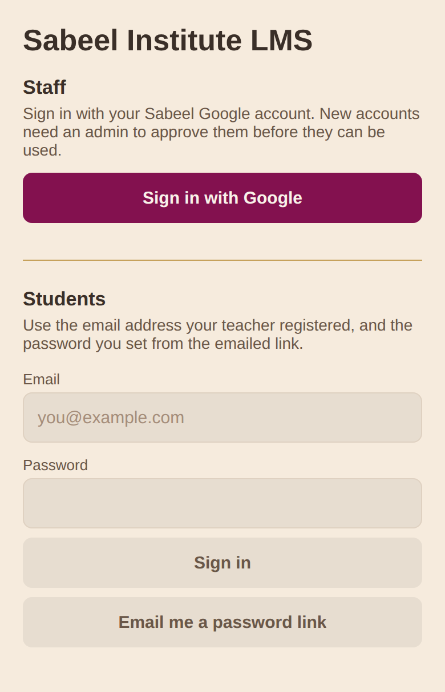<figcaption>On a phone</figcaption></figure>
<figure class="wd">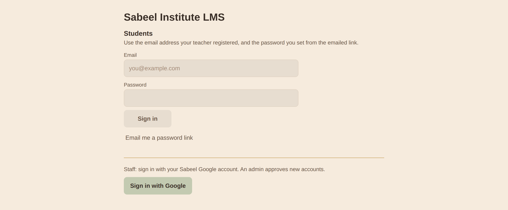<figcaption>On a computer</figcaption></figure>

Open the app or the website. Under **Students**, enter the **email address your
teacher registered** and your password, then tap **Sign in**.

The first time you sign in, the app shows the institute's rules: tap **I
agree** to carry on (see "The institute's rules, and reporting a problem"
above).

Your first password comes from an email. When your teacher creates your account,
the app sends you a "set your password" link — open it, choose a password, and
you're ready. If you never received it or the link has expired, tap **Email me a
password link** on this screen to get a fresh one.

The **Staff** line at the bottom is only for teachers and administrators — you
don't need it.

## 1.2 To do — everything you owe

<figure class="ph">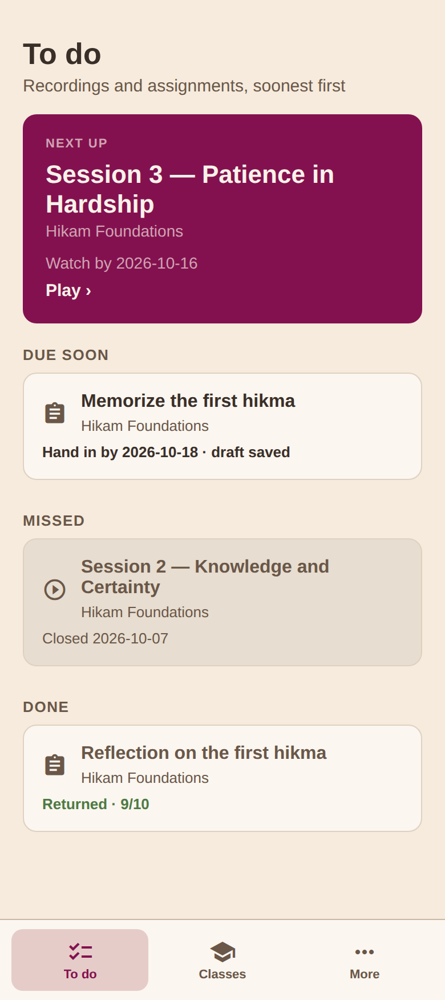<figcaption>On a phone</figcaption></figure>
<figure class="wd">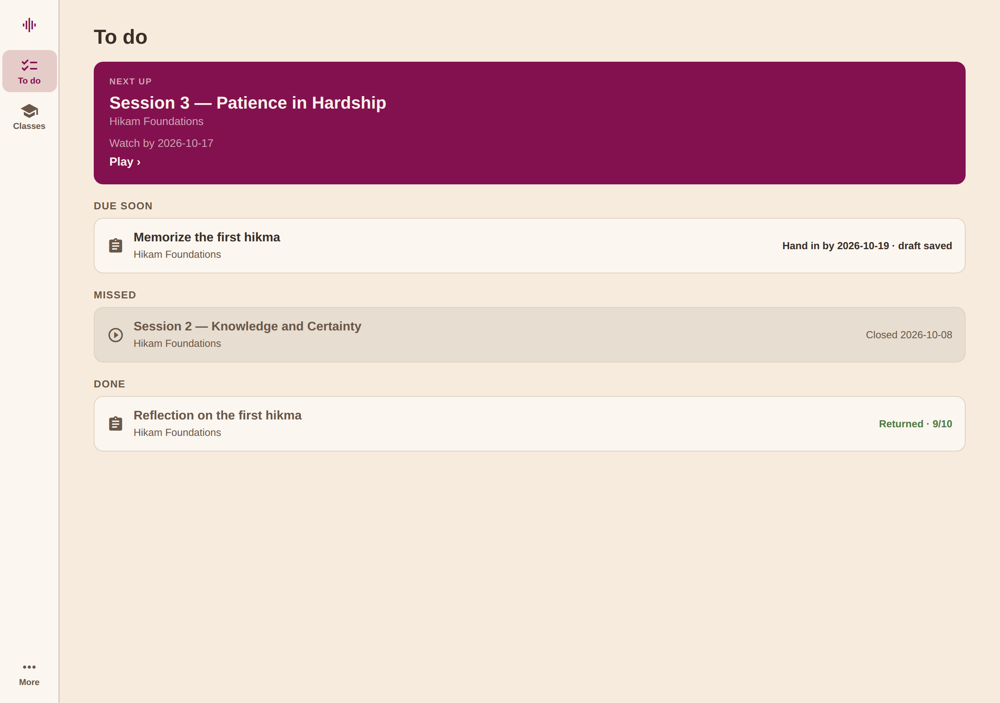<figcaption>On a computer</figcaption></figure>

**To do** is the first thing the app opens on. It is everything you owe on one
list — the **recordings** you need to play and the **assignments** you need to
hand in — soonest first.

**A recording is opened to you when your teacher marks you *excused* for that
class.** That is the whole rule. If you were there, you don't need it; if you
missed a class without being excused, it isn't opened to you. So this one list is
both what you *may* play and what you *need* to play — there is no
separate archive to go hunting through. **Assignments** come to everyone in the
class when the teacher posts them, and to anyone who joins the class by the due
date.

**The one to do next is at the top, in full** — the nearest date still ahead,
recording or assignment. Late work you can still hand in sits right under it.
Everything else is grouped so nothing slips past you:

- **Past due** — assignments whose date has passed but which your teacher still
  accepts, late.
- **Due soon** — due within the next week.
- **Upcoming** — further off.
- **Missed** — closed, with the date it closed. Nothing can be done about these,
  so they are set quietly rather than as an alarm.
- **Archived** — the class has been archived and its recordings closed, so
  these are no longer required and cannot be played. Quiet, like Missed.
- **Done** — what you finished or handed in over the last two weeks. Your class's
  page keeps the whole record.

Each card shows its title, which class it's from, and its date: **Watch by** for
a recording with video, **Listen by** for one that is audio only, **Hand in by**
for an assignment. Tap a card to open it — except a Missed or Archived
recording, which can no longer be played and so does not open.

**Every recording has a closing date.** After it passes you can no longer play
that recording — the card stays on your list marked *Missed*, so you can still
see what it was, but the recording is closed. Opening it shows **Your record**: how
much of it you played, and whether it was marked complete. Nothing you did
is lost when a recording closes. If you need it reopened, ask your teacher: they
can move the date. If you are playing it when its last day ends at midnight,
the part you are on plays on to its end; once it stops, or you switch to
another part or format, it cannot be started again. Paused at midnight, it
has closed.

One thing worth knowing: if you finish a recording and mark it complete *before*
the date, it counts as complete for good. It is never turned into a "missed" the
next day.

## 1.3 Playing a recording

<figure class="ph">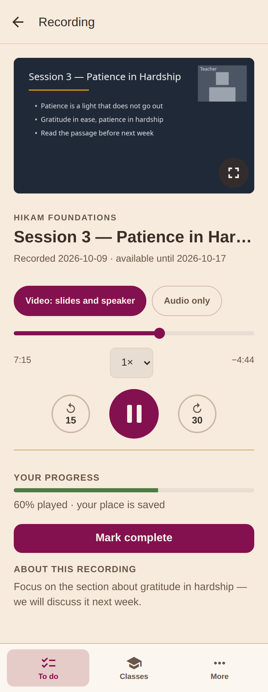<figcaption>On a phone</figcaption></figure>
<figure class="wd">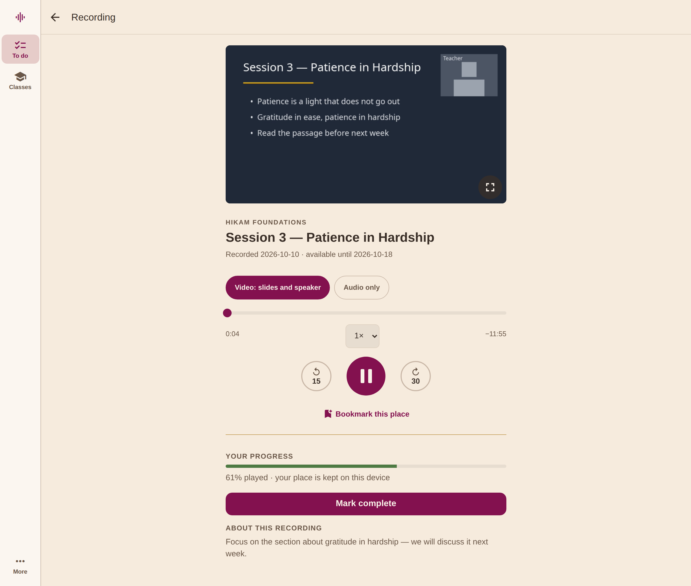<figcaption>On a computer</figcaption></figure>

The title is at the top. A long one slides slowly along its line — or, if your
phone is set to reduce motion, ends in "…" — and tapping it shows it whole; tap
again to fold it back. Under it are the day of the class and the last day you
can play it.

When a recording has video, the picture is at the top of the player. Tap the
**full-screen icon** in its bottom corner to fill the screen with it. On an Android phone, leaving the
app while a video plays shrinks it into a small window over your other apps;
on any phone the sound carries on when the screen is locked.

**Choosing what to play.** A recording may have more than one version of the
same class:

- **Video: slides and speaker** — the teacher and the shared screen.
- **Video: slides only** — just the shared screen.
- **Audio only** — the sound, and the smallest download.

The buttons under the player switch between them, and you carry on from the
same moment — switching to audio on a walk and back to video at home loses
nothing. A video uses far more mobile data than audio, so on a phone plan,
audio only is the thrifty choice.

**Parts.** A long class is sometimes recorded in parts — for example when the
recording was stopped for a break. The parts are listed under the player, in
order; the next part starts on its own when one ends, and you can tap any
part to go to it.

The controls are the ones you'd expect from a podcast app:

- **The big round button** plays and pauses. A long recording can take a
  while to get ready on a slow connection, and a ring turns around the
  button while it does. Tap it anyway: the recording starts by itself as
  soon as it can, and tapping again takes that back.
- The two side buttons **skip back 15 seconds** and **skip ahead 30 seconds** —
  handy for re-hearing a point or moving past a pause.
- Drag the **progress bar** to jump anywhere. The times below it show how far in
  you are and how much is left.
- **The speed**, beside the times — 1× up to 2× — changes how fast it plays
  without changing the pitch.

A line under the controls says how much of the recording you've played. **Each
phone or computer keeps your place**: open the recording again on the same one
and it carries on where you stopped.

**Bookmarks.** To carry on somewhere else — stop on your phone on the bus and
pick up on your laptop at home — tap **Bookmark this place** before you stop.
On the other device, open the recording and tap **Go to bookmark**. A
recording has one bookmark, and bookmarking again moves it. Signing out
clears the places a device kept, so the next person at a shared computer
sees nothing of yours; your bookmarks stay with your account.

If the teacher left a note, it appears under **About this recording** — often
"focus on this part" or "we'll discuss this next week."

<figure class="ph">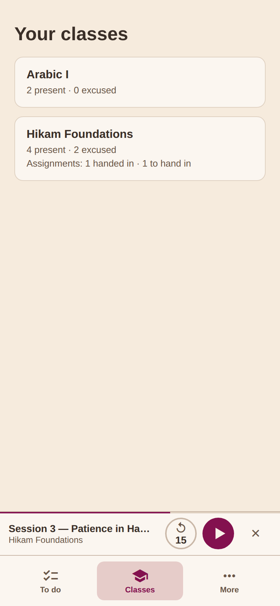<figcaption>On a phone</figcaption></figure>
<figure class="wd">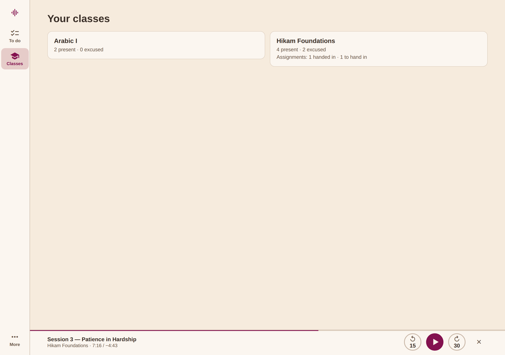<figcaption>On a computer</figcaption></figure>

**You can leave this screen without stopping playback.** Go and check your
attendance record or open another class — a slim bar keeps showing what's
playing, with play/pause and a 15-second skip back, and tapping it brings you
back here. On a computer that bar carries the skip forward and the times as
well.
Closing it with the **×** is what stops playback.

## 1.4 Marking a recording complete

The **Mark complete** button is at the bottom of the player. Tap it when you've
finished, and the recording moves to **Done**.

A few things worth knowing:

- **It's on your honor.** The app doesn't force you to play every second —
  it trusts you to mark complete when you're genuinely done. The progress bar
  is there to help *you* keep your place, not to police you.
- **You do have to press play first.** The button only unlocks once you've
  started the recording — you can't mark something complete you've never opened.
- **Changed your mind?** You can open a completed recording again and play
  more; marking complete isn't a locked door.

## 1.5 Assignments — your answer, your files, Hand in

<figure class="ph">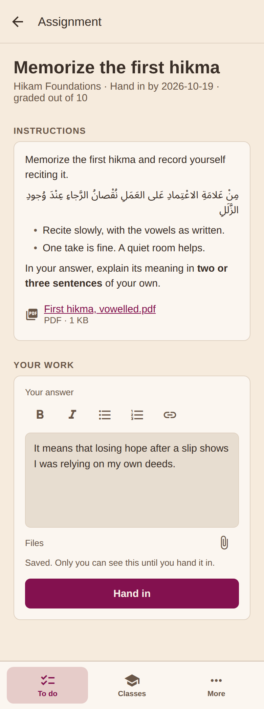<figcaption>On a phone</figcaption></figure>
<figure class="wd">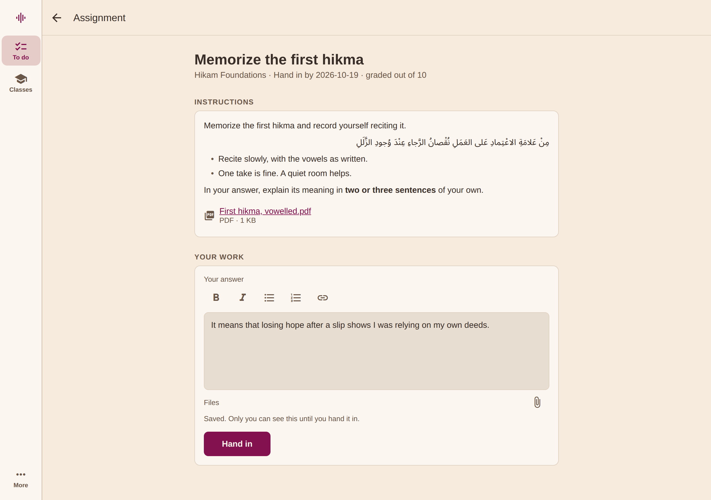<figcaption>On a computer</figcaption></figure>

An assignment is work your teacher sets for the whole class: a reflection, a
recitation, a worksheet. It appears on **To do** with the date to hand it in by,
and opens to your teacher's **instructions** and any **files** they attached — a
worksheet to print, a reading, a recording to listen to. Tap a file to open it.

**Your work** is under the instructions:

- **Your answer** — write it right there. Bold, italics, lists and links are on
  the bar above the box, and Arabic runs right to left. Sometimes the answer is
  all there is: a question put to the class, a few sentences. An answer can be
  up to 20,000 characters, about 3,000 words; longer work goes in a document.
- **Files** — tap the paperclip to add a document, a picture or an audio
  recording. On a phone it asks where from: **Choose files**, or **Take a
  photo** of a page you wrote out by hand. Up to ten files, 25 MB each; no
  video. Tap a file to open it, and the bin beside it to take it off.

A file opens in a tab of its own. One your browser cannot show there — a Word
file, or a PDF on a phone without a PDF viewer — is saved to your downloads
instead, under its own name.

Everything is saved as you go, on the server — start on your phone and finish on
the website, or leave and come back later — and nobody sees it until you hand it
in. If you try to leave while a file is still uploading, the app asks first,
because leaving stops the upload.

When it's ready, tap **Hand in**. It needs an answer, a file, or both. Your
teacher sees exactly what is on your screen at that moment.

**Changed your mind?** Until the due date, and while your teacher hasn't
returned it, tap **Take back**, beside what you handed in, change what you need
to, and hand it in again.

**Late.** If your teacher accepts late work, you can still hand it in after the
due date until the date the screen gives you; it is marked late. After that it
is **missed**, and the screen says so. If you need more time, ask your teacher —
they can give you a date of your own.

<figure class="ph">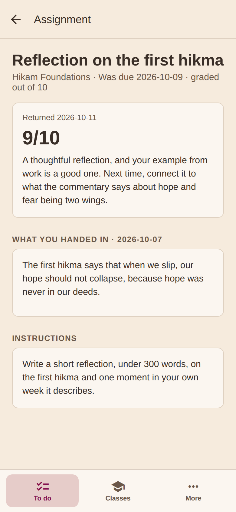<figcaption>On a phone</figcaption></figure>
<figure class="wd">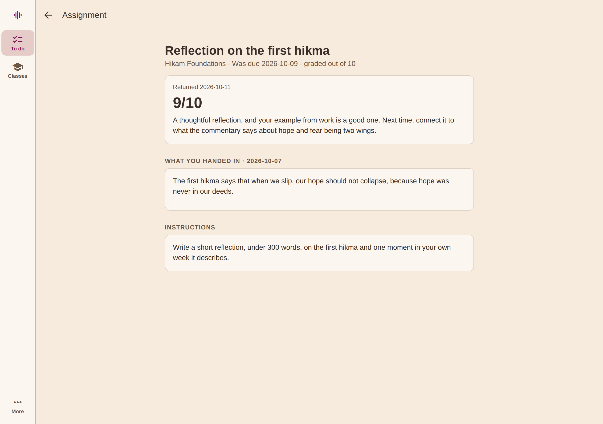<figcaption>On a computer</figcaption></figure>

**Returned.** When your teacher returns your work, your grade and their feedback
appear at the top, and the app tells you it's back — never the grade itself,
because a lock screen isn't private. You see a grade only once it is returned.
If your teacher asks for **another try**, the assignment goes back on To do with
a new date, and your first attempt and its feedback stay underneath.

Now and then an assignment is marked **not required** for you, with your
teacher's reason. You can still read it.

## 1.6 Your classes

<figure class="ph">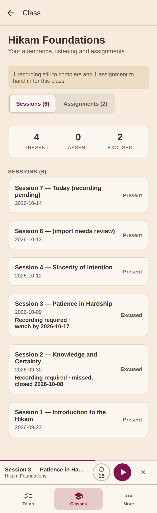<figcaption>On a phone</figcaption></figure>
<figure class="wd">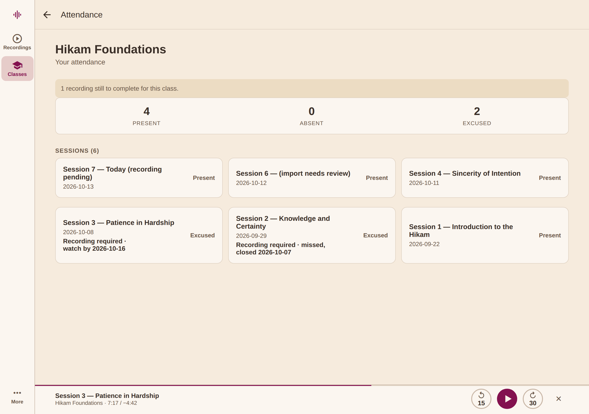<figcaption>On a computer</figcaption></figure>

Tap **Classes** in the navigation to see the classes you're enrolled in — each
one shows your attendance and your assignments at a glance. Classes that have
finished wait in a closed **Finished** section at the bottom; tap it to open it.

Tap a class to open its page. A line at the top says what you owe in it, and it
has two tabs:

- **Sessions** — **your own attendance**. At the top, one line counts the
  meetings you were **present** for, **absent** from, and **excused** from.
  Below it, every meeting your teacher recorded you in, newest first, with the
  date and your own mark. Where you were excused, the row also says that a
  recording was required and whether you've completed it.
- **Assignments** — every assignment in the class and where it stands: to do,
  handed in, returned with its grade, or missed, under a line counting what you
  handed in and what you missed.

Two things this page is not: it isn't where you play a recording (that's
**To do**), and it never shows anyone else's attendance or work.

## 1.7 Changing your password

Tap **More**, then **Change password**. The app emails you a link to set a new
one — the same kind of link you used when your account was first created. Your
account is created for you by the institute; you can't sign yourself up, and
there's nothing to create here.

## 1.8 Playing on a spotty connection

The app is built to survive a bad signal. If you mark a recording complete while
you're offline or your connection drops, the app **holds onto that** and syncs it
the moment you're back online — even if you close the app in between. You may
briefly see a "pending" state; that just means "saved on this device, not yet
sent." You don't have to do anything; it sorts itself out.

Streaming the recording itself does need a connection, so for a long class on
the go, a stable network (or Wi-Fi) is your friend — and audio only needs far
less of it than video. Where you got to is saved even if your phone is locked
and the signal comes and goes; it reaches your account the next time the app
is open with a connection.

## 1.9 Notifications

The app can send you five kinds of message, and no more. Tap **More**, then
**Notifications**, to turn any of them off:

- **A recording is ready for me** — when a class you were excused from has a
  recording for you. Worth leaving on: it's the only way you'll know
  one has appeared.
- **Last day for a recording** — on the morning of the day a recording closes, if you
  haven't finished it.
- **New assignments** — when a teacher posts an assignment for you, or moves
  its due date.
- **Last day to hand in** — on the morning an assignment is due, if you haven't
  handed it in.
- **Work returned** — when your teacher returns your work, asks for another
  try, or changes a grade they returned.

All of them start switched on. There's deliberately no message *after*
something closes: by then there'd be nothing you could do about it. **Tapping a
message opens what it's about** — the recording or the assignment. On an
Android phone the app's messages are listed as **Class alerts and deadlines** in
its notification settings.

A message is shown whether the app is open or closed, on the phone and on the
website. While you're in the app — playing a recording, say — it appears as a banner,
without a sound.

Your choices follow you — they apply on every device you sign in on. Reaching
this device needs its permission as well. The app offers to set that up once, on
To do after you sign in; you can also tap **Enable
notifications** on this screen at any time. If it says they are blocked, use **Open settings** on a
phone, or allow them from the site settings behind the icon in your browser's
address bar. If it says this device can't show them at all, either the browser
doesn't support them or setting them up didn't finish — try again from this
screen, and if it keeps saying that, tell Faisal.

---

# Part 2 — For staff

*Managers and admins both use this section. A few actions are admin-only and are
marked; managers see only the courses they've been assigned to.*

## 2.1 Signing in and getting approved

Staff sign in differently from students. On the sign-in screen, use **Sign in
with Google** with your Sabeel Google account. Any other Google account is
turned away, and the sign-in screen says so.

**The first time, you'll wait for approval.** New staff accounts start as
*pending* — an administrator has to approve you and choose your role before you
can do anything. The screen updates by itself the moment they do; you do not
need to sign in again. (If you're the very first administrator, that step was
done for you during setup.) Once approved, you agree to the institute's rules,
once, before anything else.

## 2.2 Today — what's waiting

<figure class="ph">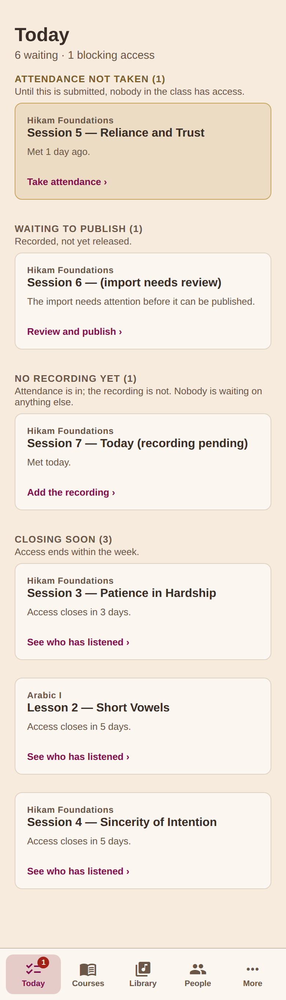<figcaption>On a phone</figcaption></figure>
<figure class="wd">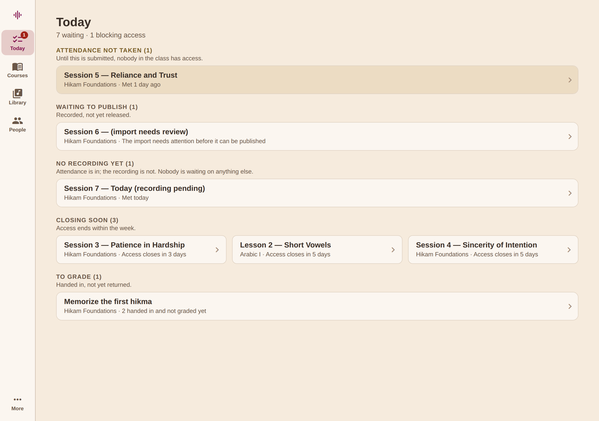<figcaption>On a computer</figcaption></figure>

The app opens on **Today**: everything across your courses that is waiting on
you, most urgent first, under a heading that says what to do. Every row is a link
straight to the screen where you do it, and says which class it is and how long
it has waited.

- **Attendance not taken** — a class has met and nobody has submitted the
  register. This is first and it's the one entry the screen tints, because until
  it's submitted **nobody in that class has access to the recording** — and
  nothing else on any screen would tell you.
- **Waiting to publish** — a recording is added but not out: still a draft, an
  import that needs attention, or one that was published and has since been
  unpublished or archived.
- **No recording yet** — attendance is in, the recording isn't.
- **Closing soon** — access to a recording ends within the week; a good moment
  to see who still hasn't finished.
- **To grade** — work handed in and not yet graded, in the courses you manage
  (an admin sees it only for courses they are a manager of, so it never buries
  the registers). It is never in the count on the tab. Tap a row to grade
  (Section 2.15).

The number on the **Today** tab counts what is blocking access right now: a
register not yet submitted, and a recording that was published and has since
been taken back — unpublished, or archived before its due date. A
draft that has never been published is waiting on you but is blocking nobody, so
it is in the list without being in the count. Archiving *after* the due
date took nothing away from anyone, so it is simply filing and says nothing
here.

If you run more courses than one screen can watch at once, Today says so above
the list — the rest are still there under **Courses**, they are just not in this
count.

A row disappears the moment you close the gap, and the count goes with it. An
empty Today is the answer, not a blank screen: it means attendance is in, every
recording is published, nothing closes this week, and no work is waiting to be
graded.

The rest of the navigation is the structure: **Courses** (cohorts and their
courses for an admin, your own courses for a manager), **Library**, **People**,
and **More**.

## 2.3 Cohorts, courses, and a course at a glance

The structure is **Cohort → Course → Session → Recording**, with **assignments**
on each course too. A **cohort** is a term or intake (like "Autumn 2026"). A
**course** is a subject taught over that term. A **session** is one dated
meeting of the course, and a **recording** is that meeting as the class made it:
audio, and often video too. An **assignment** is work set for the course
(Sections 2.14 and 2.15).

<figure class="ph">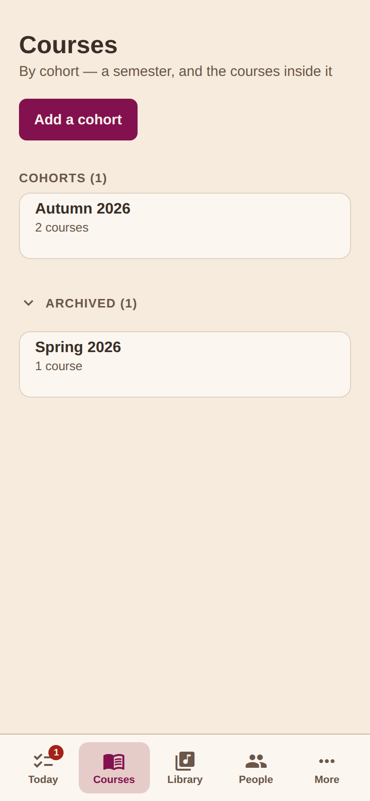<figcaption>On a phone</figcaption></figure>
<figure class="wd">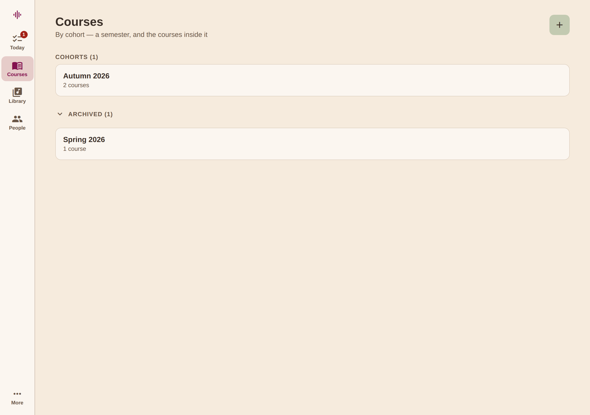<figcaption>On a computer</figcaption></figure>

Finished terms move into an **Archived** section at the bottom of the cohort
list — tap the heading to open it.

Open a cohort to see **its courses**, and open a course to work with it.
Archived courses wait in a closed **Archived** section at the bottom; tap the
heading to open it. The same goes for **Your courses**, a manager's list.
Shaping the structure is for **admins only**: the **pencil** beside the cohort's
name renames it, and **Settings**, under the courses, archives it — the same
way a course is renamed and archived from the course page. Archiving a cohort
turns off every course in it; reactivating puts each course back to the setting
it had.

<figure class="ph">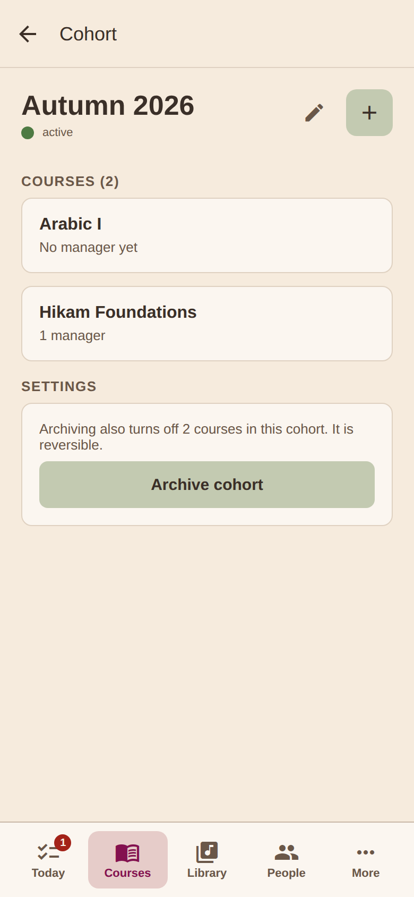<figcaption>On a phone</figcaption></figure>
<figure class="wd">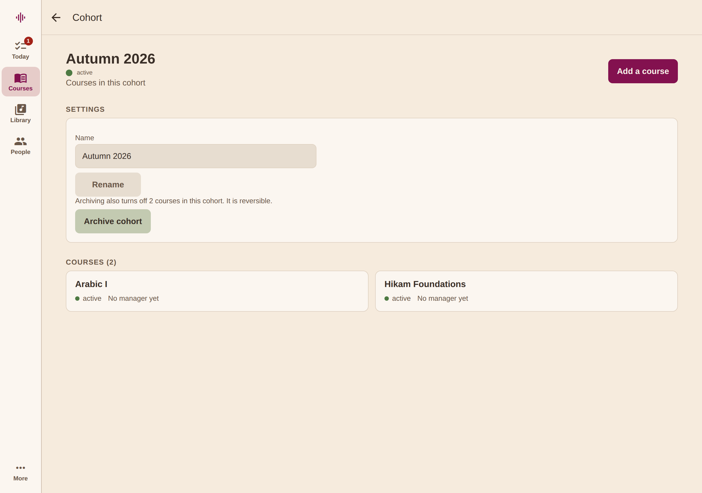<figcaption>On a computer</figcaption></figure>

The **course page** is your dashboard for that course:

<figure class="ph">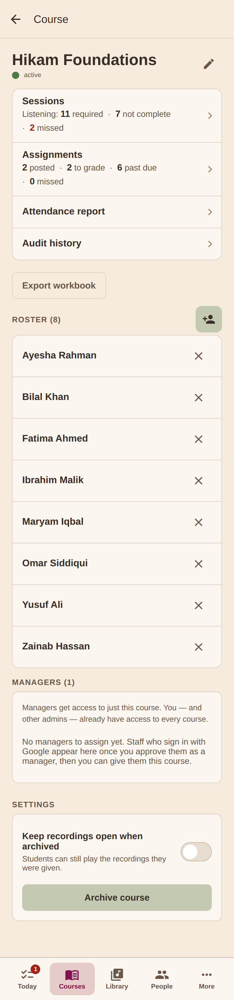<figcaption>On a phone</figcaption></figure>
<figure class="wd">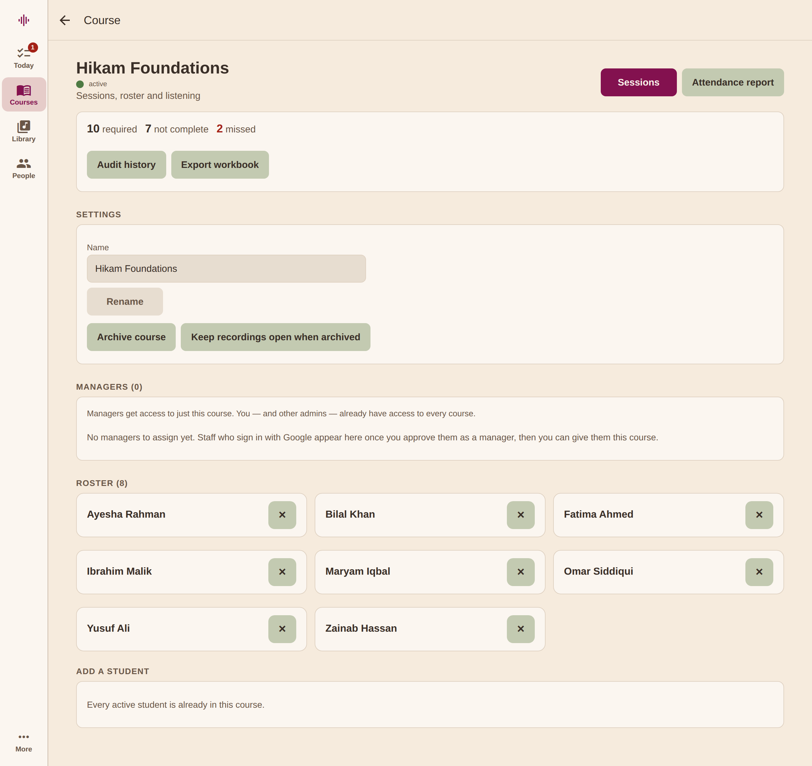<figcaption>On a computer</figcaption></figure>

- **Sessions**, **Assignments**, **Attendance report** and **Audit history**
  are rows at the top, each opening that part of the course: the meetings,
  where attendance and recordings live (Section 2.4); the assignments, written
  and posted (Section 2.14), graded and returned (Section 2.15); attendance and
  catch-up across the whole course (Section 2.9); and the course's history.
  **Sessions** carries the course's listening at a glance — *N required · not
  complete · missed* — and **Assignments** counts what is posted, waiting to be
  graded, past due and missed.
- **Export workbook**, under them, downloads the whole course — every student,
  session, register and required recording — as one Excel file (Section 2.13).
- **Roster** lists the enrolled students, one line each. Tap a student to see
  their personal ledger for the course (Section 2.8). The **+** on its heading
  adds students: it lists everyone not in the course, and stays open while you
  add several. The grey **×** on a row takes that student off the course, after
  asking — their history is kept, and you can add them back.
- **Managers** (admins) lists the staff, with a tick on each who manages *this*
  course; tap a row to tick or untick it. Everyone ticked gets the course's
  reminder when attendance has not been taken, and its work to grade on
  **Today**. Managers only ever see and act on the courses they're ticked on
  here — being in a cohort grants nothing by itself. Admins see every course
  already; tick one who teaches the course, and it is marked *admin*. A
  manager who has been disabled stays ticked on their courses, marked
  *disabled*, until you untick them.
- **Settings** (admins), at the bottom: **Keep recordings open when archived**
  decides whether an archived course's recordings stay open to the students they
  were required of, and **Archive course** ends the term. A recording whose due
  date came while the course was archived with its recordings closed reads
  *Closed* in every ledger and workbook, never *Missed*, even after the course
  is opened again: its students could not play it. The **pencil** beside
  the course's name renames it. A manager's own course page has neither
  Managers nor Settings.

## 2.4 Sessions, attendance, and adding a recording

<figure class="ph">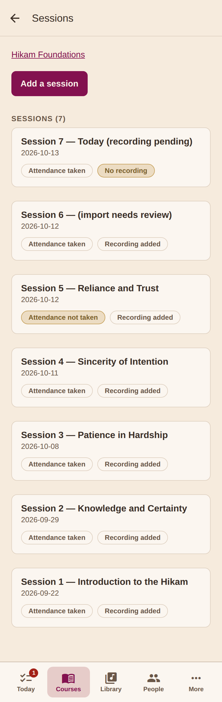<figcaption>On a phone</figcaption></figure>
<figure class="wd">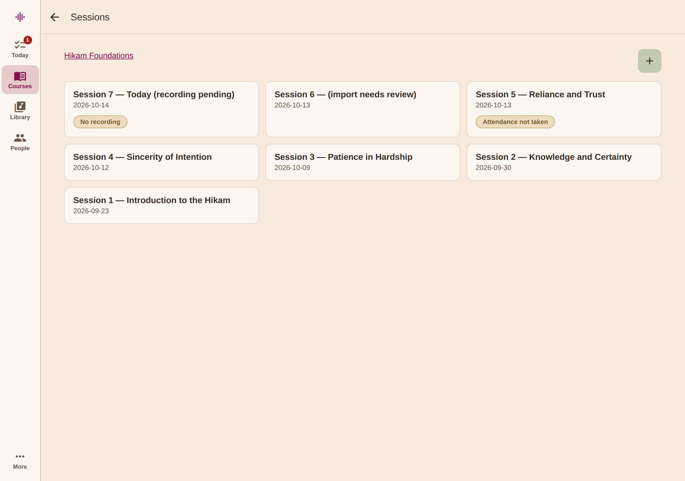<figcaption>On a computer</figcaption></figure>

A **session** is one class meeting. Create one for each meeting with the **+** —
give it a title, its date, and a **Due by** date. Each session's row says what is
still outstanding — **Attendance not taken**, **No recording** — and nothing
once it is done.

**The "Due by" date is required, and it matters more than it looks.** It is
the day the recording *closes* to the students you excused — after it, they can
no longer play it. It fills in automatically as a week after the meeting (or
today, if the meeting was long enough ago that a week later has already been and
gone); change it to whatever suits. You can't *move* it into the past, and you
can move it forward later to reopen a session for someone who needs longer.
Everything else about a closed session stays editable — fix a title or a date on
a session whose due date has passed and the date simply stays as it is.

The **course name under the heading is a link** — on the sessions list, on a
session, and on the attendance report. Tap it to go straight back to the course.
The back arrow takes you one step back the way you came; this takes you to the
course itself, however many steps in you are, and it works even when you have
opened a session from a link somebody sent you.

Open a session to work with it:

<figure class="ph">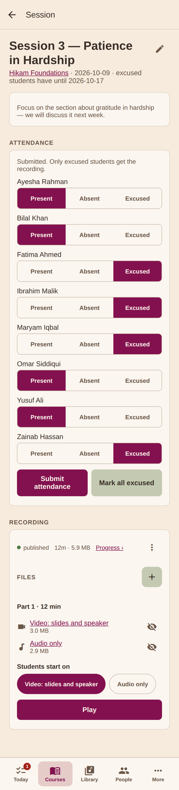<figcaption>On a phone</figcaption></figure>
<figure class="wd">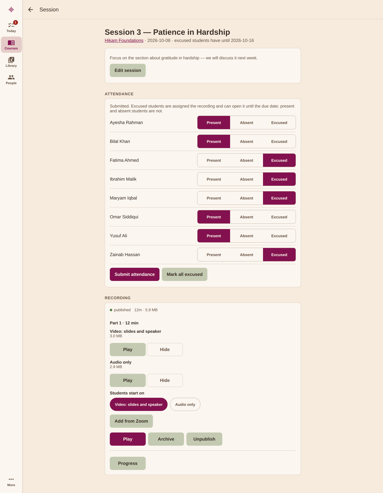<figcaption>On a computer</figcaption></figure>

**Take attendance.** For each enrolled student, choose **Present**, **Absent**,
or **Excused**, then tap **Submit attendance**. Everyone starts as *Present*, so
often you only flip the few who missed. You can re-submit a corrected attendance
later and everything updates automatically.

**Excusing a student is what gives them the recording.** It is the only mark that
does:

- **Present** — they were there. Nothing is required of them, and the recording
  is not opened to them.
- **Excused** — they missed it with your permission. The recording opens to them
  and playing it is required, until the due date.
- **Absent** — they missed it without being excused. Nothing is opened to them.

So **Mark all excused** is the one-tap shortcut for "everyone must catch up on
this one." And if someone genuinely needs to catch up on a class you marked them
absent for, just change their mark to Excused and submit again.

One limit worth knowing: you can't excuse anyone *new* for a session whose due
date has already passed — it would hand them something they could never open.
Move the date forward first, then excuse them. Correcting a closed session in
every other way still works, including changing someone from excused to present
or absent, so the attendance record never becomes uncorrectable.

**Add the recording.** In the same screen, **Upload files…** from your own
computer or phone, or **Import from Zoom**. The recording takes its title, date,
and notes from the session, so you don't retype them. Once there is a
recording, the **+** beside its **Files** adds more: **Upload files**, or **Add
from Zoom** — the second half of a class in another meeting, say.

**Editing the session.** The **pencil** at the top opens its title, date, **Due
by** date and notes. An admin deletes a session from there too, once it has no
recording.

**Importing from Zoom.** Every class in a cohort is held in the same recurring
Zoom meeting, so every recording in the list has the same title. What tells them
apart is when it ran: each card shows the date and the hours, for example
*2026-10-08 · 6:02–8:18 PM*, so the 6 pm and 7 pm classes of one evening are two
different cards. The list opens showing only recordings from the session's own
date. Untick **Only recordings from this session's date** to choose a date
range and load it. Dates and hours are institute time (America/Chicago), so an
evening class is listed under the day it was held.

Zoom keeps several files of one meeting, and each card lists them all:
**Video: slides and speaker**, **Video: slides only**, **Audio only**, each
with its size. If the meeting was stopped and restarted, its files come in
**stretches** — *Stretch 1*, *Stretch 2* — each with its own hours; each
stretch you import becomes one **part** of the recording, in order. Tick the
files you want, or use a **quick pick** on the card — **Audio only**, **Video
and audio**, or **Everything** — which ticks those files in every stretch at
once. A file Zoom is still processing cannot be ticked until it is ready.
**Filters** — the sliders beside the search — show recordings already imported
too, narrow the list to one kind of file, or bring back recordings under two
minutes; a line under the search says when they are doing any of that.

Under the list, **Selected** adds it all up before anything is copied: how many
files, their size, how much class they cover, and roughly what they will cost
to store each month. **Video is where that cost is** — a two-hour class is tens
of megabytes as audio and a gigabyte or more as video — so import video when the
class needs it (slides, a whiteboard), and audio only when it doesn't. Tap
**Import N files** and you're taken back to the session; the files copy from
Zoom on their own, usually in under a minute, and the session shows each one as
*copying from Zoom…* until it arrives. A file already imported is marked so,
with a link to where it went, and can't be imported twice.

**The recording's files.** On the session, each recording lists its parts in
order and, under each part, its versions, with their size or state:

- **The file's name** is a link that plays it, so you can check it.
- **The eye** hides a file from students without deleting it, and tapped again
  puts it back — for example a slides-only version nobody needs. A published
  recording must keep at least one file students can play.
- **The red bin** deletes a file, so a bad one can be replaced. A file students
  can play is removed only from a draft; once a recording has been published
  its files are hidden, not removed.
- **The arrows** on a part's line fix the order if the parts came in wrong.
- **Students start on** chooses which version the player opens on when there
  is more than one — students can switch at any time.

Above the files, one line gives the recording's status, its length and size, and
**Progress ›** (Section 2.6). The **⋮** at its end holds the moves that take it
away from students or back to work on — **Archive**, **Unpublish**, **Back to
draft** — and **Delete**, for an admin, or **Discard** for an empty draft.
**Publish** and **Play** are the buttons under the files.

If a copy from Zoom fails, the file says why and **Retry import** tries again.

**Uploading files.** **Upload files…** takes one file or several at once:
audio as M4A, MP3 or WAV (up to 300 MB each), and video as MP4 (up to 8 GB
each). The chosen files are listed before anything is sent. Each one becomes
a new part, in the order listed, unless you tap **Version of Part N** to make
it another version of a part already there — for example a phone video of the
whiteboard beside the Zoom audio. A part takes one uploaded video and one
audio file. Then tap **Upload N files**.

Each file shows how far it has got. Big files go up in pieces, and a dropped
connection is waited out for up to three minutes, so it costs that time, not
the whole upload. Keep the page open meanwhile. When a file has arrived
the app checks that phones can play it. A video in another format — an
iPhone's HEVC video is the usual one, and a camera's 10-bit video another — is
refused with what to do instead: export it as MP4 (standard 8-bit H.264) and
upload that. A video with no sound is fine. Files can be added to a published
recording too; students see a new one only once it has arrived.

**Stay on the page until the files say Added.** Leaving it, or tapping **Stop
uploading**, stops the upload and keeps nothing of the unfinished file. A file
that is still uploading, or that failed, can be taken off with its **bin** at
any time, even on a published recording, since no student ever saw it.

**Or say it wasn't recorded.** Some classes aren't, and until you say so the app
keeps asking: **Today** shows the session as waiting for its recording, and you
get the "attendance still not taken" reminder every morning. **This class was not
recorded** stops both. It changes nothing else — the register stays exactly as it
is, and the marks in it still count — and **It was recorded after all** puts the
session back if you change your mind.

<figure class="ph">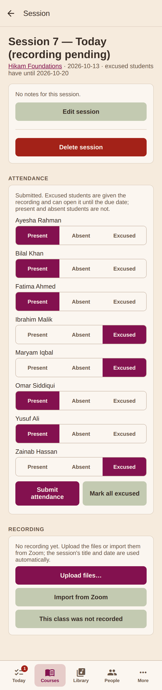<figcaption>On a phone</figcaption></figure>
<figure class="wd">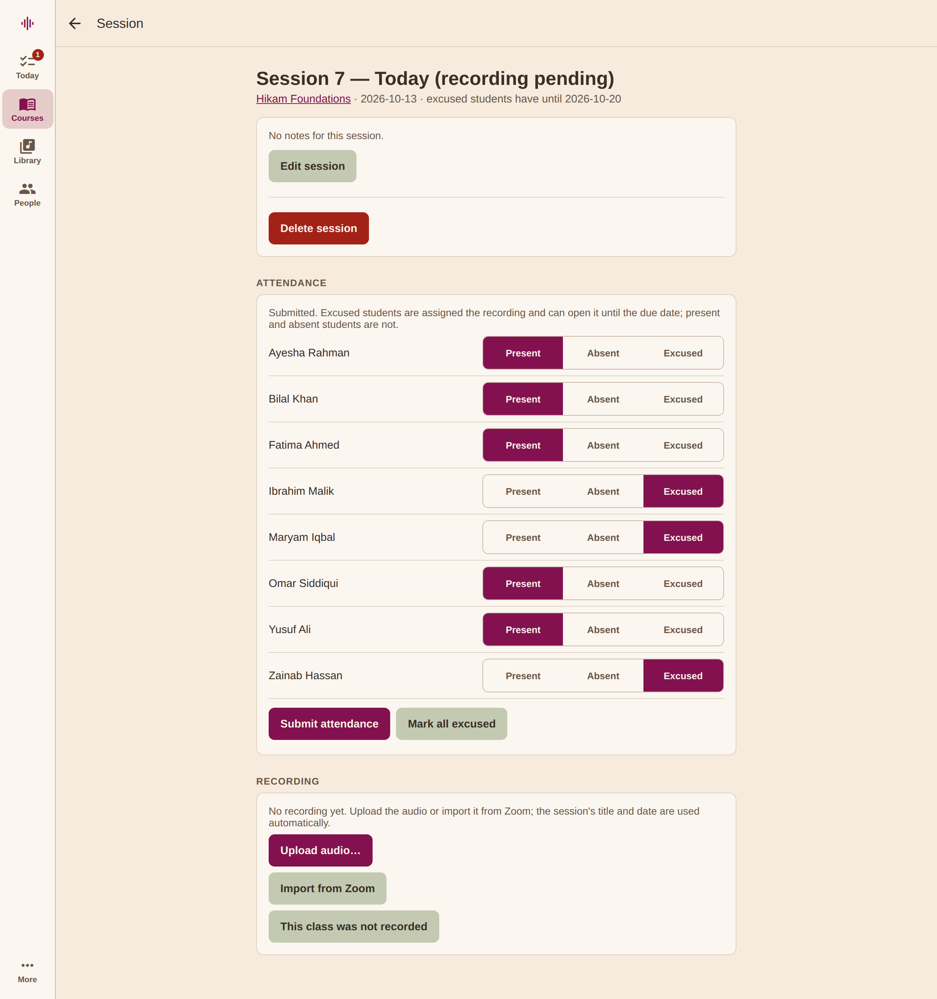<figcaption>On a computer</figcaption></figure>

Each recording moves through a few states:

- **Draft** — added, not yet visible to students. You can add, remove and
  replace its files freely.
- **Published** — live. The students you excused can now play it, and are on
  the hook for it. Publishing needs at least one file students can play and
  nothing still copying or failed, and it is blocked if the session's due date
  has already passed, because nobody would be able to open it.
- **Needs attention** — flagged for a problem (for example, a Zoom import that
  failed). Publish is blocked until it has a file students can play and no
  failed file: retry the import, or remove the failed file and upload the
  class instead.
- **Unpublished** — pulled back from students after being live. It goes back to
  Draft to be fixed, then out again.
- **Archived** — closed for good, one recording at a time. Like unpublishing,
  it closes the recording to everyone who was excused, so **Today** raises it
  if you archive one whose due date has not passed yet. One tap puts it
  back — while that date is still ahead. Once it has passed, Publish is greyed
  out and the card says why: publishing then would give nobody access, so move
  the session's **Due by** date forward first, which reopens it for everyone
  excused.

**Archiving or unpublishing a recording takes it out of the course totals.**
Everything that happened on it — who completed it, who missed it — leaves the
course page's counts, the attendance report's catch-up columns and each
student's per-course counts, as if it had never been required. The
recording's own **Progress** page still keeps its rows (Section 2.8),
but nothing sums it into the term. So this is not how a term ends: **to close a
term, archive the course** (Section 2.3), which keeps every count and only
decides whether its recordings stay open. Reach for archiving a recording
only when that recording itself should be withdrawn.

## 2.5 How a recording becomes required

Here's the rule that runs the whole ledger:

> **A recording opens to the students marked EXCUSED for its session, and to
> nobody else** — automatically, once the recording is **published** and its
> attendance has been **submitted**. The same fact makes it required.
> It closes again when the session's **Due by** date passes.

You never give students a recording one by one; the attendance sheet decides who gets it. If
you correct attendance — flip someone from excused to present, or the reverse —
access and obligations update to match, and any progress or completion already
recorded is kept.

- **Being enrolled opens no recording.** A student in the class who was
  present, or absent without being excused, cannot play the recording at all.
  (Enrolment does give a student the course's assignments — Section 2.14.)
- **The due date closes it.** After that day the student sees the recording
  on their list marked *Missed*, with the date it closed, and can no longer play
  it. Move the session's Due by date forward to reopen it. Students see the
  date as **Watch by** on a recording with video and **Listen by** on one that
  is audio only.
- **A student who joins late** wasn't on the roster when earlier attendance was
  taken, so they are **not** retroactively given those older sessions. On an
  earlier session's register they appear as *not marked* — correcting somebody
  else's mark there leaves them that way. If you *do* want a latecomer to catch
  up on an earlier one, open that session, mark them **Excused**, and re-submit
  attendance.
- **Unpublishing** a recording closes it to everyone again.

## 2.6 The recording ledger — who has caught up

<figure class="ph">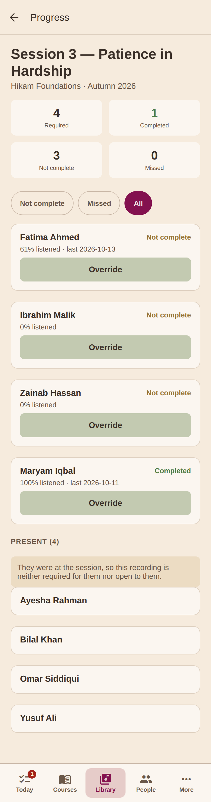<figcaption>On a phone</figcaption></figure>
<figure class="wd">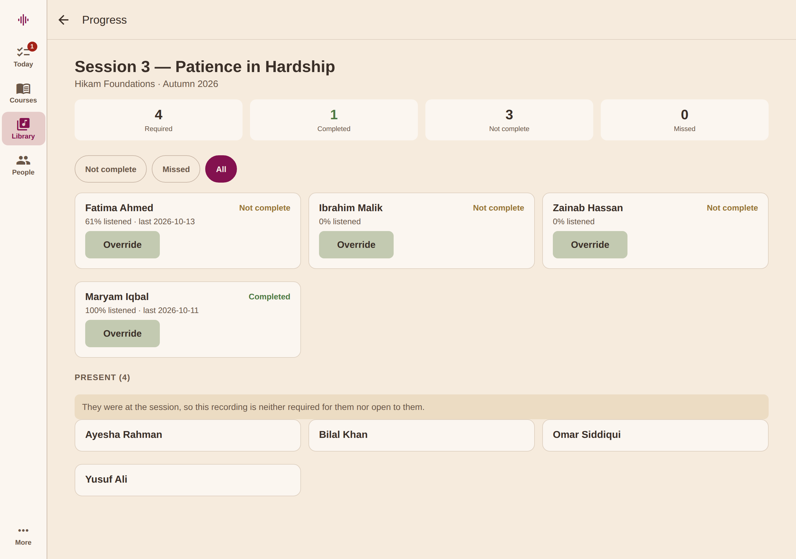<figcaption>On a computer</figcaption></figure>

Open a recording's **Progress** (from its session, or from the
library) to see exactly where things stand. Up top, one line of counts:
**required** (the students you excused, the only ones who can open it),
**completed**, **not complete**, and **missed**. An archived or unpublished recording keeps this
page: the counts and rows are the record as it stood when it closed, and a
grant that was still open then reads *Closed (recording archived)*. It is the
only place that record survives — the course totals no longer include it
(Section 2.6).

**The required list** comes first — the students you excused, each with their
status (**Completed**, **Not complete** or **Missed**), how much they've played
and when they last played it. The **filter chips** — *Not complete / Missed /
All* — open on **Not complete**, so you land on exactly the people who still
need a nudge.

Below it, closed sections hold everyone else, each with its count — tap one to
open it:

- **Present** — the students who were there. The recording is neither required
  for them nor open to them.
- **Absent** — marked absent rather than excused, so it was never opened to them.
  To let one of them catch up, mark them **Excused** on the session and submit
  again.
- **Excused, access closed** — students you excused whose access has since been
  withdrawn: they were unenrolled from the class, or the recording was
  unpublished or archived. Nothing is required of them and they can't open it.
  Re-enrolling them, or publishing the recording again, restores it — for
  anything still inside its due date. A session whose date has already
  passed stays closed, so nobody comes back to an obligation they had no chance
  to meet.
- **Also listened** — progress from someone who no longer holds the recording,
  for example a student you excused, who played it, and whom you then corrected
  to present. Kept as history.

For a copy you can keep or hand on, export the course's **workbook** from the
course page (Section 2.13); its **Detail** tab is this ledger for every
recording in the course.

## 2.7 Overriding a completion

<figure class="ph">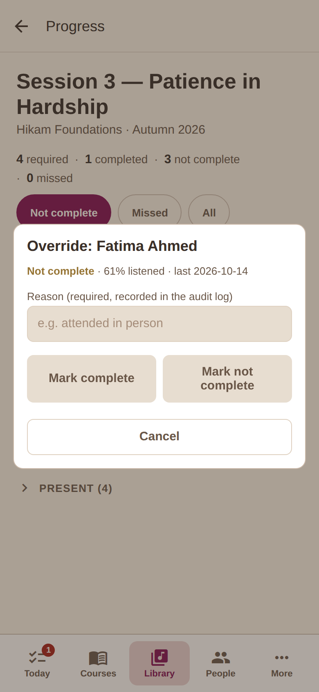<figcaption>On a phone</figcaption></figure>
<figure class="wd">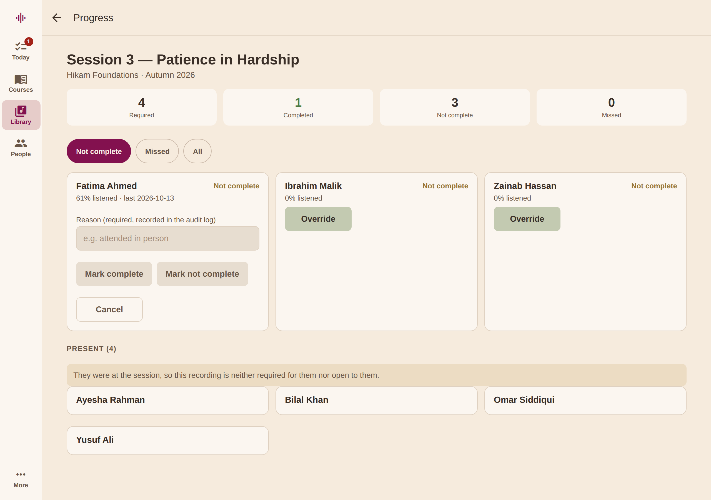<figcaption>On a computer</figcaption></figure>

Sometimes the ledger and reality differ — a student caught up in person, or
played it on someone else's device. Tap the **pencil** on their row to set the
status yourself:

- Enter a **reason** — it's **required**, and it's written into the audit history
  so there's always a record of why. "Caught up with the teacher one-on-one" is a
  good example.
- Choose **Mark complete** or **Mark not complete**.

An override **wins over the student's own mark**. If you mark someone complete and
they later fiddle with their own status, your override stands. To undo it, tap
the pencil again and **Remove override** — the status falls back to whatever the
student's own mark says. Every override, and every removal, is audited.

**The student sees it too**, with the reason you typed — on their player, in
their list, and in what the app counts as outstanding. Somebody you have marked
complete stops being asked to catch up and stops getting the last-day reminder, and
they cannot unmark what you set. Write the reason for them as much as for the
record: "Caught up with the teacher one-on-one" is read by the person it is
about.

## 2.8 One student's ledger

From a course's **Roster**, tap a student to see *their* view: the recordings
they're required to play in that course, each with its status, and the same
action-first filters. It's the per-person counterpart to the per-recording
ledger in 2.6 — the right screen when a parent or student
asks "where do I stand?" Tap the student's **name** at the top to open their
profile — the same page People opens — for their access, every course they are
in, and their history.

## 2.9 The attendance report

<figure class="ph">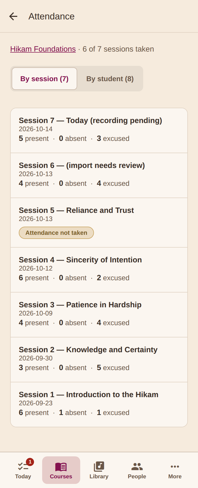<figcaption>On a phone</figcaption></figure>
<figure class="wd">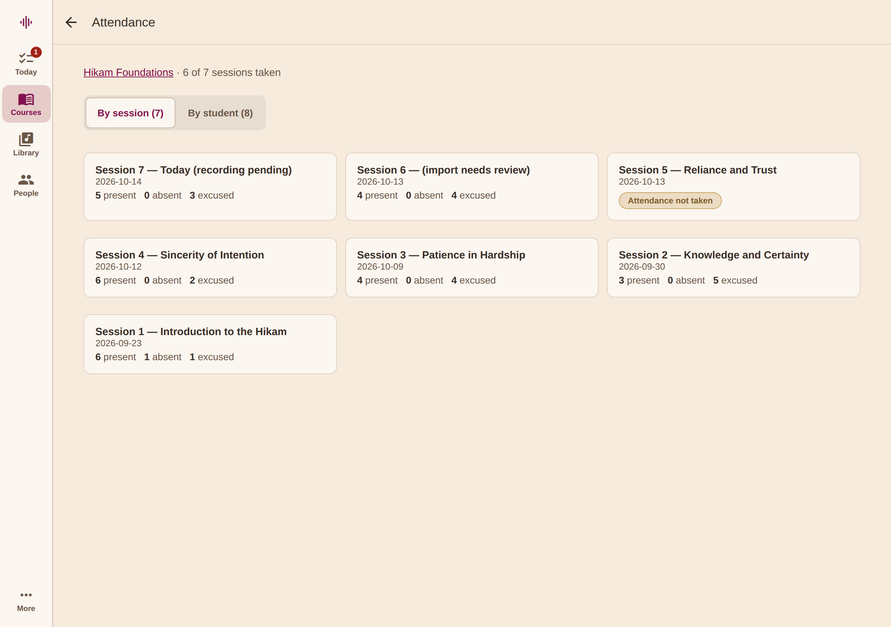<figcaption>On a computer</figcaption></figure>

Reached from the course page, the **attendance report** rolls the whole course up
two ways — a toggle switches between them:

- **By session** — every session with its present / absent / excused counts, and
  a clear flag on any meeting where attendance was never taken.
- **By student** — each student's attendance across the course (chronic absentees
  first), plus their **catch-up** status: of the recordings they were excused
  from, how many are complete and how many they missed. **Not marked** counts the
  registers taken while the student was in the class that hold no mark for
  them — a mark you could still give. A register taken before they joined,
  after they left or while they were out of the class is not counted.

The course **workbook** (Section 2.13) carries the same numbers in a form you
can keep: the **Students** and **Sessions** tabs are these two views, and the
**Register** tab is the roster with every mark.

**Tap any row to go straight to the detail.** A session opens that session — its
attendance roster and its recording; a student opens that student's progress
for the course. So the report is where you spot the problem, and one tap
is where you deal with it.

## 2.10 The recording library

<figure class="ph">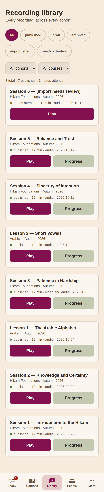<figcaption>On a phone</figcaption></figure>
<figure class="wd">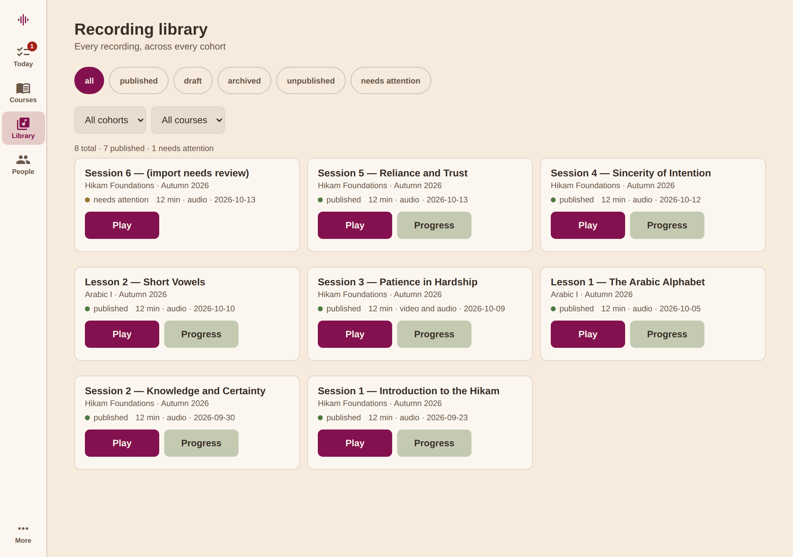<figcaption>On a computer</figcaption></figure>

The **library** is every recording you can see, across all your courses, in one
list with a count summary. It's the fastest way to answer "which recordings
still need their files?" or "what's flagged?" without walking course by course.
Admins see everything; managers see their assigned courses. Each row starts with
a large play button: **tap the row to play it**, and the small chart at its end
to see its **Progress**.

Three dropdowns narrow the list. Choose a **cohort** and leave the course alone
to see everything in that term; choose a **course** as well to see just that
course. The course list offers the courses in the cohort you chose — or every
course, each with its term, when no cohort is chosen — and the count line
describes whatever you have narrowed to. **Status** narrows to published, draft,
archived, unpublished or needs attention. The **×** after them appears whenever
something is narrowing the list and puts everything back.

## 2.11 People — managing students

<figure class="ph">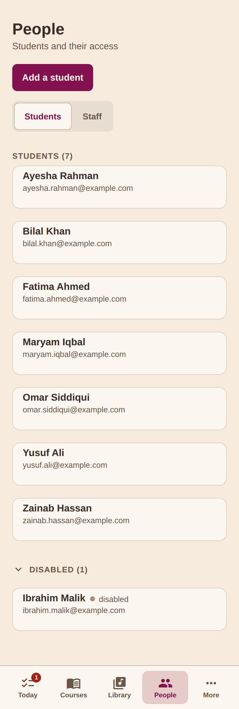<figcaption>On a phone</figcaption></figure>
<figure class="wd">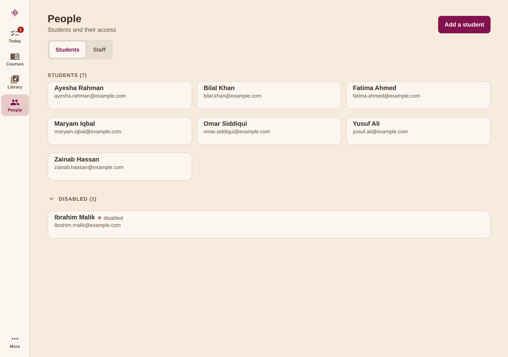<figcaption>On a computer</figcaption></figure>

**People** holds both populations. Admins get a **Students / Staff** switch above
the list; managers see the student directory and no switch, because approving
staff isn't theirs to do. The directory is the whole institute for every staff
member — a manager can look someone up before enrolling them, which they could
not do if the list were cut to the courses they already run. What a manager
cannot see is anyone's *progress* outside their own courses: open a student and
the page shows only the courses that manager runs.

To add a student, tap the **+**, enter their **full name** and **email**,
optionally **enrol them in a course** right away, and tap **Create account**. The
app emails them a link to set their own password — you never handle passwords.
The course list offers only courses that are running; an archived course, or one
in an archived cohort, is not listed there (you can still enrol someone into it
from the course's own page).

**Creating accounts is done on the website, not in the phone apps.** The **+**
in the figures above is a capture of the website at a phone's width; in the
Android app it is simply absent. This is a store
requirement rather than a limitation we chose, and it only affects *creating* —
changing roles, disabling an account and enrolling someone all work everywhere.

The list itself is just for finding someone. **Tap a student to open their
page**, where everything about them lives. Students you've disabled move out of
the main list into a **Disabled** section at the bottom — tap the heading to
open it.

### A student's page

<figure class="ph">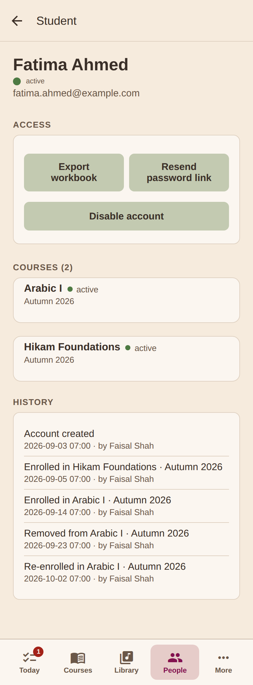<figcaption>On a phone</figcaption></figure>
<figure class="wd">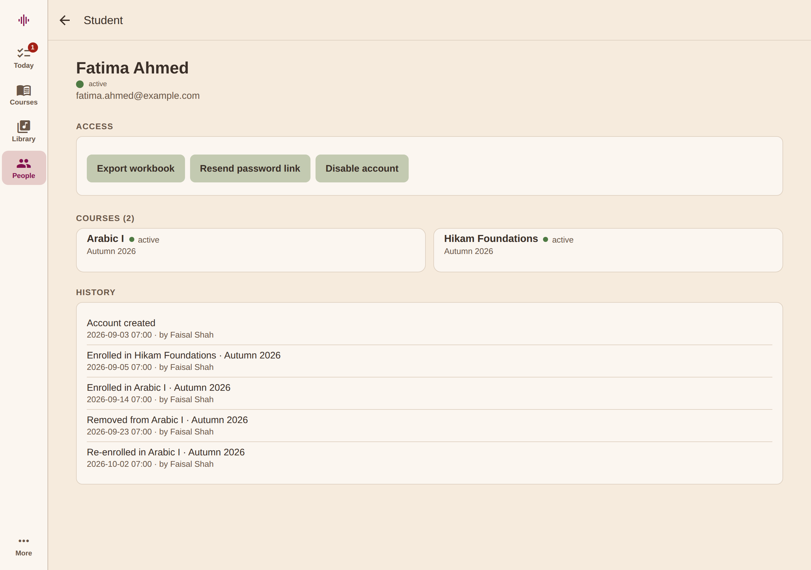<figcaption>On a computer</figcaption></figure>

It shows their name, address and whether they're **active** or **disabled**.
The **⋮** beside the name holds what can be done:

- **Resend password link** — if they lost the email or the link expired.
- **Export workbook** — one Excel file for this student across their courses
  (Section 2.13).
- **Disable account** — turns off access without deleting anything. (Disable,
  don't delete — deletion is a separate, deliberate, admin-only step.) Admins
  only; a manager's menu does not have it, because access spans every course.

Below that are **the courses they're in**. Tap one to open that student's
progress for it.

If you're a **manager**, this lists the courses *you* manage — it's headed
**Courses you manage** to say so. You aren't shown classes you don't run, so
treat it as your view of the student rather than their whole record. An admin
sees every course.

**History**, at the bottom, is the student's record from the day the account
was created: when it was made and by whom, then every enrolment, removal and
return, and every time the account was disabled or re-enabled — each with who
did it and when, in the institute's time. It is read from the same audit
history admins see (Section 3.3), so nothing here is a second record. A manager's
list covers the courses they manage; account changes are admin-only, and an
admin sees everything.

---

## 2.12 Notifications *(staff)*

Tap **More**, then **Notifications**. Managers get one message — and only one,
deliberately: students are told about assignments, but a teacher is not sent a
message for every hand-in, since **Today** carries the count.

- **Attendance still not taken** — a couple of days after a class meeting whose
  attendance you never submitted.

It goes to the people who manage the class, so if you manage none — which is
usual for an administrator — you have no switches here, and the screen says so.
A session marked **not recorded** stops sending it.

It's more useful than it sounds. Until attendance is submitted nobody has been
excused, so a recording you've already published is sitting there that not one
student can open. **Today** shows the same thing in the app, with a count on the
tab, so this message is a nudge rather than the only warning.

Reaching this device needs its permission as well. The app offers to set that up
once, on Today after you sign in; you can also tap **Enable notifications** on
this screen at any time. If it says they are blocked, use
**Open settings** on a phone, or allow them from the site settings behind the
icon in your browser's address bar.

## 2.13 Exporting a workbook

Two buttons produce every export the app has, and both make an **Excel
workbook** — one `.xlsx` file with several tabs — rather than a flat list. On a
phone the file goes to the share sheet, so you can send it to yourself or save
it; on a computer it downloads.

**Export workbook on a course page** covers the whole course:

- **Summary** — the course's cohort, status and managers, the size of the
  roster, how many registers have been taken, the attendance and catch-up
  rates for the class, how many required recordings are still open, how many
  assignments are posted, how much work waits to be graded, the average
  grade, and when the file was made and by whom.
- **Students** — one row per student: when they first joined and, if they
  have left, when, their attendance counts and rate, and their catch-up on
  excused sessions — required, completed, still open, missed deadline,
  closed. Sorted so the students with the most missed deadlines are at the
  top. A **Note** column flags registers they were never marked on, each time
  they were out of the class and came back, why any recording closed, and
  completions that came from a staff override.
- **Sessions** — one row per meeting: when its register was taken and the
  marks on it, the recording's status, when it was published and its due
  date, and how the excused students have done with it. A recording that has
  been archived or unpublished is noted as *withdrawn from the totals*.
- **Register** — students down the side, sessions across the top, one mark in
  each cell: **P**, **A**, **E**, a dot for a register never taken, a dash for
  a register that had no place for the student and holds no mark for them —
  a session before they joined, after they left or while they were out of the
  class, or a register taken while they were out of it.
- **Recordings** — the same grid for published recordings: whether each
  excused student completed it (and when), or is still open, missed the
  deadline, or was closed — with how much of the recording they have played.
- **Detail** — every required recording as its own row, with played, last
  played, completed at, and any override with its reason. This is the ledger
  of Section 2.6 for the whole course; filter it in Excel.
- **Assignments** — one row per posted assignment: when it was posted, its
  dates, how it is graded, and how the class stands on it — handed in, late,
  to grade, to return, returned, not in yet, past due, missed, not required —
  with the average grade. The same figures as the assignment's own page
  (Section 2.15).
- **Grades** — students down the side, assignments across the top: a
  returned grade in each cell (points as a number, so a column adds up in
  Excel), or where the work stands — *to grade*, *not in yet*, *missed*.
  Each student's totals and average grade are at the end of their row.
- **Definitions** — what every term in the file means, so the workbook explains
  itself to whoever you send it to.

**Export workbook on a student's page** covers one person across courses:

- **Summary** — their account, how many courses they are in, and their
  attendance, catch-up and assignment totals across all of them.
- **Courses** — one row per course, with the same enrolment, attendance and
  catch-up columns the course workbook gives each student.
- **Sessions** — every meeting in the time they were enrolled, in date order
  across courses, with their mark and — if excused — the recording's due date
  and outcome.
- **Recordings** — every recording they were required to play, with the
  evidence behind it.
- **Assignments** — their work on every assignment, soonest due first: where
  it stands, when they handed it in and whether late, the grade and when it
  was returned, and the feedback they were given.
- **History** — their record from the day the account was created: enrolments,
  removals and returns, account changes — each with who did it and when. It is
  the history the student's page shows (Section 2.11), plus the completion
  overrides the page leaves to each recording's ledger.
- **Definitions** — as above.

A manager's student workbook covers **the courses they manage**, and its
Summary says so on the **Scope** line — the same view of the student their
screens give. An admin's covers every course.

The file's **Definitions** tab reads:

| Term | Meaning |
|---|---|
| **Held** | Registers submitted in which the student was marked, whatever the session’s date: a newcomer marked on an earlier session’s register, to catch them up, counts too. A session whose register was never taken is not held for anyone. |
| **Present / Absent / Excused** | The mark on the register. Excused is the only mark that opens the recording and requires it. |
| **Attendance rate** | Present ÷ Held. |
| **Required** | Excused sessions whose recording is published — one recording the student must play and mark complete by its due date. A recording that has been archived or unpublished is withdrawn: it counts nowhere, and the Sessions tab says so. |
| **Completed** | The student marked the recording complete, or staff overrode it as complete (the override’s reason is recorded). |
| **Still open** | Not yet completed, and the due date has not passed. |
| **Missed deadline** | Not completed by the due date. Access has closed; nothing further can happen to it unless the date is moved. |
| **Closed** | Neither done nor missed: a required recording the student could not play when its date came, because they were out of the class or the class was archived with its recordings closed (or cannot play now, for either reason, with its date still ahead); an assignment still open when its course was archived. |
| **Catch-up rate** | Completed ÷ (Completed + Missed deadline). Open and closed items are not held against anyone. |
| **Played** | Time played as a share of the recording’s length. Evidence, not the gate — completion is the student’s own mark. |
| **Assigned** | Students an assignment went to, less any a teacher marked not required. Someone who left the class counts only if they handed something in first. |
| **Handed in** | Work given in, graded or not and late or not, and work graded on paper with nothing handed in. |
| **Late** | Handed in after the student’s due date: their own date, if they were given more time. |
| **To grade** | Handed in and not graded yet. |
| **To return** | Graded but not given back yet. The student does not see the grade. |
| **Returned** | Graded and given back. The grade is what the student sees. |
| **Not in yet** | Nothing handed in, and the due date has not passed. |
| **Past due** | Nothing handed in, the due date has passed, and late work is still taken. |
| **Missed** | Nothing handed in by the last day work was taken, or before the teacher stopped taking it. |
| **Not required** | A teacher let the student off the assignment, with a reason. It counts nowhere. |
| **Average grade** | Returned grades on assignments graded in points, each as a share of its points. Satisfactory and Needs work are not averaged. |
| **Times** | Institute time (America/Chicago). Dates are real dates; sort and filter them in Excel. |

The columns hold real dates and real numbers, not text — so they sort, filter
and add up in Excel. A rate shows a dash where there is nothing to divide by.

## 2.14 Assignments — writing and posting

<figure class="ph">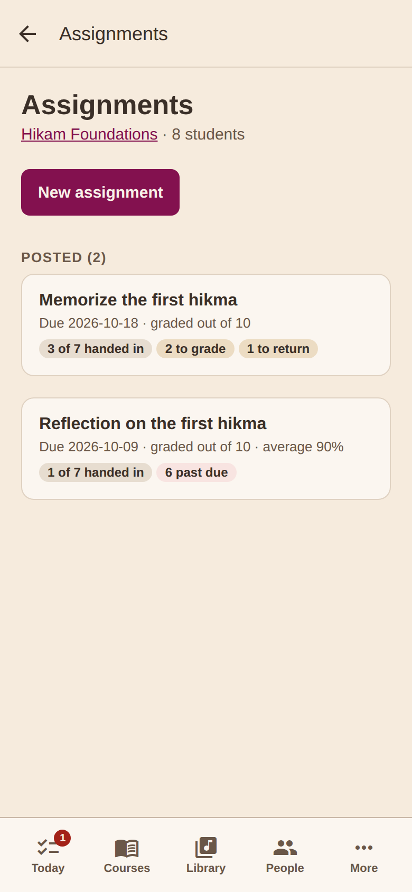<figcaption>On a phone</figcaption></figure>
<figure class="wd">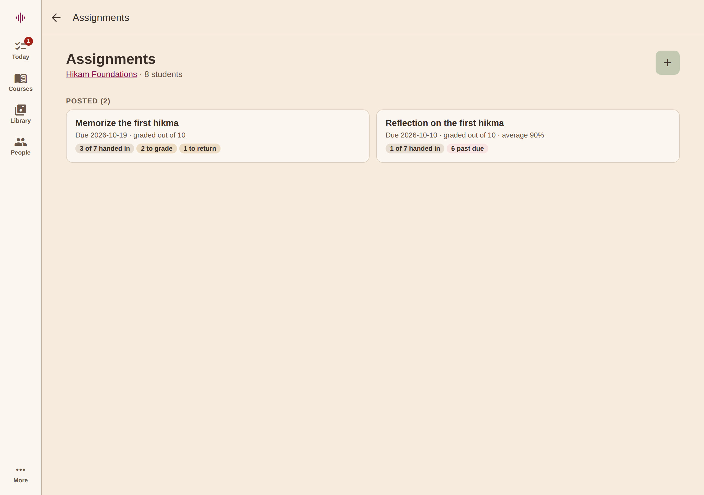<figcaption>On a computer</figcaption></figure>

**Assignments** on a course page lists the course's assignments: drafts first,
then the rest with the latest due date first. Each card says where the class
stands — how many have handed in, and what is waiting on you (**to grade**,
**to return**, in gold) apart from what is waiting on students (**past due**,
**missed**).

<figure class="ph">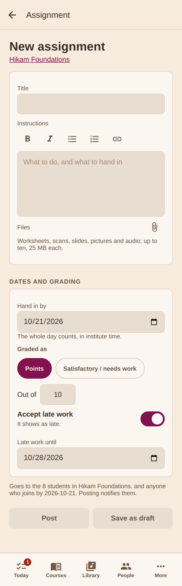<figcaption>On a phone</figcaption></figure>
<figure class="wd">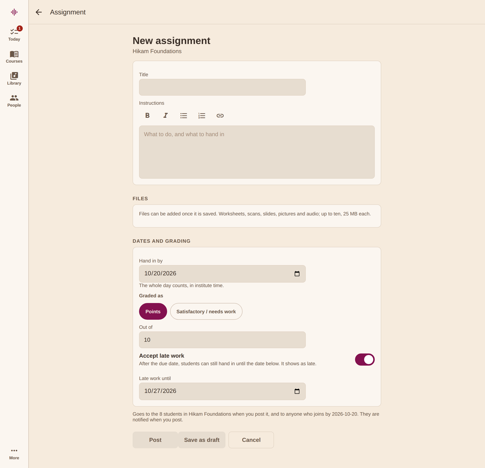<figcaption>On a computer</figcaption></figure>

Tap the **+** (New assignment):

- **Title** and **Instructions**. Bold, italics, both kinds of list and links are
  on the bar above the box, and Arabic runs right to left. Select some words and
  tap the link button to make them a link.
- **Files**: the paperclip adds worksheets, scans, slides, pictures and audio;
  up to ten, 25 MB each. Add them as you write — they are kept with the assignment when you save
  or post it, and thrown away with it if you leave without saving. **Post** and
  **Save** wait until every file is up. Audio you add for the class can be up
  to 15 minutes, and there is no video.
- **Hand in by** — a week from today to begin with. The whole day counts, in
  institute time.
- **Graded as** — **Points** out of any whole number, or **Satisfactory / needs
  work**. This cannot change once a grade has been saved.
- **Accept late work** — on to begin with, until a week after the due date.
  Late work shows as late; after the last day it is missed.

**Post** sends it to everyone enrolled and tells them; the line above the
buttons says how many that is. Anyone who joins the class by the due date gets
it too; anyone who joins after does not. **Save as draft** keeps it for the
course's staff only, until you post it.

**Changing it later.** Open it and tap the **pencil**. A new due date reaches everyone
still working on it, and tells them — except a student you gave more time, who
keeps their own date. If someone else changed the assignment while you had it
open, your save is refused and says so, so their change is not lost; open it
again to see it. If you leave the form with changes you haven't saved, the app
asks before discarding them. Files are the exception: on a posted assignment,
a file you add or remove reaches students at once, without **Save changes**,
so the app asks before removing one, and **Discard** does not bring it back.

**Stop taking work**, on the same form, closes it now: everyone with nothing
handed in shows as missed, and work already in can still be graded. A student
you gave more time or another try keeps their own date and can still hand in
until then. Stopped too early, or by mistake? **Take work again** opens it
until its dates once more: the students it marked missed are back to work on
it, and anyone who joined the class meanwhile gets it if its due date hasn't
passed.

**Delete assignment**, at the foot of the form, is for a mistake: a teacher can delete an assignment only
while no student has started it. Once any student has a draft, a hand-in, a
grade or a mark on it, only an admin can — close it instead, which keeps the
record.

## 2.15 Grading and returning work

<figure class="ph">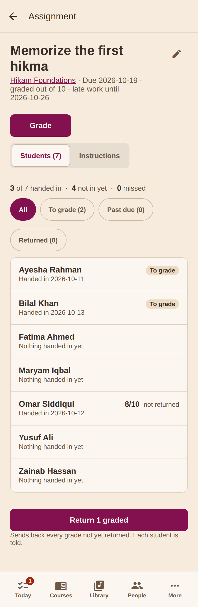<figcaption>On a phone</figcaption></figure>
<figure class="wd">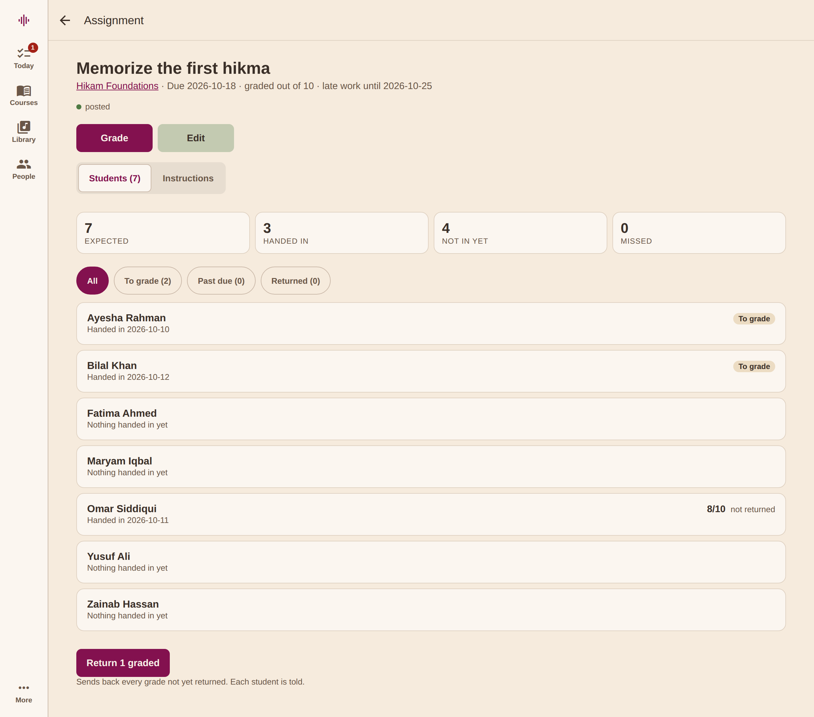<figcaption>On a computer</figcaption></figure>

Open an assignment to see the class: one line of counts — how many of the class
have handed in, how many are not in yet (**past due** once the date has gone),
and how many missed — then the students by name,
with filters for **To grade**, **Past due** and **Returned**. The list remembers
its filter while you grade and come back. **Instructions** shows the assignment
as students see it.

<figure class="ph">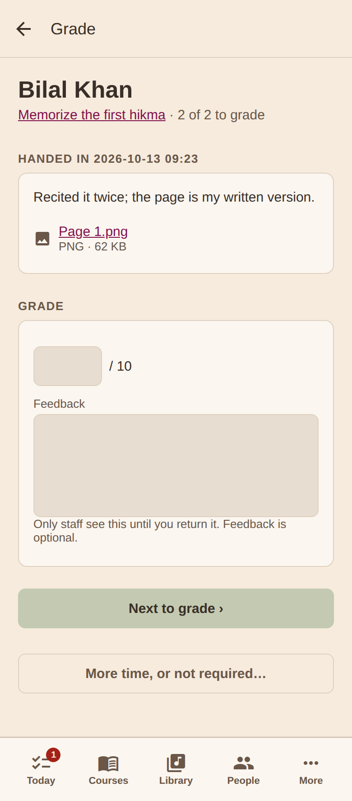<figcaption>On a phone</figcaption></figure>
<figure class="wd">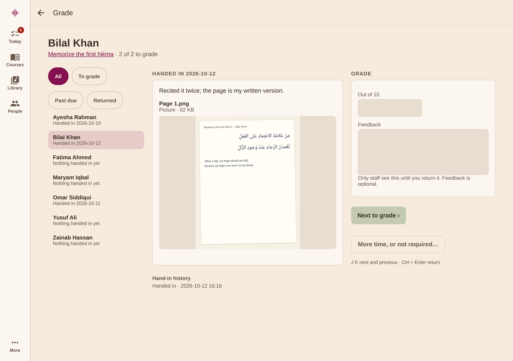<figcaption>On a computer</figcaption></figure>

Tap **Grade**, or a student, to open their work: when it was handed in, their
answer and their files — tap one to open it — and, once there has been more
than one hand-in or take-back, the **hand-in history**, each with its time.
Under it:

- **The grade and feedback** save as you type, as a draft only staff see. A
  student sees nothing until you return it.
- **Next to grade ›** moves on to the next student waiting, in name order.
- **Return now** sends this one back at once: the student sees the grade and the
  feedback and is told it is back. **Ask for another try…** returns it with a new
  date to hand in again by; this attempt, its grade and its feedback stay with
  the next one.
- **More time, or not required…** gives this student a date of their own, or
  lets them off this assignment, each with a reason the student sees.
- Work done on paper or recited in class can be graded with nothing handed in.

On a computer the class list, the work and the grade sit side by side. **J** and
**K** move to the next and previous student in the list, and **Ctrl + Enter**
(**⌘ + Enter** on a Mac) returns the work on screen — never a single key, so a
stray one sends nothing. Moving on and returning always store what you typed
first, so nothing is lost by going quickly; if a grade can't be saved, the
screen says so and asks before you leave it.

**Returning together.** Back on the assignment's page, **Return N graded** sends
back every grade not yet returned, at once. The app asks once more first,
because a return cannot be taken back. To change a grade or feedback after it
has been returned, edit it on the grading screen and press **Send the change**:
nothing reaches the student while you type. Sent, it reaches them at once, tells
them if the grade changed, and is recorded in the audit history. A returned
grade can be changed but not removed; **Undo** puts back what they have.

---

# Part 3 — For admins

## 3.1 Approving staff

<figure class="ph">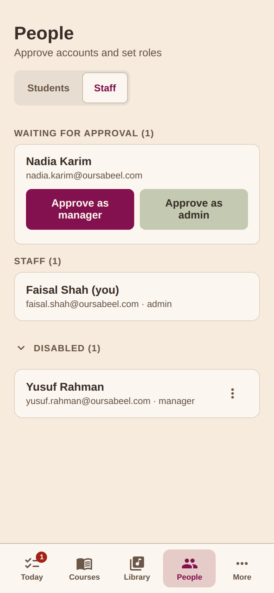<figcaption>On a phone</figcaption></figure>
<figure class="wd">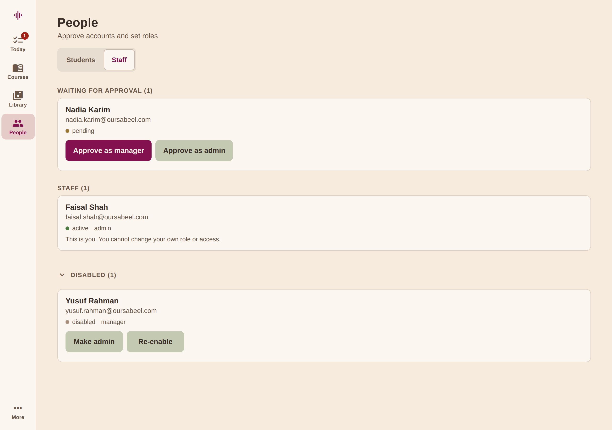<figcaption>On a computer</figcaption></figure>

Open **People** and switch to **Staff**. New staff who sign in with Google land
in **Waiting for approval**. For each, you choose the role as you approve:

- **Approve as manager** — they can run the courses you later assign to them.
- **Approve as admin** — full access, including approving other staff.

Below, **Staff** lists everyone with access, one line each with their address
and role. The **⋮** at the end of a row changes their role or disables them.
Either takes effect at once: someone disabled is signed out on every device,
and an admin you make a manager is too, then signs in again as a manager.
Your own row is marked *(you)* and has no ⋮ — you can't change your own role or
access, which stops an admin from accidentally locking themselves out. Staff
you've disabled move out of that list into a **Disabled** section at the
bottom, exactly as disabled students do — tap the heading to open it;
**Re-enable** is in the row's ⋮.

Only staff on the institute's own Google domain can be approved at all — the app
checks this on the server, not just in the browser.

## 3.2 Managers are scoped course by course

A manager can't see anything until you give them a course. Do that on the
**course page** (Section 2.3), under **Managers** — add them there, and they'll
see that course's sessions, recordings, ledgers, attendance, and audit, and
nothing else. Putting a course in a cohort a manager works in does *not* grant
access; the assignment is always the specific course.

## 3.3 The audit history

<figure class="ph"><figcaption>On a phone</figcaption></figure>
<figure class="wd"><figcaption>On a computer</figcaption></figure>

The **audit history** is the running record of consequential actions — staff
approvals, attendance submissions, completion overrides (with their reasons),
recording edits, and assignments posted, edited, closed, deleted and returned,
with any change to a returned grade — newest first. A grade becomes a record
when it is returned; drafts change constantly while a teacher works and are not
logged keystroke by keystroke. What students do with assignments is kept on
their work instead (Section 2.15). Each entry shows *who* did *what*, *when*, and the
details that matter.

You can reach it two ways: **globally** from **More → Audit history** (admins,
all courses), or **scoped to one course** from that course's page (managers see
their own courses' history). It's there so that "who marked this complete, and
why?" always has an answer.

Times are the institute's, not your device's — the same clock as every due
date, so the two are comparable wherever you are reading from. The screen
shows a fixed number of the most recent changes and says how many when it is
full; nothing is deleted, and older history is still in the record.

A sign-up the app refuses — someone signing in with an address outside
oursabeel.com, or trying to make an account of their own — is turned away
before any account exists, and is not in the history. **Rejected sign-up**, one
entry a day with how many there were and the latest address, means an account
got past that and was removed at once.

## 3.4 Disable and archive — don't delete

The app is built around **reversible** actions:

- **Disable** a student or staff member to switch off access while keeping their
  history. It ends their session and stops reminders reaching their phone.
- **Unpublish** a recording to pull it from students without losing it, or
  **archive** it when it should stay closed. Both close it to the students who
  were excused and take it out of the course totals — its own **Progress**
  page keeps the record; archiving is the one you reach for when
  nothing is wrong with the recording itself.
- **Archive** a course when a term ends — every count stays, and you decide
  whether its recordings stay open. This, not archiving its recordings,
  is how a term is closed. Its assignments close too, and stay on record.
- **Stop taking work** on an assignment rather than deleting it; a teacher can
  delete one only while no student has started it.

Permanent deletion exists, but it's deliberately admin-only, asks for strong
confirmation, and is audited. Reach for disable, unpublish, or archive first.

**Deleting an account** is for a request to delete someone's data (the privacy
policy's "Deleting your account"). On the website, an admin first **disables**
the person; then, from their page's **⋮** (a colleague's, from their row in
the Disabled section), **Delete account** asks once more. It removes their
sign-in, their email address wherever it is held, and their notification
settings; a student leaves the classes they were in, and a colleague stops
managing their courses. Their name stays on the record — attendance,
listening, work, grades and history — and they are listed under **Deleted**,
where their record can still be opened and exported. It cannot be undone.

---

# Part 4 — "How do I…?" quick answers

| I want to… | Do this |
|---|---|
| **Catch up on a class I missed** | **To do** → tap the card → big round button. |
| **Switch between video and audio** | Tap the version under the player — you carry on from the same moment. |
| **Pick up where I left off** | Reopen it on the same phone or computer. On another one, tap **Bookmark this place** first, then **Go to bookmark** there. |
| **Slow down or speed up** | Choose the speed beside the times on the player. |
| **Mark something done** | Press play once, then **Mark complete** at the bottom of the player. |
| **See my attendance for a class** | **Classes** → tap the class. |
| **Set my student password** | Open the emailed link, or tap **Email me a password link** on sign-in. |
| **Hand in an assignment** | **To do** → the assignment → write your answer and/or add files with the paperclip → **Hand in**. |
| **Change what I handed in** | Open it → **Take back** (until the due date, and before it is returned) → change it → **Hand in**. |
| **See my grade** | It appears on the assignment once your teacher returns it. |
| **Add a session** *(staff)* | Course → **Sessions** → **+** → title + date → **Create session**. |
| **Take attendance** *(staff)* | Session → mark Present / Absent / Excused → **Submit attendance**. |
| **Add a recording** *(staff)* | Open the session → **Import from Zoom** → tick files or a quick pick → **Import**. Or **Upload files…** → choose → **Upload N files**. |
| **Hide a version from students** *(staff)* | Session → the **eye** beside the file. |
| **Open a recording to students** *(staff)* | Mark them **Excused**, then **Publish** — that is the whole of it. |
| **Change the closing date** *(staff)* | Session → the **pencil** → **Due by**. Moving it forward reopens a closed recording. |
| **See who's behind** *(staff)* | Session → **Progress** → **Not complete** / **Missed**. |
| **Post an assignment** *(staff)* | Course → **Assignments** → **+** → title, instructions, date → **Post**. |
| **Grade and return** *(staff)* | The assignment → **Grade** → grade + feedback → **Return now**, or **Next to grade ›** and **Return N graded** at the end. |
| **Give one student more time** *(staff)* | Their work → **More time, or not required…** → reason + date → **Give more time**. |
| **Stop taking work, or take it again** *(staff)* | The assignment → the **pencil** → **Stop taking work** (or **Take work again**). |
| **Give someone credit anyway** *(staff)* | Ledger → the **pencil** on their row → reason (required) → **Mark complete**. |
| **Make a latecomer catch up on an old session** *(staff)* | Open that session → mark them **Excused** → **Submit attendance**. (Move **Due by** forward first if it has passed.) |
| **See course attendance** *(staff)* | Course → **Attendance report** (toggle by session / by student). |
| **Export a course for records** *(staff)* | Course page → **Export workbook**. |
| **Export one student's record** *(staff)* | **People** → the student → **⋮** → **Export workbook**. |
| **Turn a notification off** | **More** → **Notifications** → tap the one you don't want. |
| **Report something or someone** | **More** → **Report a problem** → say what or who, and what is wrong → **Send**. An administrator replies by email within a day. |
| **Approve a new teacher** *(admin)* | **People** → **Staff** → **Approve as manager / admin**. |
| **Give a manager a course** *(admin)* | Course page → **Managers** → add them. |
| **Create a student** *(staff)* | On the website: **People** → **+** → name + email → **Create account**. |
| **See who changed what** *(admin)* | **More** → **Audit history**. |

## Troubleshooting

**I signed in but I'm stuck on an "approval" screen.** *(Staff)* New accounts wait
for an admin to approve them. The screen updates by itself the moment they do — no
refresh needed. If you're stuck, contact your administrator.

**A student can't sign in.** Check the email address matches the one on their
account exactly, then open their page from the People screen and use
**Resend password link**, in the **⋮** beside their name, so they can set a
fresh password. New students have no password until they use that link.

**A recording won't play.** Streaming needs a working connection — try switching
between Wi-Fi and mobile data, or to **Audio only**, which needs far less of
it. Play links refresh automatically, so simply reopening the recording usually
clears a stale one.

**A student says they shouldn't be on the hook for a recording.** Check that
session's attendance — what is required follows it. If they were there, mark
them **Present** and re-submit; the obligation drops (and any progress they made
is kept). If they genuinely missed it, that's exactly what the required listing
is for.

**I marked something complete but it still shows incomplete.** If you were
offline, the app is holding your mark and will sync it once you're back online;
it may briefly show as pending. If a *teacher* has overridden your status, their
mark takes precedence — that's by design.

**A manager can't see a course.** Managers only see courses they're assigned to.
An admin adds them under **Managers** on the specific course page — being in the
cohort isn't enough.

**Where did a recording go?** It may have been **unpublished** (back to draft) or
its course **archived**. Both are reversible — check the session or the course
settings. If the session's due date has passed, move it forward before
publishing again; the card on the session says so.
