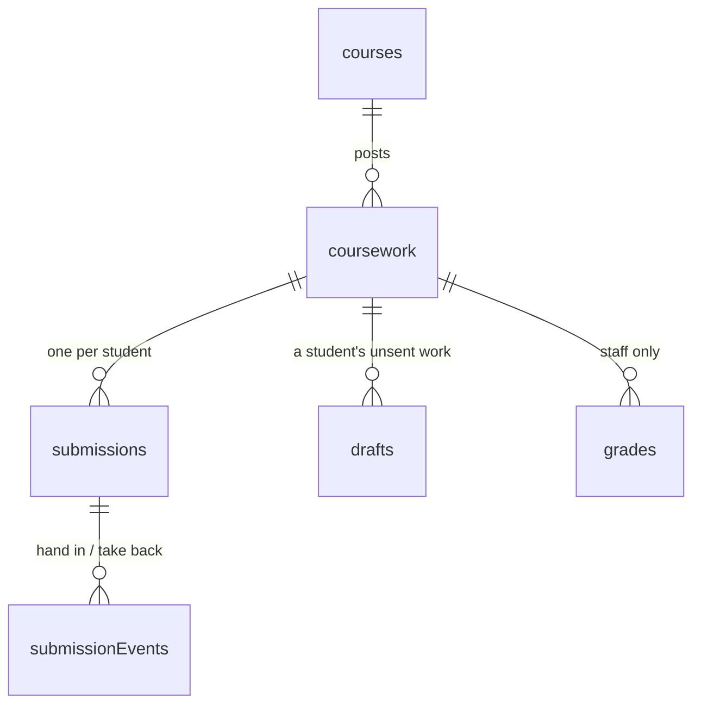

# Assignments and grades — build plan

The product is decided in `docs/proposals/lms-assignments-proposal.html`
(second draft, approved as drafted 2026-10-13, decision log in
`docs/PHASE_STATUS.md`). This file is how Part 1 of it ("the loop": post,
hand in, grade, return) gets built, in steps that each ship tested. Part 2
(Grades report, workbook sheets, record button, feedback files, copying an
assignment) and Part 3 follow once teachers have used Part 1.

Native libraries approved 2026-10-13: the Kanban app's rich-text editor
(Lexical on the web, `react-native-enriched-html` on Android, which needs
`react-native-reanimated` and `react-native-worklets`), `expo-image-picker`
for the camera, and `expo-image-manipulator` for shrinking photos.

## Where this departs from the proposal's developer notes

The proposal was written against v0.7.1, before media moved to R2. Its
"Storage" paragraph describes Firebase Storage paths and rules; there is no
Firebase Storage in this project any more. Files go to the R2 bucket the
recordings use, through callables, which is stricter than rules could be:

- **Every upload URL is signed by a callable that has already checked**
  course scope, enrolment, the work being open and the ten-file cap. There is
  no write path a client can use without asking first, so the proposal's
  "accepted residual" (an account writing unreadable, billable bytes) does
  not exist here.
- **Every file is looked at when it arrives.** The upload probe from the
  video plan reads the stored file's headers: the type is the bytes' type,
  not the declared one, so a video renamed `.m4a` is refused rather than
  stopped only at 25 MB, and a teacher's 15-minute audio limit is the file's
  own length, not the device's measurement.
- Keys: `coursework/{courseworkId}/{fileId}` for a teacher's files,
  `work/{uid}/{courseworkId}/{fileId}` for a student's.
- Read links are pre-signed GETs for one hour, minted by a callable that
  checks the reader may see the file — the same pattern as `getPlaybackUrl`.

Everything else follows the proposal's notes: the records are `coursework`,
`submissions`, `drafts`, `grades` and `submissionEvents` (`assignments` is
already the listening grant); only the interface says "assignment".

## Records

| Collection | Key | Who writes | Who reads |
|---|---|---|---|
| `coursework` | auto | callables | course staff; a student holding an active submission, once posted |
| `submissions` | `{uid}_{courseworkId}` | callables, fan-out | course staff; the student |
| `drafts` | `{uid}_{courseworkId}` | the student (note only, shape-checked); callables (files) | the student only — no staff arm |
| `grades` | `{uid}_{courseworkId}` | callables | course staff only |
| `submissionEvents` | auto | callables | course staff; the student, their own |

The grade reaches a student only as `submissions.returned`, copied when the
work is returned — the attendance-projection pattern, because Firestore has
no field-level security.

## Steps

| Step | What | Checked by |
|---|---|---|
| A1 | Shared types and the pure rules: a submission's state, late, past due, missed, To do buckets, who receives coursework | Unit tests in shared — **done 2026-10-13** |
| A2 | Server: create, edit, post, delete coursework; fan-out on posting, enrolment and leaving; hand in and take back; grade, return, another try, more time, not required; archive closing; audit; rules | Integration and rules tests, each named for the promise — **done 2026-10-13**; the drafts and grades rules were opened once and their denials went red |
| A3 | Files: teacher and student uploads to R2 through callables, probed on arrival; signed read links | Integration tests with real files; browser e2e — **done 2026-10-13**: PDF and pictures must be what their name says, Office files a ZIP or OLE container, text no binary signature, audio through the upload probe; the e2e attaches a worksheet and a photographed page and asserts the picture loads for the student and the teacher |
| A4 | Student screens: To do with both kinds; the assignment screen (note, files, camera, hand in, take back); class page tabs | Browser e2e; layout sweep with seed coursework in every state — **built 2026-10-13**; the sweep now also fails text that runs past its card (it caught a late-work date at 320 px); the whole loop is in the e2e with A5 |
| A5 | Staff screens: course page, assignment list, the form, the assignment page, grading on a phone, Today's To grade, the Assignments tab on a student's page | Browser e2e; layout sweep — **done 2026-10-13**: the e2e posts, attaches, hands in, takes back, grades and returns, and asserts a saved grade reaches neither the student's screen nor their record until it is returned; the sweep tours the six new staff screens and Today's To grade for a manager |
| A5b | The rich-text editor in the form (the Kanban editor: Lexical on web, react-native-enriched-html on Android) | Browser e2e; device pass for Arabic |
| A5c | Grading on a laptop: the work and the grade side by side, keys for next and return | Browser e2e; layout sweep at 1440 px |
| A6 | Messages: four student messages under three switches; taps that open the assignment; channel renamed | Integration tests; device pass |
| A7 | Words, brief, manual, CLAUDE.md; device pass (camera, Arabic in the editor, audio, taps, Yoga at 320 px); release | The proposal's "Device pass" list |
