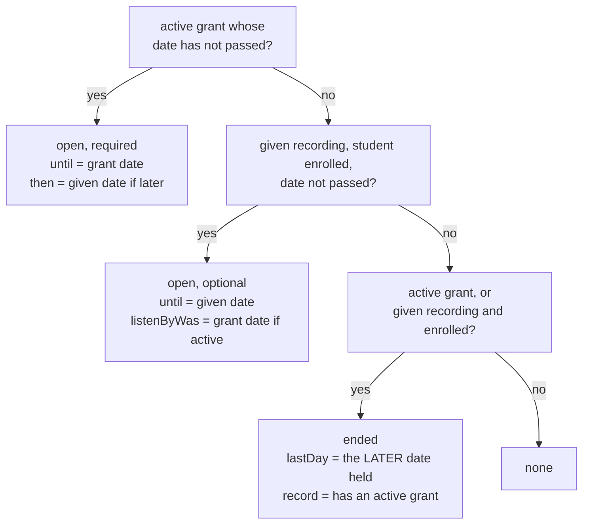
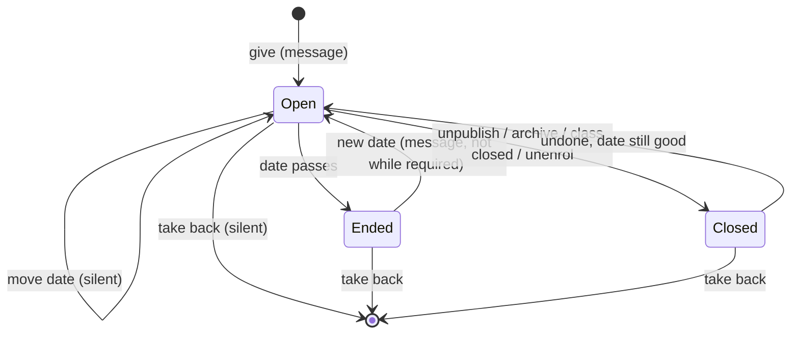

# Give a recording — build plan

Staff open one class recording to one enrolled student until a date they
choose, once the session's attendance has been taken. It sits on the
student's To do under **Optional**, nothing tracks it, and it closes by itself
at the end of that date. Being marked **excused** is unchanged and stays the
only thing that makes listening required.

The product was decided on the design page (published 2026-11-06,
<https://claude.ai/artifact/QLnBwM85J66Zdetpfofdcr>). This file is how it gets
built and proven: the behaviour as a contract, the design that meets it, every
sentence that changes, the build order, the verification, and the release. It
went through three rounds of independent review against the code on
2026-11-11 (rules and server; app surfaces; edge cases and time; verification;
an implementer's walkthrough; test techniques; internal consistency; a term as
its users; security, data and deploy). Their findings are folded in.

## Decided by the owner

- Any student **enrolled** in the class, whatever their mark: present, absent,
  excused, or none (enrolled after the register was taken).
- **The session's attendance must have been taken** (submitted) first. Until
  then nobody can open its recording, as the app already says on Today, on
  Progress and in the attendance-missing message, and that stays true.
  A submitted register can be corrected but never un-submitted.
- An end date is **required**. It is never in the past, the student can play
  through the whole of that day, and there is no upper limit. The form
  prefills a week from today (`DEFAULT_DUE_DAYS`).
- On To do in its own **Optional** group, below the required groups and above
  Missed. Never the Next up card.
- **Not tracked**: no Mark complete, no Missed, no reminder of its own,
  nothing in the ledger counts, rates, workbooks or stats.
- **One message**, when it is given. Moving the date is silent, earlier or
  later (2026-11-11). A new date on one that has ended sends the message
  again. Taking it back is silent.
- **From the recording's Progress page only**, one student at a time. No notes
  or reasons. Given recordings are listed nowhere else for staff.
- **Any admin or manager of the class** can change the date or take it back,
  whoever gave it (2026-11-11). Colleagues are never refused for each other's
  work. The one check is for two people saving the same row at once: the
  second is told what the first did, and saving again applies theirs (the
  refusal table).
- An excused student whose listen-by date is still open **cannot be picked**.
  Once that date passes they can be (2026-11-11). An excused student who needs
  more time shows as Missed when the date passes; the teacher then gives it,
  and when they have finished marks it complete on Progress with the existing
  override, which takes a reason and works at any date (`overrideCompletion`).
- After its date the given recording disappears from the student's To do. Ended given recordings stay
  on Progress as "Ended <date>", where a new date reopens them.
- **Closing follows excused**: unpublish, archive, archiving the class with
  listening off, or unenrolling closes it; it comes back when that is undone,
  if its date is still good.
- **Unpublishing or archiving a recording whose session's listen-by date has
  passed closes its given recordings until it is published again**, as for
  the excused (2026-11-11). Publishing is refused after that date
  (`setRecordingStatus`), so publishing again means moving the listen-by
  date forward first, which reopens it to the excused as well. Meanwhile its
  Progress rows offer Take back only.
- Giving, changing and taking back are written to the audit log.
- **Closing it at once asks first** (2026-11-11), for the excused and the
  given alike: "if it's currently open and you're going to change the date
  such that it would immediately close ... confirmation required". No date
  change can do that: neither a session's listen-by date
  (`validateDueDateChange`) nor a given date can be set in the past, and
  today keeps it open to midnight. The actions that can, and what each asks,
  are in "Closing at once" below; two of them ask nothing today (call 11).
- The interface word is **give**, and the plan says "given recording", never
  "gift" (2026-11-11), so the code reads as the screens do.

## Calls made while planning

Each is the owner's to change before the build.

1. **Reopening is refused while the student is required to listen**, as giving
   is.
2. **A class archived with listening off cannot be given from.**
3. **The give sheet** is a tick list with the date and the Give button at the
   top, opened by a plus beside "Given to". A tick only selects; Give is a
   separate press, so a mis-tap never messages the wrong student.
4. **"This recording is not open to you" loses its second sentence** ("Your
   teacher marks who needs to listen when they take the register"), wrong for
   a student whose given recording was taken back: "This recording is not open to you.
   Ask your teacher if you need it."
5. **When a given recording runs past a required date** (given first, then the student
   was excused), the player shows both, "<listen/watch> by <listen-by date> ·
   open until <open-until date>"; the last-day reminder says it stays open until the
   given recording's date; Progress says "Required until <date>, then open until <date>".
6. **A given recording followed by a correction to excused sends two messages**, both
   true: "open to you until <open-until date>. It is not required.", then "you were
   excused, so it is now required by <listen-by date>." Only one goes if the
   correction lands before the given recording's message is sent.
7. **At most one "ready" message per student, recording and day.** Give, take
   back and give again on one day sends one message, so a slip cannot spam a
   phone. A reopen always falls on a later day than the opening before it.
8. **Take back asks once more** ("Take back from <name>? It stops at once if
   they are listening."), because it is silent and stops the audio.
9. **For a student who missed and is then given it**, the To do row says "Open
   again until <date>", and the player says "Its listen-by date was <date>.
   Listening now does not change your record." Missed stays Missed.
10. **A given student's row elsewhere on Progress** (Present, Absent,
    Required, Also listened) adds "· given until <date>" while the given recording is
    open, so their listening has a visible reason.
11. **The owner's "ask before closing" applies beyond dates, to one
    recording at a time.** Dates cannot close anything at once, but two
    existing actions do and ask nothing: the ⋮ Archive and Unpublish, and
    submitting a corrected register that takes Excused from a student who can
    play it. Both ask first ("Closing at once"). Archiving a class or a cohort
    keeps stating its effect instead of asking, by the decision written in
    `CoursesScreen.tsx` ("archiving is the SAFE action in this product, and
    obstructing the safe action is how people learn to click through
    warnings"): it is the end-of-term act, undone in one tap.

## What reading the code changed

The design page said "only the recording read rule and `getPlaybackUrl` learn
it". The code and the reviews changed that:

1. **Listening progress and bookmarks are refused without an excused grant.**
   Both rules learn the given recording; otherwise a given student's listening is
   silently dropped.
2. **Completions stay excused-only in the rules.** A student holding only a
   given recording is refused by the server. A student who missed holds an active grant,
   and the rules accept their completion at any date (true today); for them
   the screen is the guard, and the player design makes it hold.
3. **The "ready" marker has no date in it today**, so the given recording's message has
   its own.
4. **The player must know the window before it draws.** It draws today from a
   date passed by the screen that opened it; a Done-row tap while a given recording plays
   would stop the audio, and Mark complete would flash for a student who
   missed. For students the Player route waits for the live reads, and no
   student navigation carries a date.
5. **The window is worked out where the clock ticks.** Computed in the route,
   it would not change at midnight while the student is paused. The player
   and the docked bar compute it from the live reads and `useInstituteDay()`.
6. **A closed window carries the later date**, or the midnight play-on cuts a
   given recording short and names the wrong closing date.
7. **The trigger acts on the opening edge**; `notifyOnce` returns before
   recording a send when there is no device, the switch is off, or the
   student is outside the audience.
8. **"Required right now" is read from the session**, because the grant
   follows the register by seconds.
9. **Each call names the given recording as its caller saw it**, date included, so a
   stale sheet never undoes a colleague.
10. **To do reads recordings once**, so the given recordings are read again on
    focus, on return to the app, and when the student's classes change.
11. **No downloads exist** (deferred in the brief).
12. **Deploy order is load-bearing**: rules and Functions before any client.
13. **Older phone apps** show no Optional row; the message opens a player
    that says the recording is not open to them. The owner wants a forced
    update (2026-11-11): the floor rises to 1.1.0 once both stores carry it.

## The contract

### Staff actions

Every call carries `expect`: `null` from the plus, or `{ givenAt, openUntil }`
as the row's sheet showed WHEN IT OPENED, frozen then. Read from the live row
at the moment of saving, it would follow a colleague's change within a second
and overwrite it without a word. A mismatch is refused with what changed, and
the refusal's `details.current` (`{ givenAt, openUntil }`, or `null`) becomes
the sheet's `expect`; the date typed stays in the field, so Save again applies
it on purpose. Who gave it never matters. A save of the date already stored
is `unchanged` whatever `expect` says, and a take back that finds nothing is
`gone`, so neither is refused for being out of date.

| Action | Allowed when | Effect | Message | Audit |
|---|---|---|---|---|
| Give | Admin or manager of the class; attendance submitted; recording published; class playable; student enrolled; date today or later; not required right now; no given recording exists | Record created | One "ready" | `giveRecording`, `opened` |
| Move the date | The given recording exists and is open; recording published; class playable; student enrolled; date today or later (earlier or later than before) | Date moved; `givenAt` kept | None | `giveRecording`, `moved` |
| New date | The given recording exists and has ended; as Give otherwise | Reopened; new `givenAt` | One "ready" (call 7) | `giveRecording`, `reopened` |
| Same date | The stored date resent, even if passed | Nothing written | None | Not logged |
| Take back | Admin or manager of the class, in any state | Record deleted | None | `takeBackRecording` |
| Take back, gone | — | Nothing | None | Not logged |

"Required right now" (`requiredUntil`) is the reconcile's own test, read in the
same transaction: an active grant whose date has not passed, or the register
submitted with the student excused, still enrolled, the recording published
and the session's date not passed.

Refusals, one sentence each, produced by one shared function so the sheet and
the server cannot disagree:

| Cause | Sentence |
|---|---|
| Attendance not submitted | "Take attendance for this session first." |
| Not published | "Only a published recording can be given." |
| Class archived, listening off | "This class is archived and its recordings are closed." |
| Not enrolled | "That student is not in this class." |
| No date / malformed | "Choose the last day it stays open." |
| Date passed | "That date has passed. Choose today or a later day." |
| Required right now | "It is required for them until <date>. It can be given after that." |
| Already given (plus) | "It has already been given to them. Change it from their row." |
| Stale `expect`, date changed or given again since | Save: "Someone else changed the date to <date> just now. Save again to use yours." Take back: "Someone else changed the date to <date> just now. Take back again to take it back anyway." |
| Stale `expect`, taken back since | Save: "Someone else took it back just now. Give it again with the plus if they still need it." (Take back: `gone`, not refused) |
| Out of scope | "You are not assigned to that class." (existing) |

Results shown in the sheet (never claiming delivery):

- Opened: "Given to <name> until <date>. It is on their To do under Optional,
  with a message if their notifications are on."
- Moved: "Now open until <date>."
- Reopened: "Open again until <date>. They get a message if their
  notifications are on."
- When the chosen date is today: "It closes at midnight tonight." (One given
  at 23:59 may close before its message goes; the message is then rightly not
  sent.)

### The student

| Situation | To do | Player | Can play |
|---|---|---|---|
| Given, date not passed | Optional row "Open until <date>", never Next up | Plays; "open until <date>"; "This one is optional, so there is nothing to mark." in place of Mark complete; no "mark it complete below" at the end | Yes |
| Given, last day ends while playing | Gone after midnight | Plays to the end of the file, then closes (the existing midnight rule, on the later date) | Not again |
| Given, date passed | Nothing | "This recording was open to you until <date>. Ask your teacher if you need it again." | No |
| Taken back, player open | Gone at once | Stops at once; then the not-open sentence (call 4), or the existing "That recording is not available…" if the recording read is refused first | No |
| Taken back, opened afresh (old message, restored tab) | — | "That recording is not available. It may have been removed, or you may no longer have access to it." (existing) | No |
| Given, then excused, listen-by open | Required row only | Required player with Mark complete; "<listen/watch> by <date> · open until <open-until date>" when the given recording runs later | Yes |
| Excused, listen-by passed, not completed, given | Missed row stays; Optional row "Open again until <date>" | Optional player; "Its listen-by date was <date>. Listening now does not change your record."; Mark complete never drawn | Yes, until the given recording's date |
| As above, given recording ends while playing | Missed row | Plays to the end of the file (the later date decides), then "closed" with the excused record | Not again |
| Excused, completed, listen-by passed, given | Done row stays; Optional row "Open again until <date>"; either opens the optional player | Optional player showing "✓ Completed" read-only | Yes |
| Recording unpublished or archived | Gone the next time To do is shown; a tap before then gets "not available" | Stops at once | No |
| Class archived, listening off | Gone the next time To do is shown | Stops at once | No |
| Class archived, listening kept on | Stays until its date | Plays | Yes |
| Unenrolled | Gone at once; back on re-enrolling if the date is good | Stops at once | No |
| Notification tapped | — | This recording's player in the mode above, once the window is known | As above |
| Class page (Classes tab) | Unchanged: a record, no play button, no given recording shown | — | — |

"The next time To do is shown" means on returning to it from another screen,
on coming back to the app, or on a tab press. A playback link already issued
keeps working for its twelve hours after any of these (`SIGNED_URL_TTL_MS`),
as for excused access; the app stops using it at once.

### Staff: the Progress page

- **Given to (n)**, under the required list, rows by name. Shown when a given recording
  exists or giving is possible. The plus ("Give this recording to a
  student") shows when attendance is submitted, the recording published and
  the class playable; when given recordings exist and giving is not possible, one line
  says which is missing. With none given and giving possible: "Not given to
  anyone."
- **The give sheet**, "Give this recording": the date ("Open until") and
  "Give to <name>" at the top, then the hint "They can play it through the
  end of that day. It is optional: nothing is required of them, and it isn't
  counted." Then the class's enrolled students with active accounts, not
  already under Given to, as tick rows. A student required right now shows
  greyed with "Required until <date>; it can be given after that." With
  nobody to pick: "Everyone in this class already has it or is required to
  listen." The sheet stays open after a give: the result line shows, the
  student leaves the list, the date is kept. It closes with Close, not
  Cancel: what was given stays given.
- **Each row's status**, the first that applies: "Closed (recording
  archived)" / "Closed (recording unpublished)" / "Closed (course archived)"
  (the page's existing `closedReason` spelling) / "Left the class" /
  "Required until <date>, then open until <date>" / "Required until <date>" /
  "Ended <date>" / "Open until <date>".
- **The row's sheet**, "Given: <name>": the date, prefilled with the given recording's
  date while open and a week from today once ended, and Save, shown only when
  the shared refusal function finds nothing, otherwise its sentence in Save's
  place. Take back at the foot, in the danger tone, with call 8's confirm.
  Refusals inside the sheet, the date reset on every close, Cancel to close,
  as the override sheet on this page does. No leave guard: one date field,
  like the override sheet.
- A given student's listening shows where it does today (their Present,
  Absent or Required row, or Also listened), with call 10's note.
- The counts line, filters and Required list never change because of a given recording.
  An excused student who missed and then listened under a given recording keeps
  "Missed", with their listened share and last-played date growing; the
  workbook shows the same, and its "Played" note says so.

### Staff: elsewhere

- **Session page, the recording's ⋮**: Archive and Unpublish ask first while
  anyone can play it ("Closing at once").
- **Audit log**: "Gave a recording or changed its date" with the recording's
  title, what happened (opened, moved, reopened) and the dates; "Took back a
  recording" with the title and its date.

### Closing at once

What a staff action does to students who can play the recording right now,
and what it asks first (call 11). "Can play it" is `canPlayNow` on the
student's `listenWindow`, for an active account: an archived class with
listening off and a disabled account both count as cannot. For a student on
the register, `requiredUntil` is read from the session, so the register gap
counts.

| Action | Closes at once for | Asks |
|---|---|---|
| Move a session's listen-by date | Nobody: a past date is refused, and today stays open to midnight | Nothing, as today |
| Move a given date | Nobody, the same way | Nothing |
| Take back | That student, unless they are required right now | Always: "Take back from <name>? If they are listening, it stops." (call 8); for a student required right now, "Take back from <name>? It stays open to them until <date>, while it is required." |
| ⋮ Archive or Unpublish | Everyone who can play it | New, while anyone can: "Archive <title>? It closes now for <n> students who can play it." (Unpublish the same.) After the session's listen-by date it adds "To publish it again, first move its listen-by date forward, which reopens it to the students you excused." With nobody able to play it, the move runs at once, as today |
| Submit a corrected register | Each student it takes Excused from while they can play the session's recording, unless they also hold it given and open | New, when anyone is named: "Submit? <Title> closes now for <names>." (up to three names, then "and <n> others"). Pressed before the reads behind it have answered from the server, it asks anyway, "Submit? Checking who can play <title> right now…", and the sentence follows them ("…closes now for <names>.", or "Nobody who can play <title> right now loses it."); a read refused, "Who can play <title> right now could not be checked, so this may close it to someone." Archive and Unpublish say "Who can play it right now could not be checked." then |
| Archive a class with listening off; turn listening off on an archived class; archive a cohort | Everyone in it who can play | Nothing new: each states its effect beside the control, by the decision in `CoursesScreen.tsx` (call 11) |
| Disable an account | That student, for everything | Nothing new: closing their access is the point of it |
| Hide a file | That file; the recording's other files still play | Nothing new |
| Unenrol | That student | Yes, in place (existing) |
| Delete a recording or a session | Nobody: a published recording cannot be deleted (`recordings.ts`), nor a session whose recording is | — |

The confirms are `ConfirmDanger`, enabled while the action is still possible:
the recording still published, or for the register, its `attendanceSubmittedAt`
as it was when the confirm opened (a colleague's submit clears the local
marks, so confirming would send something else; the confirm closes then). The
count re-renders while it is open; at 0 the sentence becomes "Nobody can play
it right now." rather than the confirm closing under the person's hand. The
register's marks, Mark all excused and Submit sit inside its confirm; the ⋮
is disabled while the recording's confirm is open, as it is for delete, and
both sit inside the card's existing delete `ConfirmDanger`.

### Notifications

- Kind `recordingReady` (the student's existing switch).
- **Given**: title "<Class>: a recording is ready", body "<Title> is open to
  you until <date>. It is not required." Path `play/<recordingId>`.
- **Excused, while holding a given recording**: body "<Title> — you were excused, so it is
  now required by <date>." (otherwise unchanged).
- **Last day, when a later given recording exists**: title "<Class>: last day for a
  required recording", body "<Title> is required by the end of today. It stays
  open to you until <open-until date>." (otherwise unchanged).
- Sent when a write opens a given recording (`givenAt` changes), after re-reading it,
  under the marker `recordingReady_<recordingId>_given_<institute day of
  givenAt>`. Not sent when the given recording has gone or changed since, its date has
  passed, the recording is not published, the class is archived with
  listening off, the student has left the class or is required right now.
- No reminder of its own.
- `NOTIFY_AUDIENCE` and the switch apply as to every message.
- Settings lines: `recordingReady` "When a recording is opened to you,
  because you were excused or your teacher gave it to you."; `lastDay` "On
  the morning of a recording's listen-by date, if you have not finished it."

### Unchanged, and asserted as unchanged

Attendance marks and `attendanceRecords`; excused access and its dates; the
recording ledger counts and Required list; the course and student ledgers;
the attendance report; workbook figures; Today's queue (its wording aside);
completion overrides; coursework. Of these, only the last-day reminder and
the excused "ready" message read the new record, for their wording.

## Design

### The record

`givenRecordings/{studentUid}_{recordingId}`, server-written only:

| Field | |
|---|---|
| `studentUid`, `recordingId`, `courseId` | Who, what, and the recording's class (a recording's class never changes) |
| `openUntil` | `YYYY-MM-DD`, institute timezone, the last day it plays |
| `givenAt` | Integer ms of the latest opening (a give or a reopen); kept by a date move |
| `givenBy` | Uid of whoever made that opening |

No `active` flag: openness is worked out from the given recording's date, the student's
enrolment, the recording's status and the class's setting, so nothing has to
be kept in step and the attendance reconcile is not touched.

### Shared decisions (`packages/shared/src/assignments.ts`)

- `givenRecordingId(uid, recordingId)`.
- `requiredUntil(uid, { session, grant, enrolled, recordingStatus, today }):
  string | null` — the reconcile's test, returning the date it is required
  until. Used by the callable, the trigger, the Progress page and the
  refusal function.
- `giveRefusal(...)`: the refusal sentence or null, for each action. Thrown by
  the callable, shown by the sheets.
- `listenWindow(grant, given, enrolled, today)`:



- `canPlayNow(cls, window, studentUid)`: staff first, then the class, then
  `window.state === 'open'`. It no longer reads a date.
- `completionShown(window)`: open and required only.
- The player's `finishing` (midnight play-on) uses `window.lastDay`.
- `playbackDenial` gains `given` and `enrolled`: none is `not-assigned`;
  ended with the excused date the later one is `past-due` (existing
  sentence); ended otherwise is `given-ended`, "This recording is no longer
  open to you."
- `TodoBucket` gains `optional`, after `upcoming` in `TODO_ORDER`.
- `isCalendarDate` moves here from `functions/src/sessions.ts`.

### Given-recording states



"Closed" is the given recording read against the recording, the class and the
enrolment; it is never stored, and a row stays "Closed (…)" or "Left the
class" while the cause stands, whatever the date. Undoing an unpublish is
impossible once the session's date has passed, which leaves take back. The
required overlay (given, then excused) is not a state of the given recording: the record is
unchanged and the window decides.

### Rules

```
function givenPath(rid) {
  return /databases/$(database)/documents/givenRecordings/$(request.auth.uid + '_' + rid);
}
function enrolledIn(cid) {
  let p = /databases/$(database)/documents/enrollments/$(request.auth.uid + '_' + cid);
  return exists(p) && get(p).data.active == true;
}
function holdsGrant(rid) { /* gains exists() before get() */ }
function holdsGiven(rid, cid) {           // cid: the row's courseId
  let rec = get(/databases/$(database)/documents/recordings/$(rid)).data;
  return exists(givenPath(rid)) && rec.status == 'published'
    && rec.courseId == cid && enrolledIn(cid);
}

match /givenRecordings/{givenId} {
  allow get: if (isStudent() && (resource == null
        ? givenId.split('_')[0] == request.auth.uid
        : resource.data.studentUid == request.auth.uid))
    || (resource != null && staffManagesCourse(resource.data.courseId));
  allow list: if (isStudent() && resource.data.studentUid == request.auth.uid)
    || staffManagesCourse(resource.data.courseId);
  allow write: if false;
}

// recordings, student get
isStudent() && resource.data.status == 'published'
  && (holdsGrant(recordingId)
      || (exists(givenPath(recordingId)) && enrolledIn(resource.data.courseId)))

// listeningProgress and bookmarks, grant arm first
create: ... && ((holdsGrant(rid) && cid == grantedCourse(rid)) || holdsGiven(rid, cid))
update: ... && cid == resource.data.courseId && (holdsGrant(rid) || holdsGiven(rid, cid))
```

The class of a progress row is the recording's, which the given arm reads for
its status anyway, so a wrong `courseId` on a given recording cannot file listening
under a class the ledger never reads. No date check, as the grant arm has
none. Reads: recording get 3 distinct documents; a progress save by a student holding only a given
recording 5 (students, assignments, given recording, recording, enrolment), under the
limit of ten, which the emulator does not enforce, so the count is reasoned,
not tested. Firestore treats `error || true` as true; the `exists()` guards
make that explicit.

`completions` and `completionEvents` are unchanged.

### Server

- **`functions/src/given.ts`**: `giveRecording({ recordingId, studentUid,
  openUntil, expect })` and `takeBackRecording({ recordingId, studentUid,
  expect })`, through `auditedCall`. In order:
  1. `requireStaff`.
  2. Validate the shape: ids non-empty strings of at most 128 characters
     without `/`; `openUntil` a calendar date; `expect` present, `null` or
     `{ givenAt: integer, openUntil: date }`. `invalid-argument` otherwise.
  3. Read the recording; `requireCourseScope` on its `courseId`.
  4. One transaction reading the recording again, the class, the session, the
     enrolment, the grant and the given recording; compare `expect`; apply
     `giveRefusal`; write only if something changes. State refusals, a past date
     and a stale `expect` are `failed-precondition`, each with its sheet
     sentence; a malformed call is `invalid-argument`.
  5. Return `{ outcome: 'opened' | 'moved' | 'reopened' | 'unchanged',
     current, toldToday }` for a give (`current`, the record as it now stands,
     which the sheet adopts; `toldToday`, whether the day's message has
     already gone) and `{ outcome: 'taken' | 'gone' }` for a take back. Audit
     detail, flat: `{ title, outcome, openUntil, previousOpenUntil }`
     (`previousOpenUntil` left out for a first give), or `{ title, openUntil }`
     for a take back;
     `courseId` set; `noop` for `unchanged` and `gone`.
  `requireEnrolled`'s check becomes one pure `assertEnrolled(doc)` in
  `guards.ts`, used inside and outside transactions; `recordingCourseId` moves
  there too. The core takes `today` (defaulting to the institute day), as
  `sessions.ts` and `notifyJobs.ts` do, so its tests can set it.
- **`getPlaybackUrl`** reads the given recording, and the enrolment only when there is one.
- **`notifyRecordingGiven(db, givenId, givenAt, today)`** in `notifyJobs.ts`:
  re-reads the given recording and returns if it is gone or its `givenAt` differs; reads
  the recording, class, enrolment, session and grant; returns unless open and
  not required; then `notifyOnce` with the day-keyed marker. Missing or
  malformed data returns without throwing (a throw retries for days).
- **`onGivenRecordingWritten`** in `notifyTrigger.ts`, configured as
  `onAssignmentWritten` (`SENTRY_DSN` and `PUSH_SECRETS`, `retry: true`,
  `reportError` then rethrow), acting only when `after` exists and
  `before?.givenAt !== after.givenAt`.
- **`notifyRecordingReady`** and **`notifyLastDay`** read the student's given recording for
  their wording; one get per message sent.
- **Cascades**: `applyDeleteRecording` deletes the recording's given recordings through
  its own list beside `RECORDING_DEPENDENTS`; `deleteAccountRecord` deletes
  the student's, and its docblock says why (a permission, not history; the
  audit log keeps it).
- **Publishing refused after the session's date**: the sentence in
  `setRecordingStatus` is reworded (below).

### Client

- **`useMyListenReads(uid, recordingId, courseId, scope)`** in
  `completion.ts`: live grant, given recording and enrolment, each through
  `useLiveDocState`; the enrolment with `denialIsAnswer`, the given recording without (a
  refusal there is a fault). Returns the three documents and whether all
  three have answered. Replaces `useMyAssignmentState` and `liveDueDate`,
  which are deleted.
- **Player route** (`Play` in `App.tsx`): for a student, the loading gate until
  the reads have answered once; afterwards it keeps rendering while they
  change. Student navigations stop carrying a date: To do, `openPlayer`, and
  the docked bar's `onOpen` (which passes `now.dueDate` for staff only).
  `PlayerScreen` takes `reads` for a student and `dueDate` for staff.
- **PlayerScreen and MiniPlayer** each compute `listenWindow(…,
  useInstituteDay())`, then `canPlayNow`, `finishing` and
  `completionShown` from it. The docked bar decides to stop only once its
  reads have answered. A student's `OpenRequest.dueDate` is null; the
  `NowPlaying.dueDate` docblock says staff only. The player's optional mode,
  overlap line, ended sentences and read-only completion line are as in the
  contract.
- **A refused progress save while the window is open** is reported to Sentry
  once per sitting (the request carries whether the window was open), so a
  rules fault on the given arm is not silent.
- **To do**: `useMyGivenRecordings(uid)` (live, `studentUid ==`); the given recordings
  whose date has not passed and whose class the student is enrolled in
  (`useStudentEnrollmentsState`) resolve in their own `useResolvedDocs` call,
  which gains a `refresh` value in its effect's dependencies (not its key, so
  nothing flashes "Checking…"), bumped on focus (`useFocusEffect`), on the
  app becoming active (`AppState`), and when the set of enrolled classes
  changes. Each optional row comes from `listenWindow`, dropped when the class
  cannot play; key `given-<id>`, testID `optional-<title>`, its own line, no
  override or Pending sync notes, accessibility label "Play <title>, optional,
  open until <date>", `deadline = openUntil` for ordering. Loading waits for
  the given recording and enrolment lists; a failed list of given recordings never hides required
  work and never produces "Nothing to do".
- **Progress page**: `useGivenRecordings(recording)` (`courseId ==` and
  `recordingId ==`), joined to the roster (`useRosterState`) and names
  (`useStudentsState`); its label added to the page's `useListenerFailed`
  list. Every action through `useOneAtATime`. testIDs: `given-add`,
  `give-pick-<name>`, `give-submit`, `given-row-<name>`,
  `given-edit-<name>`, `given-save-<name>`, `given-takeback-<name>`; the
  date fields by their labels. The pencil reads "Change the date or take
  it back from <name>", distinct from the override pencil on the same student.
- **Session page**: one class-scoped live query of given recordings, read by
  the ⋮ confirm and the register confirm with the session itself (attendance,
  listen-by date), the class, the roster and the students' accounts
  (`useStudentsState`). Who would lose access is one shared function,
  `closesNow(...)` beside `listenWindow`, unit-tested over each row of
  "Closing at once". testIDs: `recording-close-confirm`,
  `att-submit-confirm`.

### Copy

Every sentence that changes, drafted here so it can be read for tone before
the build. Existing sentences quoted from the code.

| Where | Today | New |
|---|---|---|
| `SessionDetailScreen.tsx` register note, submitted | "Submitted. Only excused students get the recording." | "Submitted. The students you excused must play the recording. To let anyone else play it, give it to them from its Progress page." |
| same, before submit | "…Only excusing grants access, and nothing is granted until you submit." | "…Nothing opens to anyone until you submit." |
| same, publish notice | "This session's due date has passed, so publishing would give nobody access." | "This session's due date has passed, so the students you excused could not open it." |
| same, ⋮ Publish | "Opens it to the students you excused." | "Opens it to the students you excused. You can then give it to others from Progress." |
| same, ⋮ Archive / Unpublish, register Submit | — (no question) | the confirms in "Closing at once" |
| `recordings.ts` publish refusal | "…Move it before publishing, or nobody will be able to open it." | "…Move it before publishing, or the students you excused will not be able to open it." |
| `RecordingLedgerScreen.tsx` empty | "Nobody holds this recording now — every grant from this session has lapsed. See below." | "Nobody is required to play it now: every excused student's access has lapsed. See below." |
| same | "No one was excused from this session, so nobody has been granted this recording." | "No one was excused from this session, so it is required of nobody." |
| same, Present | "They were at the session, so this recording is neither required for them nor open to them." | "They were at the session, so it isn't required of them. It opens to one of them only if you give it to them." |
| same, Absent | "Marked absent rather than excused, so the recording was not opened to them. To let someone catch up, mark them excused on the session and submit again." | "Marked absent rather than excused, so it isn't required of them. To require it, mark them excused on the session and submit again. To let one play it without requiring it, give it to them." |
| same, Also listened | "Listening from someone who holds no current grant — for example, excused and listening, then corrected to present. Kept as history; does not count toward accountability." | "Listening from someone it isn't required of: given it, or excused and then corrected to present. Kept as history; it does not count toward accountability." |
| `PlayerScreen.tsx` not open | "This recording is not open to you. Your teacher marks who needs to <play> when they take the register." | "This recording is not open to you. Ask your teacher if you need it." |
| same, given recording ended | — | "This recording was open to you until <date>. Ask your teacher if you need it again." |
| same, optional | — | "This one is optional, so there is nothing to mark."; hero "open until <date>" |
| same, missed then given | — | "Its listen-by date was <date>. Listening now does not change your record." |
| `playback.ts` | — | `given-ended`: "This recording is no longer open to you." |
| `workbooks.ts` mark note | "…Excused is the only mark that opens the recording and requires it." | "…Excused is the only mark that requires the recording. A recording staff give to one student is not counted here." |
| same, Missed deadline | "Not completed by the due date. Access has closed; nothing further can happen to it unless the date is moved." | "Not completed by the due date. Nothing further counts toward it unless the date is moved." |
| same, Played | "…Evidence, not the gate — completion is the student's own mark." | "…Evidence, not the gate — completion is the student's own mark. It includes any listening after the due date." |
| `todayQueue.ts` | "Access closes today" / "Access closes in N days" | "Listen-by date today" / "Listen-by date in N days" |
| `notifications.ts` settings | as above | as above |
| Comments stating the old rule | `types.ts` (AttendanceStatus), `notifications.ts` (header), `assignments.ts`, `collections.ts`, `StudentHomeScreen.tsx`, `RecordingLedgerScreen.tsx`, `playback.ts` | rewritten |

## Build order

One pull request, with each step a commit whose tests pass: a rule, a shared
export or a screen does not land without its first reader and its docs.

| Step | What |
|---|---|
| G1 | Shared: record type and id, `requiredUntil`, `giveRefusal`, `listenWindow`, `canPlayNow`, `completionShown`, `isCalendarDate`, document shape, sample and screen check, `optional` bucket, messages and settings lines |
| G2 | Rules and their tests |
| G3 | Server: guards, callables, playback, trigger and job, the two message variants, cascades, audit labels, scope table, push-secret list |
| G4 | Student app: reads hook, Player route gate, player, docked bar, To do (e2e given recordings written out of band until G5) |
| G5 | Staff app: Progress section and sheets, copy across screens |
| G6 | Closing at once: `closesNow`, the ⋮ and register confirms. No existing e2e step meets them (checked: the registers at `web-e2e.mjs` 1647 and 1658 take Excused from nobody; the archive at 3521 runs after the date is patched into the past, with nobody able to play, so the new block takes back its given recordings before it) |
| G7 | Harness: seed world, sweep visits, push case, SW and push coverage keyed by message, query shapes, wipe list |
| G8 | Docs, manual, films |
| G9 | Device pass, older-client check, iOS Native workflow |

## Verification

Each test asserts what the feature promises a person; the named mutation turns
it red. A test that cannot discriminate says so in its file.

### The promises

| # | Promise | Proven by | Mutation that must fail it |
|---|---|---|---|
| P1 | A given student plays it through the end of the date, not after | `playbackDenial` unit cases at the boundary; `getPlaybackUrl` integration fetching the signed URL (206) with `openUntil` = today, refused for yesterday (real clock) | Given recording date ignored |
| P2 | Their listening reaches Progress | Rules: progress create and update accepted under a given recording; refused with the wrong class, after take back, unenrolled, unpublished. e2e: they play; Progress shows their share with "· given until" | Given arm missing; status or class check dropped |
| P3 | Giving makes nothing required or counted | Rules: completion and event creates refused for a student holding only a given recording. e2e: `ledger-counts` identical before and after. Integration: no reminder for a given recording on its last day | Given arm on completions; `optional` among the open buckets |
| P4 | Giving changes no attendance | e2e: the session's attendance map and `attendanceRecords` read back unchanged | The callable writing a mark |
| P5 | Take back stops the audio at once | e2e, below: tracked media elements paused with no source after take back, with the player open and with only the docked bar; a positive control before. Integration: playback refused right after | Reads hook not watching the given recording; docked bar not using it |
| P6 | Unenrol, unpublish, class closed close it; undoing restores it while the date is good | Rules: unenrol and unpublish. Playback: all three. e2e: unenrol and re-enrol live; unpublish, row gone on return, a stale tap gets "not available" | Enrolment check dropped; no refresh on focus |
| P7 | Required wins, and a miss stands | `requiredUntil` and `listenWindow` tables; refusal while required, including the register gap (session submitted, grant not yet written). e2e: give then excuse shows the Required row only; excused-missed then given shows Missed and Optional, Mark complete never inserted (below) | `requiredUntil` reading the grant only; precedence swapped; Mark complete drawn before the reads answer |
| P8 | Reopening is refused while required; moving an open given recording is not | Integration | One rule for both |
| P9 | The audio plays to the end of the file at the last midnight, by the later date, and the window changes at midnight while paused | `listenWindow` cases; browser test: an excused-missed student with a given recording dated today, `clock.install` at 23:59:35, playing across midnight, then the excused record; a second run paused across midnight shows no Mark complete after it | Ended window carrying the grant's date; window computed in the route |
| P10 | One message per opening, never on a move, at most one a day | Below | No `givenAt` edge; marker without the day |
| P11 | Only staff of that class give or take back; students cannot write or read others' | `callableScope` rows; rules matrix: own get, null arm bound to own id, another student, manager of another class, admin, every client write | Scope check removed; null arm unbound |
| P12 | Never in the past | Core tests with `today` set: yesterday refused, today accepted, malformed refused, the institute's 23:59 and 00:00 via `todayInZone(TZ, instant)`; one `.run()` on the real clock for the audit row | Validation against UTC |
| P13 | A stale sheet never undoes a colleague, and never blocks one | Integration (core with `today`): a move naming a date someone else changed, refused with the current date and `details.current`; the move resent with `expect` taken from that `details.current` (never rebuilt from Firestore), applied; a save of the date already stored with a stale `expect`, `unchanged`; a give naming a `givenAt` since taken back, refused with the taken-back sentence; a take back after a colleague's move, refused, and again with `details.current`, taken; a take back of one already gone, `gone`; two concurrent gives from the plus, one `opened`, one refused (requests built before `Promise.allSettled`); a move by a second manager of the class, never the giver, applied. `details` crossing the wire is proven by P21's e2e, since `.run()` never serialises | `expect` ignored or date left out of it; the giver checked; `details.current` missing, so Save again is refused forever; stale checked before same-date |
| P14 | A double tap gives once | e2e: POSTs to `/giveRecording` counted, exactly one, with the callable slowed by a route so the second tap lands in flight | Button outside `useOneAtATime` |
| P15 | A same-date call changes nothing | Integration: `updateTime` unchanged, no audit row | Unconditional write |
| P16 | Deleting a recording or an account leaves no given recording | Integration as admin: publish, give, unpublish, delete; delete a disabled account | Cascade missing |
| P17 | The tapped message lands on the optional player | `push-e2e`, tab open and none, asserting the optional sentence and no Mark complete | Wrong path |
| P18 | Every new screen state lays out at five widths, both populations | Sweep, below | — |
| P19 | The shipped bundle carries it | e2e export leg: Fatima holds an open given recording and sees Optional | — |
| P20 | An older client is not broken | Below | — |
| P21 | Refusals and results say the right sentence | Unit: `giveRefusal` for each cause; e2e: the sheet shows the server's sentence for a required student; for a stale sheet, the change made out of band AFTER the sheet opened and once the row shows it (or a sheet reading the live row passes), then Save again applies the typed date. The sheet reads `e.details` before `errorText`, which drops it | Sheet and server sentences diverging |
| P22 | The staff screens say who has it and why | e2e and sweep: Given to statuses (open, ended, required overlay, closed, left), the greyed pick row, Save hidden with its sentence, the audit card | — |
| P23 | Closing at once asks first, and only then | `closesNow` unit table, a row per line of "Closing at once": the register gap; an excused student also holding it given and open, not named; one whose date has passed, a present student, an ended given recording, a disabled account and a class archived with listening off, none counted. e2e, with those non-players enrolled beside one excused-open and one given student: ⋮ Archive asks with 2; Cancel leaves it published and the given student playing; confirming closes it. Unpublish asks the same. After the date, the extra sentence. With nobody able to play it, Archive runs with no question. A register correction naming the excused-open student, Cancel keeps the mark; a correction of one whose date has passed submits with no question; a colleague's submit while the confirm is open closes it. Sweep: both confirms at five widths | Confirm skipped; asking when nobody can play it; counting a student who cannot play it (each kind above); the register confirm reading the grant rather than the session; the confirm outliving a colleague's submit |

### Where the build departs from this table (2026-11-12)

Some checks above were planned and then held another way, or not at all.
Each is listed so that no row reads as proven when it is not.

- **P7.** The register gap is held by the shared unit tests (`given.test`,
  "refuses a student who is required right now, including in the register
  gap", and the `closesNow` cases), not by an integration test. "Given, then
  excused, shows the Required row only" has no browser test: To do drops the
  Optional row when `listenWindow` says required (`StudentHomeScreen`), and
  only `listenWindow`'s precedence is unit-tested. There is no route-gate
  unit test: the gate is the Player route in `App.tsx`, not a pure function.
  The held-request run below was not built; the MutationObserver watches
  the runs that happen (`docs/DEV-TOOLING.md`).
- **P9.** The browser midnight run is an excused recording's. The given and
  given-and-excused cases are the unit tables of `listenWindow`, `playsOn`
  and `requiredPlaysOn` (`app/src/listening.test.ts`), which the player and
  the docked bar both read.
- **P12.** The callable's own clock is held by one `.run()` at 7 PM in
  Chicago, when UTC's day is the next one (`given.integration`).
- **P21.** The sheet never sends a give for a required student (the pick
  row is greyed), so the server's sentence for one is not shown in a browser
  test; `given.integration` holds the server's sentences equal to the shared
  ones the sheet shows.
- **Rules mutations.** The `holdsGrant` guard mutation was not run, and no
  test file carries a note on it.

### Mark complete never appears (P7)

- `completionShown` and the route gate are pure, unit-tested over every
  partly-answered combination of the three reads.
- e2e: an init script with a MutationObserver on `document` (`childList`,
  `subtree`, and the `data-testid` attribute) records any `mark-complete` or
  `mark-incomplete` inserted inside the current player. Opened from the
  Optional row, the Done row and the docked bar on fresh pages.
- The gap made deterministic: the SDK multiplexes every listener on one
  channel, so holding the given recording's request would hold everything. Instead the
  student signs in and settles To do before the given recording exists (recording, class
  and grant now in the persistent cache), the page goes to `about:blank`, the
  recording is given, a route holds POSTs whose body contains `givenRecordings`
  (form-encoded, so not `givenRecordings/`) for about four seconds (under the
  SDK's ten-second offline switch), and the same page opens
  `/play/<id>?dueDate=<openUntil>`. Cached reads answer at once; only the given recording
  and the enrolment wait. The test fails if no request was held.
- The mutation "draw from the fallback" is run once to show the observer
  trips.

### Messages (P10)

- `notify.integration`: given recording documents seeded with dates behind the real
  clock and `TODAY` injected, so the emulator's own trigger (whose sender
  records every send as delivered) refuses on its re-read before claiming the
  marker. Wording of all three messages, audience, switch, no devices, a given recording
  changed since the event, an earlier excused marker not suppressing it,
  required right now.
- `given.integration`: the callables on the real clock, a device seeded as
  `withDevice` does with a token unique to the file, markers read with
  `eventually`. Give with no device, register one, move the date: no marker.
  Then give, take back, give on the same day, move, wait, expect exactly one
  key; then end it out of band and reopen with the injected next day, and
  expect a second key. The final count is the check.

### Rules mutations

For the new block and each arm: given arm on `recordings` opened; enrolment
check dropped; class binding dropped; status check dropped; `givenRecordings`
writes opened; null arm unbound. Each turns a named test red, then goes back.
The `holdsGrant` guard mutation is run too; it is expected to stay green, and
the test file says so.

### Each layer

- **Unit**: `requiredUntil`, `giveRefusal`, `listenWindow`, `canPlayNow`,
  `completionShown`, the route gate; `arrangeTodo` with `optional`; the
  messages and settings lines; `playbackDenial`; the Progress status function.
- **Rules**: a new `rules.given.test.ts`; cases in `rules.recordings.test.ts`
  and `rules.assignments.test.ts`; the hand-kept write-denied list in
  `rules.identity.test.ts`.
- **Integration**: `given.integration.test.ts`; cases in
  `playback.integration.test.ts`, `notify.integration.test.ts`,
  `recordings.integration.test.ts`, `deleteAccount.integration.test.ts`.
- **Registries**: `auditLabels`, `callableScope`, knip and the
  `documentShapes` samples fail until fed. `firebaseMessagingSw` and
  `push-e2e` are keyed by message builder in this change (by kind, the
  existing `recordingReady` would satisfy them). `pushSecrets`' list gains the
  trigger. By hand: `check:queries` shapes; `wipe-demo-prod`'s `BY_REFERENCE`
  list (its rescan of every collection catches a miss). `smoke:prod` reads
  the callables from `functions/src/index.ts` and needs nothing.
- **Browser e2e**, a "Giving a recording" block after the excused run, each
  person in their own context: give to a present student; play; their share
  on Present; move the date (no new marker); end it out of band and reopen;
  unenrol and re-enrol; unpublish; take back while playing (media tracked:
  `document.createElement` wrapped by an init script, help-film videos
  ignored; assert `paused`, no `src`, `networkState === 0`, after a positive
  control); the excused-missed case; the Mark-complete observer; the sheet
  sentences. Assertions scoped by `group-optional` and `optional-<title>`.
- **Sweep**: `seed-world` gains a new session where the demo student is
  present, with an open given recording; an ended given recording; and an excused-missed recording
  with an open given recording (existing sessions untouched, the To do buckets depend on
  them). New visits: To do with Optional (the group list gains it), To do with
  Missed and Optional for one recording, the optional player, the ended-given
  player (reached the way an open tab receives a tapped message, a
  `push-open` message to the service worker listener, so Back exists),
  Progress with Given to, the give sheet, the row sheet, for admin and
  manager; screen counts updated.
- **Push e2e**: the three messages, landing asserted.
- **Look at the screenshots**: To do, the optional and ended players, Progress
  and both sheets at 320 and 1440, by eye, before each commit that touches
  them.

### Device pass (AVD), run here

On `tb_emu`, after checking who owns it: a given recording plays from the
Optional row, keeps playing locked and in the background with lock-screen
controls; take back with the screen locked stops it; a throttled connection
(the proxy) shows the waiting ring, not a refusal. The Maestro student flow
gains a step that opens the Optional row (`scrollUntilVisible`, a whole-label
regex), asserts Pause, then `assertNotVisible: { id: "mark-complete" }`; the
Native workflow runs it on the iOS simulator. A notification tapped from the
shade needs a real send, which a debug build never makes; that one check is
the owner's, on their own phone, if they want it.

**Found on the AVD, 2026-11-12:** with the screen locked, a take back
reaches the app only when it comes back to the foreground. A given
recording playing on a locked phone went on playing 20 s after the take
back (`dumpsys media_session`: PLAYING), and stopped as soon as the phone
was unlocked. Excused access behaves the same when a recording is
unpublished; the minted link lasts its hours either way, inside the threat
model. The take back confirm therefore says "If they are listening, it
stops.", not "at once", and the manual says when.

### An older client

`v1.0.1` and `main` differ only in a document, so the web export of `main`,
built now with `sabeel-ci build-web --emulators` and copied out of
`app/dist-web` at once (the next e2e run rebuilds it), is the old client.
Served against this branch's emulators by the export leg's server with its
directory made a parameter: To do loads, excused listening and completion
work, a given recording's message path opens the "not open to you" player. On the live
site, between the Functions deploy and the web deploy, a test student on the
still-old site runs the same checks.

## Release

1. **Rules.** Check the live site as a test student: unchanged.
2. **Functions** (the trigger's first deploy may hit the Eventarc permission
   lag in `DEPLOY.md`; retry after a few minutes). Then `ci-functions verify`,
   `npm run smoke:prod`, and the older-client check on the live site.
3. **Help films** to the bucket.
4. **Web.** Then on the live site, notifications still off, as a test
   student: a given recording written with the Admin SDK in the callable's
   exact shape (a staff sign-in is Google's and cannot be driven unattended;
   the callables are proven on the emulators against the shipped bundle, and
   live by `smoke:prod`), the Optional row, play, the listening row read back,
   the date moved, then deleted and the player stopping. `check:documents` and
   `check:queries`; play `staff-give`. The test data removed after.
5. **Phone release** 1.1.0: the release pull request, Play internal testing,
   the GitHub release, TestFlight from the tag. Once Play has completed the
   release and TestFlight has processed the build, the forced update:
   `node scripts/set-min-version.mjs 1.1.0`, then the 1.0.1 APK from GitHub
   releases on the AVD must show the update screen and 1.1.0 must not.

**Rollback**: the web first (the previous Deploy Web artifact); take back open
given recordings while the callables exist; then Functions (revert the PR, delete
`giveRecording`, `takeBackRecording` and `onGivenRecordingWritten` by hand,
deploy with `--force`, since the workflow refuses to delete live
functions); the rules last. With Functions rolled back and given recordings left, the old
`getPlaybackUrl` refuses them cleanly ("That recording is not open to you."),
and the old cascades do not delete them.

**Data**: nothing to migrate. `wipe-demo-prod` gains the collection; at
switchover `seed-from-legacy`'s wipe clears it with everything else.

## Docs, manual and films in the same pull request

- `CLAUDE.md`: "Being marked EXCUSED is the whole of a student's entitlement"
  becomes: excused is the whole of what makes listening required; a given recording opens
  a recording to one student until a date and requires nothing. "`firestore.rules`
  gates a recording's metadata on an active assignment" gains "or a given recording".
  The deadline invariant extends to given recordings. "Disable, archive, unpublish —
  don't delete" gains take back as a fourth deletion a manager makes: a
  permission, not history, logged.
- `docs/PRODUCT_BRIEF.md`: principles, Core rule, Attendance, Leaving and
  returning, Late enrollment, Due dates, Student home, Playback,
  Notifications, Recording ledger, data model.
- `docs/USER-MANUAL.md`: the intro's "Being excused is the whole of it"; To do
  (1.2) with why Missed and Optional can sit side by side; the player (1.3);
  notifications; the register's notes; 2.5's rule box and "You never give
  students a recording one by one"; Progress (2.6) with a new "Give a
  recording to one student" section; what happens to given recordings on
  archive, and the questions Archive, Unpublish and a corrected register now
  ask; the
  quick-answers table. Images from `capture-guide.mjs` after `seed-guide`
  gives the recording to a second guide student who has a password (Fatima is the
  student the films follow and the manual's); the PDF rendered.
- `docs/PHASE_STATUS.md`: the decision log and the phase row.
- Help films: `staff-progress` (its page changes), `staff-attendance` (the
  register note changes; its one submit is a first one, so no confirm shows), `student-notifications` (the settings line changes),
  and `staff-recording` only if a changed sentence is on screen (it
  highlights the ⋮ without opening it), all recorded again; a new
  `staff-give` (`HELP_VIDEOS` and `tutorials.mjs`). Narration from
  `scripts/tutorials/tts.py` and `asr_check.py` (models in the Hugging Face
  cache, existing WAVs in `~/repos/Sabeel-Institute/help-films/narration`, so
  only new lines render), one model at a time.
- `docs/DEV-TOOLING.md`: the new e2e block, the media-tracking and
  cache-first techniques, the sweep states.
- The stack skill, generalised: the listen channel multiplexes every
  listener, so a test cannot delay one read by holding a request, and the
  cache-first way around it; and, if the e2e shows it, whether a live
  listener is refused when only a document its rule reads changes.

## What only the owner does

- Gave the go-ahead for the whole run on 2026-11-11: the merge once all four
  required checks pass, each deploy in the order above, the release pull
  request and its merge, Play internal testing, TestFlight, and the forced
  update to 1.1.0.
- A live check of giving as staff, if wanted (about two minutes).
- Optionally, a real push tapped from the shade on their own phone.
