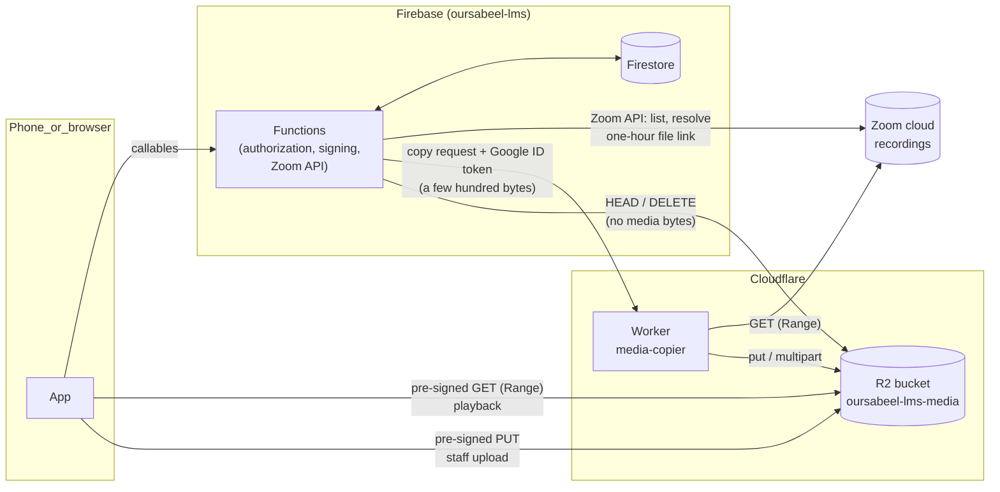
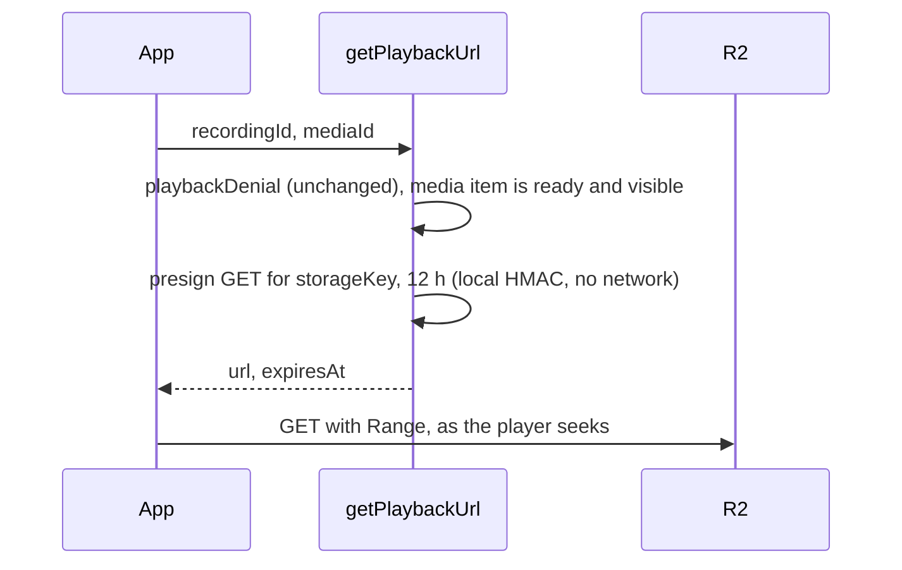
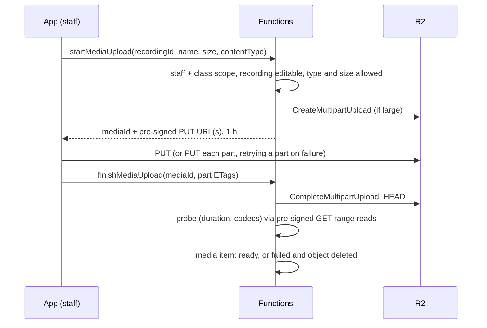
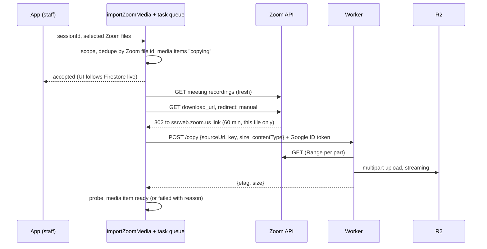

# Media on Cloudflare R2

All class media, audio and video alike, moves from Firebase Cloud Storage to
Cloudflare R2. A small Cloudflare Worker copies Zoom recordings straight into
R2, so no media ever leaves Google and no media is ever downloaded from Google.
Firestore, Auth, Functions and Hosting stay on Firebase.

Status: plan. Nothing here is built. It assumes Phase 0 of
[SWITCHOVER.md](SWITCHOVER.md) (the `oursabeel-lms` project and the code
pointing at it) and is a prerequisite for
[VIDEO-AND-MULTIPLE-MEDIA.md](VIDEO-AND-MULTIPLE-MEDIA.md).

## Why

At the planning size of 1 GB per hour of video
([../research/zoom-recordings-2026-10.md](../research/zoom-recordings-2026-10.md)):

| | Firebase Cloud Storage | R2, Worker copies from Zoom |
|---|---|---|
| Storage free | 5 GB-month | 10 GB-month |
| Storage after that | $0.020 per GB-month | $0.015 per GB-month |
| Downloads (students playing) | 100 GB/month free, then $0.12/GB | free, unlimited |
| Read requests | free at this scale | 10 M/month free, then $0.36/M |
| Copying a Zoom file in | free (Google to Google) | free (Zoom to Cloudflare) |
| Fixed | $0 | $0, or $5/month if Workers Paid is needed |

Worked example: 20 hours of video a week, kept a year, 20 students each
watching 3 hours a week. Firebase: about $29.50/month on average, rising with
every hour watched. R2: about $7.70/month on average, flat whatever is watched.
The interactive version is
[../research/video-cost-calculator.html](../research/video-cost-calculator.html).

Copying a file from a Firebase Function into R2 would be billed as Google
internet egress (1 GiB/month free, then roughly $0.08–0.12/GB). The Worker
exists only to avoid that.

## What does not change

These are the media invariants today, and every one of them holds after the
move. `CLAUDE.md` is reworded for the new mechanism in the same batch as the
code.

- **Students never hold a permanent link.** The bucket is private: no
  `r2.dev` public URL, no public custom domain, no public bucket access. Every
  read is a pre-signed URL.
- **Being excused is the whole entitlement, checked before a link exists.**
  `getPlaybackUrl` runs `playbackDenial` exactly as now (published, active
  assignment, `hasRecordingAccess`, `canPlayFromCourse`, staff scope) and only
  then signs.
- **The deadline is enforced at minting.** A URL lives `SIGNED_URL_TTL_MS`
  (12 hours); one minted late on the last day works for its full life and
  nothing revokes it. Same as now, same wording.
- **Pre-signed URLs are bearer tokens and cannot be revoked one at a time.**
  Rolling the R2 API token invalidates every outstanding URL at once, which
  replaces "rotate the signing key" in `docs/SECRETS.md`.
- **Media never passes through a Function.** Playback is a URL to R2. Uploads
  go from the browser or phone straight to R2. Zoom imports go from Zoom
  straight to R2 through the Worker.
- **Published media is never silently swapped.** Uploads are write-once
  (`If-None-Match: *` is part of the signature).
- **Config as code.** The bucket's CORS and lifecycle rules, and the Worker,
  deploy from this repo.

## Architecture



Bytes only ever flow Zoom → Cloudflare, phone → Cloudflare and Cloudflare →
phone. Google sends and receives only small JSON.

### Playback



### Staff upload



### Zoom import



The 302 target was checked against the live account on 2026-10-12: a
CloudFront-signed link (`Policy`, `Signature`, `Key-Pair-Id`) valid for 60
minutes, for that one file, not tied to an IP, needing no other credential,
and honouring `Range`. **No Zoom credential leaves Google.**

## Components

### R2 bucket

- Name `oursabeel-lms-media`, Standard storage class, location hint Eastern
  North America (the institute is in Houston).
- Public access off. No `r2.dev` URL. No custom domain (pre-signed URLs only
  work on the S3 endpoint `<account>.r2.cloudflarestorage.com`, which is fine).
- **Object keys:** `media/{recordingId}/{mediaId}.{m4a|mp4|mp3|wav}`. The
  extension is for humans; `Content-Type` is what players read.
- **CORS** (`cloudflare/r2-cors.json`, applied with
  `npx wrangler r2 bucket cors set oursabeel-lms-media --file …`):
  origins are the hosting domain(s) only; methods `GET`, `HEAD`, `PUT`;
  allowed headers `Content-Type`, `If-None-Match`, `Range`; exposed headers
  `ETag` (the client needs each part's ETag to finish a multipart upload),
  `Content-Length`, `Content-Range`, `Accept-Ranges`. A plain `<audio>` or
  `<video>` element without `crossOrigin` does not need CORS to play; uploads
  do.
- **Lifecycle:** abort incomplete multipart uploads after 1 day.

### R2 credentials

Two R2 API tokens, each scoped to this one bucket:

| Secret (Secret Manager) | Permission | Bound to |
|---|---|---|
| `R2_READ_KEY_ID`, `R2_READ_SECRET` | Object Read | `getPlaybackUrl`, the probe |
| `R2_WRITE_KEY_ID`, `R2_WRITE_SECRET` | Object Read & Write | upload callables, delete paths, the sweep |

The account id and bucket name are configuration, not secrets.

This is a deliberate exception to "no long-lived keys" in `docs/SECRETS.md`:
today Google signs URLs with the runtime service account and no key exists.
R2 has no equivalent. The exception is contained by bucket scope, by
read/write separation, and by binding each secret only to the functions that
need it. `docs/SECRETS.md` gets the rotation procedure: create a new token,
`firebase functions:secrets:set`, redeploy the bound functions, delete the old
token (which also kills every outstanding URL signed with it).

Signing uses `@aws-sdk/client-s3` and `@aws-sdk/s3-request-presigner`
against the S3 endpoint with region `auto`. Signing is local HMAC; it makes no
network call.

### The Worker: `cloudflare/media-copier/`

About 150 lines of TypeScript, deployed with `npx wrangler deploy` from this
repo, with an R2 binding to the bucket and no R2 keys of its own.

- **`POST /copy`** with `{sourceUrl, key, size, contentType}`.
- **Authentication without a shared secret:** the Function calls it with a
  Google-signed ID token (`google-auth-library` `getIdTokenClient(workerUrl)`,
  which uses the runtime service account through the metadata server). The
  Worker verifies the JWT with `jose` against Google's JWKS and checks `iss`,
  `aud` (its own URL), `exp`, and `email` equal to the Functions runtime
  service account with `email_verified`. Nothing else is accepted.
- **It can only do one narrow thing:** `sourceUrl` must be `https://` on a
  `*.zoom.us` host (no open relay); `key` must match `^media/[A-Za-z0-9]+/[A-Za-z0-9]+\.(m4a|mp4)$`;
  `size` must be at or under the media cap and must equal the source's
  `Content-Length`; an existing object at `key` is never overwritten.
- **Copies in parts:** `createMultipartUpload`, then for each part a ranged
  `fetch` of the Zoom link piped straight into `uploadPart`, then `complete`.
  Parts let a failed chunk be retried, avoid the 5 GiB single-put limit, and
  keep every byte off the JS heap. Part size 100 MiB; a 3.5 GB worst-case
  3-hour class is 36 parts, 72 subrequests.
- **Returns** `{etag, size}`; on failure aborts the multipart upload and
  returns a reason the Function records on the media item.

Workers limits that matter ([limits](https://developers.cloudflare.com/workers/platform/limits/)):
no wall-clock limit while the caller stays connected; network waits do not
count as CPU; 128 MB memory; subrequests 50 per invocation on Free and 10,000
on Paid. **The Free plan's 50 subrequests cap a copy at 24 parts (2.4 GiB at
100 MiB parts) and its 10 ms CPU per request is untested for streaming.**
Spike M1 settles both; the expected outcome is Workers Paid at $5/month, which
also lifts CPU to 5 minutes per request.

### Functions

New module `functions/src/mediaStore.ts` replaces `mediaUrl.ts` and every
`getStorage()` call:

```ts
interface MediaStore {
  signGet(key: string, ttlMs: number): Promise<{ url: string; expiresAt: number }>;
  startUpload(key: string, contentType: string, size: number): Promise<UploadPlan>;
  finishUpload(key: string, plan: UploadPlan, etags: string[]): Promise<void>;
  head(key: string): Promise<{ size: number; contentType: string } | null>;
  delete(key: string): Promise<void>;
}
interface MediaCopier {
  copy(req: { sourceUrl: string; key: string; size: number; contentType: string }): Promise<{ size: number }>;
}
```

Production implementations talk to R2 and the Worker. Tests use the same
`R2MediaStore` against MinIO (below) and a fake `MediaCopier` that copies from
a local fixture server into MinIO.

Changes by file (paths as in the legacy repo today):

| File | Change |
|---|---|
| `functions/src/mediaUrl.ts` | Deleted. Its emulator branch, which used a never-expiring download token, goes with it: MinIO signs real SigV4 URLs, so the production signing path is exercised locally for the first time. |
| `functions/src/playback.ts` | Takes `mediaId`; signs `media.storageKey` via `MediaStore.signGet`. `playbackDenial` unchanged, plus "media item ready and not hidden". |
| `functions/src/recordings.ts` | `finalizeRecording`, `clearAudio`, `applyDeleteRecording` work on media items and `MediaStore.delete`; size comes from `head`, duration from the probe. |
| `functions/src/zoom.ts` | `streamToStorage` removed. New `resolveFileLink(meetingUuid, fileId)` returns the 302 target. Listing returns every file, not just audio (see the video plan). |
| `functions/src/zoomImport.ts` | Becomes enqueue-and-return; a task-queue function (`timeoutSeconds: 1800`) resolves the link and calls the Worker. Re-resolves the link on retry, since it lives 60 minutes. |
| `functions/src/index.ts` | No Storage bucket in `initializeApp`. |
| `storage.rules`, `firebase.json` `storage` block | Deleted. Firebase Storage is no longer used. |

**Probe:** after an upload or copy, a function runs `ffprobe` (bundled with
`ffprobe-static`) against a pre-signed GET URL. ffprobe reads the header with
a few range requests, so the bytes it reads are R2 egress (free) and Google
ingress (free). It records duration, codecs and resolution, and rejects what
players cannot play (anything but AAC/MP3 audio and H.264+AAC MP4 video,
for example HEVC `.mov` from an iPhone). Duration becomes server-measured,
replacing today's client-reported value.

Zoom's MP4s already have the `moov` box at the front (checked 2026-10-12:
`ftyp, uuid, free, moov` with a 1.1–3.7 MB index), so they stream without
remuxing.

### App

| File | Change |
|---|---|
| `app/src/recordings.ts` `uploadRecordingAudio` | Becomes `uploadMedia`: `startMediaUpload`, PUT with `XMLHttpRequest` (upload progress works on web and React Native), part retry, `finishMediaUpload`. |
| `app/src/firebase.ts` | No Storage instance, no `connectStorageEmulator`. |
| `app/src/playback.ts` | URL cache keyed by `mediaId`; otherwise the refresh rules stay (`SIGNED_URL_REFRESH_MS`, re-mint if the URL would expire before the media ends). |
| `app/src/filePicker*.ts` | Accept video as well as audio (video plan). On Android, read the picked file by URI for upload; verify on a device (native seam). |

### Local development and tests

The Firebase Storage emulator is replaced by **MinIO**, a single static
binary that speaks the S3 API and verifies SigV4 signatures and expiry:

- It takes over port **61107** (the Storage emulator's), so this checkout's
  port block is unchanged; `emulatorPorts.test.ts` asserts it like the others.
  MinIO's web console stays off.
- `scripts/test-emulator.sh`, `screens-e2e.sh` and `web-e2e.mjs` start MinIO
  with a throwaway data dir, create the bucket, apply the same CORS file, and
  stop it after.
- Installing the MinIO binary is a dev-machine install: asked before it is
  done, and documented in `docs/DEV-TOOLING.md` and the shared skill's
  bootstrap script.
- The Worker has its own tests with `@cloudflare/vitest-pool-workers`
  (Miniflare's local R2): token verification (forged, expired, wrong
  audience, wrong service account), host allowlist, key pattern, size
  mismatch, overwrite refusal, part retry, abort on failure.

Tests rewritten, following "test the promise, not the mechanism":

| Today | After |
|---|---|
| `rules.recordings.test.ts` storage block (write-once, audio-only, staff-only, no reads) | Callable tests that a student or out-of-scope manager gets no upload URL; that a second PUT to the same key fails at R2 (MinIO honours `If-None-Match`); that a wrong `Content-Type` fails the signature; that an oversize upload ends `failed` with no object left. |
| `playback.integration.test.ts` against the emulator URL | The same allow/deny matrix, and now **the URL actually plays**: a GET with `Range` returns 206 from MinIO, and the same URL after `expiresAt` returns 403. That is the promise the old test could not reach. |
| `zoom.integration.test.ts` fake client writing to Storage | Fake copier from a fixture server into MinIO; plus the 60-minute link re-resolve on retry. |
| `web-e2e.mjs` "audio actually advances" | Unchanged promise, now through MinIO. |

## Moving existing media

Done as part of each seed in [SWITCHOVER.md](SWITCHOVER.md): list
`recordings/*/audio.m4a` in the legacy bucket, copy each into R2 at its new
key, and write the media item. Today that is under 1 GB; copying it from
Faisal's machine costs pennies of Google egress, and Cloudflare's Super
Slurper can copy straight from a GCS bucket for free if that ever matters.

## Delivery steps

| Step | What | Proves |
|---|---|---|
| M1 spike | Worker copies one real Zoom recording (the 1.2 GB 2026-10-01 file) into a scratch R2 bucket | Free-plan CPU and subrequests, time for a 3-hour class, the link's 60-minute window in practice |
| M2 | `MediaStore` on R2 + MinIO in all three test harnesses; playback signs from R2 | Real signed playback locally; expiry is asserted |
| M3 | Staff upload: single PUT and multipart, probe, write-once, failure cleanup | Browser and Android uploads (Android on the AVD: native seam) |
| M4 | Zoom import through the Worker, async with task queue | Copy of a 3-hour class end to end; retry after the link has expired |
| M5 | Migration in the seed script; deletion cascade; sweep | Count and byte checks between legacy and R2 |
| M6 | Docs: `CLAUDE.md` invariants, `PRODUCT_BRIEF.md`, `SECRETS.md`, `DEPLOY.md` (Worker before Functions), `DEV-TOOLING.md`, user manual | |

## Housekeeping

- **Sweep** (scheduled weekly): lists R2 keys and media items; deletes
  objects with no item (an import that finished after its recording was
  deleted), and items stuck in `uploading` or `copying` for over a day.
- **Deletes are free in R2** and never bill as operations.
- **Storage report** for admins: sum of `sizeBytes` per course from
  Firestore; R2's own metrics for reconciliation.

## Risks and open points

- **Workers plan:** expected Paid ($5/month) after M1.
- **Two vendors:** a Cloudflare outage stops playback while Firebase is up.
  There is no fallback copy; at this size one is not worth paying for.
- **R2 keys are long-lived credentials.** Mitigated as above; rotation is in
  `docs/SECRETS.md`.
- **Signed `Content-Length` on single PUTs** is not documented by Cloudflare.
  The probe and `head` after upload enforce size regardless.
- **Zoom's link format is undocumented behaviour.** If Zoom stops redirecting
  to a self-contained link, the fallback is to send the Worker Zoom's
  meeting-scoped `download_access_token` (confirmed available) instead, which
  is narrower than the account token but does leave Google.

Sources: [R2 pricing](https://developers.cloudflare.com/r2/pricing/) ·
[R2 pre-signed URLs](https://developers.cloudflare.com/r2/api/s3/presigned-urls/) ·
[R2 S3 compatibility](https://developers.cloudflare.com/r2/api/s3/api/) ·
[R2 CORS](https://developers.cloudflare.com/r2/buckets/cors/) ·
[R2 limits](https://developers.cloudflare.com/r2/platform/limits/) ·
[R2 Workers API](https://developers.cloudflare.com/r2/api/workers/workers-api-reference/) ·
[Workers limits](https://developers.cloudflare.com/workers/platform/limits/) ·
[Cloudflare terms on video](https://blog.cloudflare.com/updated-tos/)
