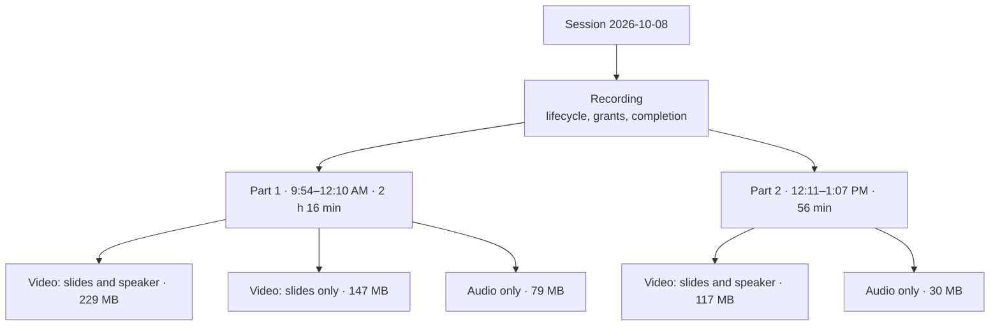

# Video, and more than one file per session

A session's recording can hold several media files, audio and video, from
Zoom or uploaded by staff. Students who are excused from that session play
them in the app and move between them.

Status: in progress — V0 and V1 done (see Delivery steps). Depends on [MEDIA-ON-CLOUDFLARE.md](MEDIA-ON-CLOUDFLARE.md)
(all media in R2) and Phase 0 of [SWITCHOVER.md](SWITCHOVER.md). Evidence for
the sizes and Zoom behaviour quoted here is in
[../research/zoom-recordings-2026-10.md](../research/zoom-recordings-2026-10.md).

## Why more than one file

One real class can produce many Zoom files:

- **Several formats of the same stretch of class.** Every recording segment
  has an `audio_only` M4A and a `shared_screen_with_speaker_view` MP4; it also
  has a `shared_screen` MP4 when someone shared their screen. All three cover
  the same minutes.
- **Several segments in one Zoom meeting.** Stopping and restarting the
  recording makes a new segment under the same meeting (2026-08-13 Team
  Meetings: 62.5 and 1.5 minutes; 2026-08-27 Testing: three segments).
- **Several Zoom meetings for one class.** Ending the meeting and starting it
  again makes a separate meeting with its own UUID (Quran Immersion on
  2026-10-08: 9:54 AM for 2 h 16 min and 12:11 PM for 56 min).
- **Staff uploads**, for example a whiteboard video recorded on a phone
  beside the Zoom audio.

Today a session has 0..1 recording and a recording has one audio file; the
Zoom picker takes one audio file per meeting (decision 2026-10-10 in
`PRODUCT_BRIEF.md`).

## The model: one recording, several parts, several versions

**The recording stays the unit of everything students owe.** It keeps its
1:1 link with the session, its lifecycle (draft, published, archived,
unpublished, needs attention), and its id as the key of assignments
(the excused-only grant), completions, overrides, listening progress, the
ledger, notifications and the workbook. None of those change shape. What
changes is that a recording holds a set of **media items** instead of one
`audioPath`.

Media items are organised two ways:

- **Part:** a stretch of class time. Parts play in order: Part 1, Part 2.
  A Zoom segment is a part. An uploaded file is its own part unless staff
  attach it to an existing part.
- **Version:** a format of a part. "Video: slides and speaker", "Video: slides
  only", "Audio only", or "Video" for an upload. All versions of a part share
  its timeline, so switching version keeps your place.



### Firestore

Media items live **inside the recording document** as a map, not a
subcollection. A recording has a handful of items; one document means one read
for the player, one rules check (the existing recording read rule), and
transactional updates alongside the recording's status.

```ts
interface MediaItem {
  id: string;                    // random, also in the R2 key
  part: number;                  // 1-based; parts play in this order
  version: 'speaker' | 'slides' | 'audio' | 'video';  // 'video' = an upload
  kind: 'audio' | 'video';
  label: string | null;          // staff override of the generated label
  status: 'uploading' | 'copying' | 'ready' | 'failed';
  failReason: string | null;
  hidden: boolean;               // staff can hide a part or version after publishing
  storageKey: string;            // media/{recordingId}/{id}.{ext}
  contentType: string;           // from the probe
  sizeBytes: number | null;
  durationSec: number | null;    // measured by the probe, not reported by the client
  width: number | null;          // video only
  height: number | null;
  source: 'zoom' | 'upload';
  zoom: {                        // zoom only
    meetingUuid: string;
    fileId: string;              // the dedupe key (was meetingUuid)
    recordingType: string;       // Zoom's recording_type
    segmentStart: string;        // ISO; groups versions into a part
    topic: string;
  } | null;
  addedAt: Timestamp;
  addedBy: string;
}

interface RecordingDoc {
  // existing fields, minus audioPath / sizeBytes / zoomUuid / zoomFileId
  media: Record<string, MediaItem>;
  defaultVersion: 'speaker' | 'slides' | 'audio' | 'video';  // what a student starts on
  durationSec: number | null;    // DERIVED: sum over visible parts of the part's longest ready version
}
```

`durationSec` stays on the recording and is recomputed by the server whenever
media changes, so `listenedShare`, the ledger's listened percent and the
workbook's "Heard" column keep working unchanged.

Zoom file ids are mirrored in a small top-level `zoomImports/{fileId}` index
(`{recordingId, sessionId, courseId}`) so the picker can mark every
already-imported file in one query, and so a file can be claimed exactly once
in a transaction.

### Progress

`listeningProgress/{uid}_{recordingId}` keeps its id and its two meanings:

- `listenedMs` still counts real-time forward playback, now across every
  part and version. Watching counts the same as listening. Switching version
  does not double count.
- `positionMs` becomes a position **in the current part**, joined by `part`
  and `version`. `mergeProgress` keeps the most recent `{part, version,
  positionMs}` triple and the larger `listenedMs`.

Resume reads "Continue Part 2 at 13:05" and opens the version the student last
used, if it still exists.

### Lifecycle rules for media

| Action | Draft / needs attention | Published | Archived / unpublished |
|---|---|---|---|
| Add a part or version (Zoom or upload) | yes | yes, audited; becomes visible when ready | yes (shows on republish) |
| Rename, reorder parts, change default version | yes | yes, audited | yes |
| Hide a part or version | yes | yes, audited; students stop seeing it, history is kept | yes |
| Remove a file (deletes from R2) | manager or admin, audited | no; hide it, or unpublish first | admin |
| Remove a file no student saw (uploading, copying, failed) | manager or admin, audited | manager or admin, audited | manager or admin, audited |
| Publish | needs at least one ready, visible item and nothing still uploading or copying; failed items must be retried or removed first | | |

"Published media is never silently swapped" still holds: a ready item's file
never changes. Adding a part to a published recording is the one new freedom:
it is the fix for "the second half was in another Zoom meeting".

Deleting a recording (admin, as now) deletes every item's file.

## Zoom import, redesigned

### What the server lists

`listZoomRecordings` returns **every playable file**, grouped as Zoom groups
them, instead of one audio row per meeting:

```
meeting (uuid, topic, start)
  segment (start, end)        // files with the same recording_start/end
    file (fileId, recordingType, kind, sizeBytes, durationSec, status)
```

Only `audio_only` M4A, `shared_screen_with_speaker_view` MP4 and
`shared_screen` MP4 are importable. Files Zoom has not finished processing
(`status` other than `completed`) are listed as "Still processing in Zoom" and
cannot be picked. The transcript, chat and timeline files are not offered.

### The picker

Opened from a session, as now. It keeps today's filters (date range, "only
this session's date", topic search, hide under 2 minutes, available /
imported / all) and adds:

- **Format filter:** All · Video · Audio only.
- **Quick picks per meeting:** "Audio only", "Video and audio" (slides and
  speaker plus audio), "Everything". The course has a **default pick** that
  the picker starts from (for example audio only for a lecture course, video
  and audio for a whiteboard course).
- **Rows** are meetings; under each, its segments; under each segment, a
  checkbox per format with its size and length. Tiny segments (under 2
  minutes) are collapsed but pickable.
- **Picking across meetings** is allowed: both 2026-10-08 meetings can go into
  the same session.
- **Already imported** is shown per file, with where it lives ("In Quran
  Immersion, 8 October"), and cannot be picked again.
- **A running total** of what is selected: size, hours, and the storage cost
  per month on R2.
- **"Import N files"** imports them all. Segments become parts in start-time
  order across all chosen meetings; the formats of one segment become versions
  of one part.

```text
Quran Immersion Fall                            8 Oct, 9:54 AM · 2 h 16 min
  Quick pick: [Audio only] [Video and audio] [Everything]
  [x] Video: slides and speaker   229 MB
  [ ] Video: slides only          147 MB
  [x] Audio only                   79 MB

Quran Immersion Fall                           8 Oct, 12:11 PM · 56 min
  [x] Video: slides and speaker   117 MB
  [ ] Video: slides only           54 MB
  [x] Audio only                   30 MB

Selected: 4 files · 455 MB · about $0.01 a month to store     [Import 4 files]
```

### Import behaviour

- **Asynchronous.** The callable claims each file id in `zoomImports`
  (idempotent: a double tap or a second staff member gets "already
  importing"), creates the recording draft if the session has none, adds media
  items as `copying`, enqueues one task per file and returns. The session page
  follows the items live. This replaces today's 9-minute blocking call, which
  could not cover several gigabytes of video.
- Each task resolves Zoom's one-hour file link immediately before calling the
  Worker, and again on every retry. Three attempts with backoff; then the item
  is `failed` with the reason, and **Retry** re-enqueues it.
- A file deleted in Zoom between listing and import fails with "This file is
  no longer in Zoom". A file that has grown or changed size fails the Worker's
  size check and is retried after a fresh listing.
- **Recording status** follows its items: it stays a draft while anything is
  copying; it goes to needs attention if every item failed; staff publish when
  ready.

## Staff upload

- **"Upload files"** on the session takes one or more files: audio (M4A, MP3,
  AAC, WAV) and video (MP4). Each becomes a new part unless staff choose
  "Add as a version of Part N" (same timeline, for example phone video of the
  whiteboard beside the Zoom audio).
- Limits: audio 300 MiB per file as now; video 8 GiB per file (3.5 hours at
  the 1.75 GB/h ceiling with headroom). Large files upload in 100 MiB parts
  and a failed part is retried without starting over.
- After upload the probe decides: anything but AAC/MP3 audio or H.264+AAC
  MP4 fails with a plain message ("This video uses a format phones can't play.
  Export it as MP4 (H.264) and upload again."). iPhone HEVC `.mov` is the case
  this catches.
- The page shows each upload's progress; leaving the page cancels unfinished
  uploads and their items are removed by the sweep.

## Staff session page

The single recording card becomes a **media list**:

```text
Recording · Draft                                   3 h 12 min · 455 MB
  Part 1 · 9:54 AM · 2 h 16 min
    Video: slides and speaker   ready    229 MB    [Play] [Hide] [Remove]
    Audio only                  ready     79 MB    [Play] [Hide] [Remove]
  Part 2 · 12:11 PM · 56 min
    Video: slides and speaker   copying from Zoom…
    Audio only                  ready     30 MB
  Students start on: [Video: slides and speaker v]
  [Import from Zoom] [Upload files] [Reorder parts]        [Publish]
```

- Publish is disabled with the reason while anything is copying or uploading
  or failed.
- Labels are generated ("Part 1", the version name) and editable.
- Reorder parts by moving up and down (no drag, which has no web/Android
  parity).
- Library and Sessions list show a summary: "2 parts · video and audio".
- The ledger and the workbook do not change columns; "Heard" uses the derived
  duration.

## Student player

### Layout

- **Video** sits at the top at 16:9, full width on a phone, with the existing
  controls below (play, back 15 s, forward 30 s, rate 1 / 1.25 / 1.5 / 2,
  scrubber). Fullscreen and landscape are available; picture-in-picture where
  the platform supports it.
- **Audio only** looks as it does today.
- **Version switcher:** a segmented control under the media ("Slides and
  speaker · Slides · Audio") listing only the versions this part has.
  Switching keeps the position and the play/pause state.
- **Parts:** a list below ("Part 1 · 2 h 16 min · watched to 1:54:12",
  "Part 2 · 56 min · not started"). Tap to jump. At the end of a part the next
  part starts automatically in the same version if it has one, otherwise in
  the recording's default.
- **"Listen only"** on a video version switches to the part's audio version
  at the same position. It saves data and suits listening on the move.
- **Completion** is as now: student-attested, enabled once anything has been
  played (`listenedMs > 0`), no threshold, no requirement to play every part.
  At the end of the last part the app prompts to mark it complete.

### Defaults and data use

- A student starts on the recording's `defaultVersion` the first time and on
  their last-used version after that.
- On a metered connection the app starts on Audio only when the part has it
  and says so ("Playing audio to save data. Switch to video."), with a
  setting to change that. Video at the planning size is about 1 GB per hour.

### Engine

Today native playback is `expo-audio` (one player at a time, background
playback and lock-screen controls through its foreground service) and web is
an `HTMLAudioElement`. Video needs `expo-video` (Expo SDK 57:
`staysActiveInBackground`, `showNowPlayingNotification`, `playbackRate`,
`currentTime`/`timeUpdate`, `replaceAsync`, fullscreen, picture-in-picture;
web renders a video element).

Two engines would mean two foreground services competing for the lock screen,
so the plan is **one engine, `expo-video`, for audio and video**, behind the
existing `playerTypes.ts` interface, provided a spike proves it on the AVD:

- an M4A plays with no picture, in the background, with lock-screen
  controls, title and course;
- seeking far into a 3-hour file is quick (range requests against R2);
- rate changes keep pitch;
- swapping the source keeps position within a second (version switch);
- memory stays flat over a long session.

If the spike fails, audio stays on `expo-audio` and the shared player module
hard-stops one engine before starting the other (the `hardStop` pattern
already in `player.ts`).

**Spike V0 result (2026-10-12): passed; one engine, `expo-video` 57.0.5.**
A 3-hour 640×360 H.264+AAC MP4 (155 MB) and an M4A of the same timeline,
from R2 through 12-hour signed URLs, on `tb_emu` (API 35, debug build) and in
Chromium. The adapter was `player.ts` rewritten on `expo-video` behind the
unchanged `Player` interface; the code is on the local branch
`spike/v0-expo-video`.

| Check | Android | Web (`<video>`) |
|---|---|---|
| M4A with no picture, in the background | plays; `ExpoVideoPlaybackService` foreground, `USAGE_MEDIA` started | plays |
| Lock-screen controls, title and course | title and course from the source's `metadata`; adds a seek bar and ±10 s buttons | n/a |
| Seek to 2:50:00 | 50 ms to the first update there, then plays on | 190 ms to `seeked` |
| Rate 1.5, pitch kept | `speed=1.5` in the media session; `preservesPitch` true (not audible on an AVD) | `preservesPitch` true |
| Swap M4A → MP4 keeping place | 165 ms, landed on the same second (the frame's burnt-in clock agreed) | 425 ms, delta 0 |
| Memory over 10 minutes at 1.5× | flat, 600–637 MB PSS (debug build) | n/a |
| Fullscreen, landscape | separate `FullscreenPlayerActivity`; rotates although the app is portrait-locked | n/a |
| Picture-in-picture | the app's task goes `pinned` and keeps playing | n/a |
| First load from cold | 310 ms | 1.75 s to `loadedmetadata` |

What V5 must carry over, each found by the spike:

- **Manifest by hand** (bare workflow, plugins do not run): the
  `expo.modules.video.playbackService.ExpoVideoPlaybackService` service with
  `foregroundServiceType="mediaPlayback"`, and
  `android:supportsPictureInPicture="true"` on `MainActivity`; `app.json`
  carries the plugin with `supportsBackgroundPlayback` and
  `supportsPictureInPicture` so a future prebuild agrees. Remove the
  `expo-audio` service and plugin in the same change.
- **Player settings:** `staysActiveInBackground`, `showNowPlayingNotification`,
  `audioMixingMode = 'doNotMix'` (honoured on Android although documented as
  iOS: it requests `AUDIOFOCUS_GAIN`), `preservesPitch`,
  `timeUpdateEventInterval = 0.5`; the lock-screen title and course travel in
  the source's `metadata`, so the `setActiveForLockScreen` race in today's
  adapter disappears.
- **A spurious `playToEnd` before the first source loads** (the player is
  created with no source). Ignore `playToEnd` until a source has loaded.
- **`replaceAsync` keeps playing if the player was playing.** `expo-audio`'s
  `replace` did not. Pause before a load that should not play; a version
  switch is the case that wants it.
- **The browser resets `playbackRate` to 1 on a new `src`.** Reapply the rate
  after every swap on web.
- The lock screen's skips are ±10 s while the app's are −15/+30 s. Acceptable;
  noted so nobody files it as a bug.

Web uses one `<video>` element for both kinds. The docked mini-player keeps
playing when the student leaves the player screen: the player object outlives
the view, and for video only the sound continues until they return.

## Corner cases

| Case | Behaviour |
|---|---|
| Recording stopped and restarted (segments) | Each segment is a part; versions of a segment share a timeline |
| Meeting ended and restarted (two meetings) | Pick from both; parts ordered by start time across meetings |
| A segment of a few seconds | Collapsed under "Short segments", pickable, off by default |
| No screen share in a segment | That part simply has no "slides only" version |
| Versions of one segment differ by a second | Same timeline; position is clamped when switching |
| Zoom still processing | Listed, not pickable, "Still processing in Zoom" |
| Zoom file deleted after listing | Item fails with "no longer in Zoom"; Remove clears it |
| Zoom link expires mid-copy (60 min) | The task re-resolves the link and retries the remaining parts |
| Same Zoom file wanted in two sessions | Refused; the picker names where it is. Moving it means removing it from the draft that has it |
| Double tap on Import, or two staff at once | Claimed per file id in a transaction; the second gets "already importing" |
| Recording deleted while a copy is running | The task finds no recording and deletes what it wrote; the sweep catches anything left |
| Upload abandoned | Multipart aborted by the bucket's 1-day rule; item removed by the sweep |
| Unplayable upload (HEVC, ProRes, odd audio) | Probe fails it with a plain message; file deleted |
| Very long video (> 4.9 GiB) | Multipart for staff uploads. A Zoom import that large is refused with a reason (the Worker copies in one put; spike M1 in MEDIA-ON-CLOUDFLARE.md); the largest Zoom file so far is 1.2 GB |
| Part added to a published recording | Visible when ready; no new notification; completion unaffected |
| Part hidden after students started it | Resume falls back to the first visible part; history kept |
| Due date passes mid-playback | The current URL plays to its expiry; switching version or part needs a new URL and is refused, with the usual "listening closed" message |
| A student switches version | No double counting of listened time; position kept |
| Staff preview | Plays any item including drafts; writes no progress (as now) |
| `notRecorded` session | No media can be added (as now) |
| Course with listening turned off | `canPlayFromCourse` refuses, as now |
| Metered connection | Starts on audio when available, says so |
| Phone locked during video | Sound continues with lock-screen controls; picture returns on unlock |
| Picture-in-picture and the docked player | One player at a time; entering PiP leaves the docked bar showing the same player |

## Wording

"Listen by" and "required listening" come from an audio-only app. A
recording with any video shows **"Watch by"** and "required viewing"; one
with audio only keeps today's words. Buttons say **Play** rather than
Listen. The notification "a recording is ready" needs no change. The user
manual, the release notes and `PRODUCT_BRIEF.md` change in the same batch.

As built (2026-10-13), the verb is `playVerb(media)` in `@sabeel/shared`:
"Watch" when a student can play any video of the recording, so a hidden or
still-copying video asks nobody to watch. Three places have no one recording
to take it from, and say neither verb:

- **Lists that mix recordings**: the student's home is "Your recordings,
  required, soonest first", its tab is **Recordings**, and counts say
  "required recordings".
- **The staff date field** is **Due by**: a session has its date before it has
  a recording, so it cannot know which verb applies.
- **The workbook** says Completed, Played and Due by, and its grid tab is
  **Recordings**.

The course setting that keeps an archived course's recordings open is worded
as recordings being open or closed, not listening being on or off.

## Product rules that change

| Today (`CLAUDE.md`, `PRODUCT_BRIEF.md`) | After |
|---|---|
| "Audio only. No video playback, no video stored." | Audio and video. Video is MP4 (H.264 + AAC) only. No transcoding in the first release: files play as Zoom or the uploader made them. |
| A session has zero or one recording, and a recording is one audio file | Still 0..1 recording per session; a recording has parts and versions |
| Zoom picker takes one audio file per meeting | Picker takes any audio or video files, across meetings |
| Publish requires audio | Publish requires one ready, visible media item and nothing pending |
| A manager may remove the audio from an unpublished draft | A manager may remove any file from a draft, and a file no student saw from any recording; published files students can play are hidden, not removed |
| Admin stats: total audio storage and duration | Storage and duration by kind (audio, video) and by course |

## Delivery steps

| Step | What | Checked by |
|---|---|---|
| V0 | Spike: `expo-video` playing M4A and a 3-hour MP4 from R2 on the AVD and web | The list under Engine — **passed 2026-10-12** |
| V1 | Data model: media map, derived duration, `zoomImports` index; migration of existing recordings to one audio item each | Unit tests on the derivation; seed count check — **done 2026-10-12**, deployed and migrated |
| V2 | Zoom listing of all files, segments, processing state; picker with formats, quick picks, totals; async import | Integration tests with a fake Zoom of multi-segment, multi-meeting fixtures; screens sweep at 320 px with expanded meetings — **built 2026-10-12**; the course's default pick is deferred: the picker starts with nothing chosen and a quick pick is one tap per meeting |
| V3 | Upload of several files, part or version choice, probe | Browser e2e with a small MP4 and an M4A; AVD upload — **built 2026-10-13**: parts are 16 MiB rather than 100 (a phone holds three in memory), bare `.aac` is not taken (ADTS has no length without reading the whole file), WAV is, and QuickTime `.mov` is refused like HEVC |
| V4 | Staff media list, hide, reorder, publish blockers | Integration tests per lifecycle row above — **built 2026-10-13**; renaming a file is deferred (labels are generated) |
| V5 | Player: versions, parts, auto-advance, listen only, resume, docked bar | `playback.test.ts` extended; web e2e plays video and switches version keeping position; AVD for background, lock screen, fullscreen, PiP — **built 2026-10-13**; "Audio only" is the version chip rather than a separate button, and starting on audio over a metered connection is deferred |
| V6 | Wording, manual, workbook and admin stats | Text-source checks; workbook tests — **built 2026-10-13** for wording, manual and workbook; the admin stats wait for Phase 8, which has not started, and are built there by kind and course |

Each step is shown working in the browser first, and on the AVD for audio,
background playback, gestures and file picking, per `CLAUDE.md`.

## Left out on purpose

- **Converting to smaller sizes.** With downloads free on R2 it saves only
  storage and students' data. A tripod camera on the whiteboard keeps files
  small at the source; revisit if real recordings run well above 1 GB/h.
- **Captions from Zoom's transcript.** The VTT files exist and `expo-video`
  can show text tracks; worth a later step, not this one.
- **Offline downloads,** still deferred, and far larger with video.
- **Live streaming.**
